## Before We Begin

Show a 5 year old a photograph of a dog and ask what color it is. She will look at it and say "brown" without thinking twice.

Now try to explain how she did it.

Somewhere between the light hitting her eyes and the word leaving her mouth, a grid of colored dots became _a dog_. Then a string of sounds became _a question about the dog_. Then the two met, and out came an answer. She has no idea how any of this happened. For most of the history of computing, neither did we.

For a long time computers could not really _see_. We had to spell out exactly what to look for: edges, corners, colors, textures. Neural networks changed that. Instead of writing the rules, we could show a model millions of examples and let it learn the patterns for itself. Computer vision went from recognizing simple shapes to recognizing objects, faces and, eventually, entire scenes.

Language followed a similar path, as models went from predicting the next word to understanding increasingly complex relationships between words, sentences and ideas. Things got interesting when we joined the two kinds of models together and let them work as one.

Today models can look at an image, read a question about it and answer in plain language, with remarkable detail and accuracy. We call them **Vision Language Models**, or VLMs.

So how does a model built around language suddenly get to see? Under the hood, a VLM is several components stitched together: something that sees, something that reasons in language, and a bridge that lets the two talk to each other.

A computer doesn't see a dog. It sees a few hundred thousand numbers arranged in a grid, and nothing in those numbers says "dog". That is where a **Vision Encoder** comes in. Its job is to cut the image into small square patches, the way you might cut a photograph into tiles. On their own the tiles mean little. A patch of brown fur could belong to a dog, a bear, or a carpet. Meaning only emerges when the patches can _talk to each other_, when the patch with the ear can ask the patch with the snout what it's looking at. The mechanism that makes this conversation possible is called **Attention**. It is the single most important idea in modern AI, and you will implement it yourself in the chapters ahead. Stack enough layers of attention together and you get an **Encoder**, a machine that turns pixels into understanding.

But seeing is only half the job. The model also has to "_read_", and it has to hold the image and the words in its head at the same time. Here we run into a puzzle: images and words are completely different kinds of things. How do you put a picture _inside_ a sentence? The answer comes in two parts. First, a **Processor** prepares the image and the prompt, leaving room in the text for the picture to sit. Then a small bridge translates what the vision encoder saw into the same language the words are written in. Once that is done, a picture is no longer a foreign object. It becomes just another part of the sentence.

Finally, the model has to "_speak_". For this we need a **Language Model**, a **Decoder** that reads the combined sequence of image and words and writes its answer one word at a time. Each word it chooses is informed by everything that came before, including what it saw. Then we load pretrained weights into the model we built, write the **inference** loop, show it a picture and ask it a question. And it answers!

#### Isn't that cool? A few lines of code, arranged in the right order, give a machine the ability to see, something a 5 year old does naturally.

---

You don't need to be an expert to make this journey. If you know that a neural network is built from layers, that a linear layer multiplies its input by a matrix and adds a bias, and that we train models by measuring a loss and nudging the weights through backpropagation, you have everything you need. Everything else is explained as we go.

Read a chapter, then close the book and open the code editor. Try to write the code _before_ you feel ready. When you get stuck, and you will, come back and reread. That moment of being stuck is not a sign that something is wrong. It happens when the idea is being carved into your mind.

Don't try to memorize anything here. Memorized code is forgotten by next week. Understood code is yours forever. If you understand _why_ each piece exists and what problem would appear if you took it away, you will find something strange happens: the code starts to write itself.

So let's start our journey with the most basic question: **how does a machine understand meaning?**

---

# Chapter 1. Turning Data into Numbers

A machine doesn't see or read the way we do. It only deals in numbers. So before it can understand anything, we have to turn that thing into numbers that can be compared and learned from. Once a picture and a sentence are both represented as numbers, we can ask a simple question: **how close should their representations be if they mean the same thing?**

> **Main Idea: A matching image and caption should give a big dot product and every mismatched pair should give a small one.**

Eventually we want a vision encoder whose output a language model can use. But before we can connect vision and language, the image encoder has to learn which visual concepts go with which words. A photo of a dog and the words "a brown dog" should mean the same thing, and since a neural network only understands numbers, that shared meaning has to show up in the numbers. So we need a way to turn a picture or a sentence into numbers we can compare.

### Embedding vectors

An embedding is a list of numbers that stands for something: a word, a sentence, an image or anything else. A list of numbers like this is called a **vector**, so embeddings are often called embedding vectors. If two things mean similar things, we want their vectors to point in similar directions.

The standard way to measure how similar two vectors are is the dot product. You multiply the numbers position by position and add them up:

$$\mathbf{a} \cdot \mathbf{b} = \sum_{i=1}^{n} a_i b_i$$

where $a_i$ and $b_i$ are the $i$-th numbers of $\mathbf{a}$ and $\mathbf{b}$, and $n$ is how many numbers each vector holds.

The dot product also equals $|\mathbf{a}|,|\mathbf{b}|\cos\theta$, where $\theta$ is the angle between the vectors. It tells two tales: how long the vectors are and which way they point. To measure direction only, we first normalize each vector to length 1, so that $|\mathbf{a}| = |\mathbf{b}| = 1$ and the dot product becomes exactly $\cos\theta$ _(the cosine similarity)_.

If both vectors point the same way, the dot product is $1$. If they are perpendicular (orthogonal) it is $0$, and if they point in opposite directions it is $-1$.

_(CLIP, which we meet later in this chapter, always normalizes its vectors this way.)_

Now we need data that teaches the encoders to place an image vector and a caption vector close together when they describe the same thing, and far apart when they don't. That data has to tell us which images and which words belong together.

### A pile of pictures


Imagine you have a huge pile of pictures, and each picture comes with a short description. A photo of a dog with the caption "a brown dog on the grass".

You build two encoders. An image encoder turns a picture into a vector. A text encoder turns a caption into a vector. Each encoder ends with a linear projection into a shared space of the same dimension $d$, so both vectors have the same number of entries and you can take their dot product. Both are then normalized to length 1.

Now take a batch of $N$ pictures and their $N$ captions. Encode them all. You get $N$ image vectors and $N$ text vectors. Compute the dot product of every image with every caption. You get a table $S$ with $N$ rows and $N$ columns.

Row $i$ is image $i$, column $j$ is caption $j$, and the cell at row $i$ column $j$ is how similar the model thinks image $i$ and caption $j$ are.

Picture $i$ goes with caption $i$. So the correct pairs are the cells where the row number equals the column number, $S_{ii}$. That is the diagonal of the table. Every cell off the diagonal, $S_{ij}$ with $i \neq j$, is a wrong pair. There are $N$ right pairs and $(N^2 - N)$ wrong ones.


**Training both encoders so that the diagonal cells become large and every other cell becomes small is called contrastive learning. The model learns by contrasting the right pair against all the wrong ones.**

But the encoders start with random weights, so the diagonal starts no brighter than any other cell, and since nobody can set millions of weights by hand, the model has to **learn** them: measure how far the table is from what we want, nudge every weight a little toward better, and repeat for every batch.

Measuring how far off the table is takes a single number, big when the diagonal is dim and small when it shines. That number is the **loss**, and backpropagation tells every weight in both encoders which way to move to shrink it. So the question becomes: how do we turn an $N \times N$ table of similarities into one number?

### How CLIP turns this into a loss

[CLIP](https://openai.com/index/clip/), from OpenAI, is the model that made this kind of training famous. To see its loss you first need to know how language models are trained, because CLIP borrows the same trick.

A language model reads "leaning tower of" and has to guess the next word. It outputs one score for every word in its vocabulary. These raw scores are called logits, and we write them as $z_1, z_2, \dots, z_V$ where $V$ is the size of the vocabulary. We want the score for "pisa" to be the highest.

To compare scores with a correct answer, we first turn the scores into a probability distribution with a function called **softmax**. For each score it computes the exponential and then divides by the sum of the exponentials of all scores. The results are all positive and add up to 1, $\sum_k p_k = 1$.

$$p_k = \text{softmax}(z)_k = \frac{e^{z_k}}{\sum_{j=1}^{V} e^{z_j}}$$

where $p_k$ is the probability the model gives to word $k$, $z_k$ is that word's logit, and $j$ is a counter that runs over all $V$ words.

The **cross entropy loss** looks at the probability given to the correct answer and punishes the model when it is low. The correct answer is given as a label $y$, which is just the index of the right class. If "pisa" is word number 72 in the vocabulary, the label is $y = 72$ and the loss is

$$\mathcal{L} = -\log p_y$$

where $\mathcal{L}$ is the loss and $p_y$ is the probability the model gives to the correct word.

If the model gives the right word probability close to 1, $\log 1 = 0$ and the loss is almost zero. If it gives it a tiny probability, the log is a big negative number and the loss is large. This loss fits any problem with many candidates and exactly one right answer.

Now look back at our table $S$. Image 0 is compared against $N$ captions, and only caption 0 is right. That is the same kind of problem, so we can use the same loss.

CLIP does the same thing to its table. Take row 0. It holds the similarity of image 0 with every caption, $S_{0,0}, S_{0,1}, \dots, S_{0,N-1}$. Treat those $N$ numbers as scores over $N$ classes. The right class is caption 0, so the label is 0. For row 1 the label is 1. For row $i$ the label is $y_i = i$. So the labels for all rows are simply $0, 1, 2, \dots, N-1$, which is exactly what `np.arange(n)` produces.

CLIP does this once along the rows, which asks each image to pick its caption, and once along the columns, which asks each caption to pick its image. The final loss is the average of the two

$$\mathcal{L} = \frac{1}{2}\left(\mathcal{L}_{\text{img}} + \mathcal{L}_{\text{txt}}\right)$$

where $\mathcal{L}_{\text{img}}$ is the cross entropy averaged over the $N$ rows (every image picking its caption) and $\mathcal{L}_{\text{txt}}$ is the same averaged over the $N$ columns (every caption picking its image).

But there is a problem. Cosine similarities can never leave $[-1, 1]$, so the right caption can beat a wrong one by at most 2, and softmax cannot turn such small gaps into a confident answer. Take a perfect table, where the right caption scores $1$ and every wrong one scores $-1$. With CLIP's batch of $N = 32{,}768$, the right caption gets probability

$$p = \frac{e^{1}}{e^{1} + 32{,}767 \cdot e^{-1}} \approx 0.00023$$

and the loss is still about $8.4$. The encoders cannot possibly do better than this, yet the loss keeps punishing them.

To fix this, every cell of the table is multiplied by $e^{t}$ before the loss, where $t$ is a learned number called the **temperature**. The model now works with $S_{ij} \cdot e^{t}$, which lets it stretch the similarities far beyond $[-1, 1]$ and decide for itself how sharp the softmax should be.


Here is the whole CLIP loss,`I_e` and `T_e` are the normalized image and text embeddings, each of shape $[N, d]$.

```python
logits = np.dot(I_e, T_e.T) * np.exp(t)     # the N x N table, stretched by the temperature
labels = np.arange(n)                       # row i should pick column i
loss_t = cross_entropy_loss(logits, labels, axis=0) # softmax across column, each caption picks its image 
loss_i = cross_entropy_loss(logits, labels, axis=1) # softmax across row, each image picks its caption
loss = (loss_i + loss_t) / 2
```

The loss is complete, and the temperature fixed our problem. But it quietly created a new one. CLIP starts with $e^{t} \approx 14.3$ and lets it grow up to $100$, so the logits entering softmax no longer sit between $-1$ and $1$. They can reach $100$, and softmax exponentiates them. Can a computer even hold $e^{100}$?

### Why softmax is dangerous and how to fix it

The exponential grows very fast. $e^{100}$ is roughly 26881171418161354484126255515800135873611118, a number with 44 digits. Computers store numbers in a fixed number of bits, usually 16 or 32, so every format has a largest value it can hold. A 16 bit float (FP16) cannot go past $65504$, and $e^{12}$ is already bigger than that. Once an exponential passes that limit it becomes infinity, infinity divided by infinity is NaN (not a number), and training breaks.

To fix it, notice that softmax is a fraction, and multiplying the top and the bottom of a fraction by the same number does not change it. So multiply both by $e^{-c}$ for some constant $c$. Because $e^{z_k} \cdot e^{-c} = e^{z_k - c}$, this is the same as subtracting $c$ from every score before the exponential

$$\frac{e^{z_k}}{\sum_j e^{z_j}} = \frac{e^{-c} e^{z_k}}{e^{-c}\sum_j e^{z_j}} = \frac{e^{z_k - c}}{\sum_j e^{z_j - c}}$$

The factor cancels and the output is identical.


Pick $c$ to be the largest score in the vector, $c = \max_j z_j$. Now the largest value becomes $e^{0} = 1$, and everything else is smaller than 1. Nothing can overflow. In code we write it as:

```python
import numpy as np

def naive_softmax(x):
    e = np.exp(x)
    return e / e.sum()
    
def stable_softmax(x):
    z = x - x.max()          # the largest score becomes 0
    e = np.exp(z)            # every value is now at most 1
    return e / e.sum()

x = np.array([1000.0, 999.0, 998.0])
with np.errstate(over="ignore", invalid="ignore"):
    print("naive  ", naive_softmax(x))
print("stable ", stable_softmax(x))
```

**Output:**

```text
naive  [nan nan nan]
stable [0.66524096 0.24472847 0.09003057]
```

So softmax is safe now. Is it perfect? Not quite. Look at what the trick needs. To compute the probability of a single cell, we first need $c = \max_j z_j$, the largest score in the _entire_ row, and then the sum $\sum_j e^{z_j - c}$, again over the entire row. Every probability depends on every other score in its row. For a language model predicting one word, that is fine. For CLIP's giant table, it becomes a bottleneck.

### The problem with CLIP at scale

Contrastive learning gets better as the batch grows (more on why below), so we want $N$ as large as the hardware allows. CLIP used $N = 32{,}768$, and the cost of its loss grows with $N$.

To compute softmax for one row, you must first find the maximum of the whole row, then exponentiate everything, then sum the whole row, $\sum_{j=1}^{N} e^{S_{ij}}$. A device computing that row needs the entire row in its memory. The same goes for columns and CLIP needs both.

This makes it hard to split the table across many GPUs, and it makes very large batch sizes painful. Large batches matter in contrastive learning because more wrong pairs give the model more to contrast against. With a batch of $N$ you get $(N^2 - N)$ wrong pairs, so doubling the batch roughly quadruples the negatives.

The root of the problem is softmax itself. Its denominator ties every cell in a row together (and, for the second loss, every cell in a column), so no cell can be scored on its own. That raises a question: do the cells really need to compete? What if we asked each pair on its own, _is this a match or not_?

### The sigmoid loss

A later model, [SigLIP](https://arxiv.org/abs/2303.15343), says no. Its **sigmoid loss** stops treating each row as a competition between $N$ captions and treats every single cell as its own yes or no question: **do this image and this caption match?**

This is a binary classification task, and the tool for it is the sigmoid function.

**Sigmoid takes any number and squashes it into a value between 0 and 1.**


$$\sigma(s) = \frac{1}{1 + e^{-s}}$$

where $\sigma$ (sigma) is the sigmoid and $s$ is any score, for us a single cell $S_{ij}$. A big positive $s$ gives something close to 1, a big negative $s$ gives something close to 0, and $s = 0$ gives exactly $0.5$.

Each cell gets a label $y_{ij}$ that is 1 on the diagonal and 0 everywhere else

$$y_{ij} = \begin{cases} 1, & \text{if } i = j \ 0, & \text{if } i \ne j \end{cases}$$

We push $\sigma(S_{ij})$ toward 1 for the diagonal and toward 0 for every other cell, using the usual binary cross entropy for each cell

$$\mathcal{L}_{ij} = -\Big[y_{ij}\log \sigma(S_{ij}) + (1 - y_{ij})\log\big(1 - \sigma(S_{ij})\big) \Big]$$

and the total loss is the average over all $N^2$ cells.

The formula looks busy, but only one of its two terms is ever switched on. On the diagonal $y_{ij} = 1$, the second term vanishes and the loss is $-\log \sigma(S_{ij})$, which is small only when $\sigma(S_{ij})$ is close to 1. Off the diagonal $y_{ij} = 0$, the first term vanishes and the loss is $-\log\big(1 - \sigma(S_{ij})\big)$, which is small only when $\sigma(S_{ij})$ is close to 0.

The real sigmoid loss also learns a bias $b$ next to the temperature, so the model can shift all scores at once. That helps at the start of training, when almost every cell is a negative.

A batch of 4 images and 4 captions gives a table of $4^2 = 16$ cells. The 4 diagonal cells are matches with label 1. The other $16 - 4 = 12$ are non matches with label 0. In general a batch of $N$ gives $N$ positives and $(N^2 - N)$ negatives.

```python
import torch
import torch.nn.functional as F

# sigmoid loss

def sigmoid_loss(img_emb, txt_emb, t, b):
    logits = img_emb @ txt_emb.T * t.exp() + b   # [N, N]
    labels = torch.eye(logits.size(0))           # 1 on the diagonal, 0 elsewhere

    return F.binary_cross_entropy_with_logits(logits, labels) # sigmoid + BCE in one stable call, averaged over all N^2 cells

# toy batch; every cell is yes/no
N, d = 4, 8
img = F.normalize(torch.randn(N, d), dim=-1)
txt_random = F.normalize(torch.randn(N, d), dim=-1)
txt_matching = img.clone()                     # a perfect encoder would give this
t, b = torch.tensor(2.3), torch.tensor(-3.0)

print("positives", N, "| negatives", N * N - N)
print("loss with random captions:", sigmoid_loss(img, txt_random, t, b).item())
print("loss with matching captions:", sigmoid_loss(img, txt_matching, t, b).item())
```

**Output:**

```
positives 4 | negatives 12
loss with random captions: 0.6071510910987854
loss with matching captions: 0.2847801446914673
```

The big win is independence. No cell needs to know about any other cell. Look at $\mathcal{L}_{ij}$ again, it only uses $S_{ij}$. There is no row maximum and no row sum. So you can cut the table into blocks, send each block to a different device and compute them separately. This is why the sigmoid loss scales to batches of a million pairs.


Now let's step back and look at what we have done so far. We set out to build a model that can see and talk, and so far we have trained two encoders against each other. What do we actually keep?

Our vision language model only keeps the image encoder from this training, not the text one. Why pick an encoder trained this way rather than a plain image classifier?

Because its image vectors were trained to line up with language. They already carry the kind of meaning text cares about. Also this training data is cheap. The internet is full of images with descriptions, like Wikipedia captions or the alt text of HTML images, which is the text shown when an image fails to load. Some descriptions are wrong or noisy, but with billions of examples the model still learns good representations.


That image encoder takes in a picture and produces a vector, and we still have no idea what happens inside. Time to build one ourselves.

---

# Chapter 2. Vision Transformer

At the end of the last chapter we left the image encoder as a black box: a picture goes in, a vector comes out. Now we open it. **The encoder we are going to build is a Transformer**, and a Transformer does not take images directly. So before we can build one for images, we must know what a Transformer expects to be fed.

### What a Transformer is, just enough

The Transformer was introduced in 2017, in the paper "[Attention Is All You Need](https://arxiv.org/abs/1706.03762)", to translate text from one language to another. You don't need its details yet, the upcoming chapters build it piece by piece. You only need its contract, the promise it makes about what goes in and what comes out.

A Transformer takes a list of vectors. Each item in the list is called a **token**. In text, a token is a word or a piece of a word. It becomes a vector through an **embedding table**, a big matrix with one row per token in the vocabulary. Every token has an id, a whole number, and the id simply picks its row. The word "dog" might be id 3290, so its vector is row 3290 of the table. The rows start random and are learned during training, just like the encoder weights in chapter 1.

The Transformer is a stack of identical **layers**. Each layer takes a list of $N$ vectors and returns a list of $N$ vectors, each of the same length as before. Nothing is added and nothing is removed. What changes is the content: every output vector is rewritten using information from the _other_ vectors in the list. The part of the layer that lets tokens look at each other is called **attention**. After enough layers, the vector for the word "bank" knows whether the sentence was about rivers or money.

We will write the shape of that list as $[B, N, D]$. A shape lists how many entries a tensor has along each axis, so $[B, N, D]$ is a 3D block of numbers: $B$ examples, each holding $N$ tokens, each token holding $D$ numbers. $B$ is the batch size (how many examples we process at once), $N$ is the number of tokens (code often calls it `seq_len`) and $D$ is the length of each token vector (the embedding dimension, called `hidden_size` in the config and `embed_dim` inside some modules; all three names mean the same number).

A Transformer where every token may look at every other token is called an **encoder**. That is what we build here. A Transformer where each token may only look at the tokens before it is called a **decoder**. That is the language model.

Notice what the contract does _not_ say: it never mentions words. A Transformer takes a list of vectors and returns a list of vectors. If we can turn an image into a list of vectors, the same machine should work.

So how do we turn an image into a list?

### Why not one token per pixel

An image arrives as a grid of pixel values, three numbers (red, green, blue, or RGB) for every pixel. The obvious move is to make every pixel a token.

But a $224 \times 224$ image has $50{,}176$ pixels, and attention compares every token with every other token. That is $50{,}176^2 \approx 2.5$ billion scores, for every layer. Stored as 32 bit floats, 4 bytes each, that one table alone takes about 10 GB, for a single image in a single layer. And a single pixel means almost nothing on its own anyway, it is just a dot of color.

So we need bigger pieces: a way to cut the image into a sequence short enough to afford, where each token is big enough to mean something.

### The Vision Transformer idea

Text is already a sequence. An image is a grid. The **Vision Transformer**, or **ViT**, from the paper "[An Image Is Worth 16x16 Words](https://arxiv.org/abs/2010.11929)", turns the grid into a sequence by cutting the image into square patches and treating each patch as a token.

Our image encoder is a Vision Transformer.

The title of that paper is the whole idea. A $16 \times 16$ patch plays the role of a word. A $224 \times 224$ image cut this way gives $196$ patches instead of $50{,}176$ pixels, so attention computes $196^2 = 38{,}416$ scores instead of about 2.5 billion. Each patch holds $16 \times 16 = 256$ pixels, so there are 256 times fewer tokens. The number of scores grows with the _square_ of the number of tokens, so there are $256^2 = 65{,}536$ times fewer scores.

That is the paper's first message. The second is just as important: once the image is a sequence of patch vectors, **nothing else needs to change**. The layers are the same ones used for text.

### Say hello to ViT

Before we build the first piece, here is the whole machine, so you always know where the piece you are building fits.


A $224 \times 224$ photo comes in. It is cut into a grid of $16 \times 16$ pixel patches, 14 across and 14 down, so 196 patches. One layer then looks at each patch and turns its pixels into a list of 768 numbers. Now we have 196 vectors, one per patch, and each one describes what its patch _looks like_. But cutting the image into a list lost track of where each patch was, so we add a second vector to each one that says which slot it came from.

The list then enters the big box in the middle, the **Transformer encoder**. It is a stack of identical layers, 12 in our config, and every layer does the same four things in the same order. A **norm** keeps the numbers at a steady scale, so they don't blow up or fade away as they pass through many layers (the next chapter). Then **attention**, where the patches finally talk: each patch looks at every other patch and borrows what is useful. Then another norm, and an **MLP**, a small network that works on each patch's vector by itself and digests what attention just gathered. (Each layer also has two shortcuts that add its input back to its output. We will meet them when we build the layer.) After the last layer comes one final norm, and out come 196 vectors.

Going in, the vector for a patch of brown fur only knew it was brown fur. Coming out, it has seen the ear, the snout and the grass, so it knows it is fur _on a dog_. Same patch, same slot, but its vector now carries its context.

You will also notice two greyed out boxes, **CLS** and **MLP head**. They belong to a version of the ViT that we don't build, and we come back to them right after this walk.

Here is the same walk again, with the shape of the data after every step.

```text
  image                      [B, 3, 224, 224]     batch, channels, height, width
  cut and embed patches      [B, 768, 14, 14]
  grid to sequence           [B, 196, 768]
  + position vectors         [B, 196, 768]
  12 encoder layers          [B, 196, 768]
  final norm                 [B, 196, 768]
```

The first shape puts the 3 color channels _before_ height and width. That is the order PyTorch layers expect. An image loaded from a file comes the other way round, as height, width, channels, so the processor we build later moves the channels to the front. Why the second shape puts 768 in front of the grid will be explained later in the chapter.

Look at the column of shapes. After the patches become a sequence, the shape never changes again. That is the Transformer contract at work, $N$ vectors in, $N$ vectors out. The 196 vectors that come out are the 196 that went in, each one rewritten by everything it learned from the others.

If you read about the Vision Transformer anywhere else, you will meet one difference: the number 197. The original ViT was built to classify images, "this is a dog". It borrowed a trick from a text model called BERT and put one extra learnable vector at the front of the sequence, called the **CLS** token, short for classification. It carries no patch. It travels through all the layers collecting information from the patches, and at the end only the CLS vector goes into a small classification head that outputs one score per class. That is $196 + 1 = 197$ tokens.

We don't need any of that. We are not classifying, we want the language model to see the whole image, patch by patch. So our encoder has no CLS token and no classification head. That is why they are greyed out in the figure. Our sequence has exactly 196 tokens.

### Configuring

Before we write any layer, we need one place to keep the numbers every layer will ask for: how long each token vector is, how big the image is, how big a patch is, how many layers to stack.

Every module you build reads its sizes from a config object. Start `vision_encoder.py` with it.

```python
class VisionConfig:
    def __init__(
        self,
        hidden_size=768,           # D, length of every token vector
        intermediate_size=3072,    # width inside the MLP
        num_hidden_layers=12,      # how many encoder layers are stacked
        num_attention_heads=12,    # attention heads per layer
        num_channels=3,            # red, green, blue
        image_size=224,            # images are resized to 224 x 224
        patch_size=16,             # each patch is 16 x 16 pixels
        layer_norm_eps=1e-6,       # small number that prevents division by zero
        attention_dropout=0.0,     # dropout inside attention, 0 means switched off
        num_image_tokens=None,     # image tokens the processor reserves, set from the real config
        **kwargs                   # swallows any extra keys from the pretrained config file
    ):
        self.hidden_size = hidden_size
        self.intermediate_size = intermediate_size
        self.num_hidden_layers = num_hidden_layers
        self.num_attention_heads = num_attention_heads
        self.num_channels = num_channels
        self.image_size = image_size
        self.patch_size = patch_size
        self.layer_norm_eps = layer_norm_eps
        self.attention_dropout = attention_dropout
        self.num_image_tokens = num_image_tokens
```

These defaults are the sizes of the base model from the ViT paper. We use them throughout this chapter because they are easy to follow. The pretrained model we load later is several times bigger (vectors of length 1152, 27 layers, 16 heads), but you won't have to change a single line of code for it. Every module reads its sizes from this config, and when the real model is loaded, its own config file simply replaces these numbers.

The only difference worth remembering now is one number. The real model cuts its images into 14 pixel patches instead of 16. A 224 image then gives $224 / 14 = 16$ patches per side and $16 \times 16 = 256$ patches instead of 196. When you see 256 in a later chapter, that is where it comes from.

### Counting patches

Before we cut anything, how many tokens will we end up with?

If the image is $H = 224$ pixels wide and each patch is $P = 16$ pixels wide, you get $224 / 16 = 14$ patches across. The same number down. So $14 \times 14 = 196$ patches. (Our images are square, so $H$ stands for both the height and the width.)

The rule is

$$N_{\text{patches}} = \left(\frac{H}{P}\right)^2$$

where $H$ is the image size in pixels and $P$ is the patch size in pixels.

In code, `self.num_patches = (self.image_size // self.patch_size) ** 2`. The `//` is integer division, it throws away any remainder. If the image size were not a multiple of the patch size, the leftover strip of pixels at the edge would simply be ignored.

The token count grows fast with resolution. The model family we load also comes in a high resolution version that reads images of 896 pixels with the same 14 pixel patches. That is $896 / 14 = 64$ per side and $64^2 = 4096$ patches, so 4096 image tokens, 16 times more than at 224.


### Look at your patches

Numbers are easy to nod along to. Before going further, cut a real photo into patches and look at them. Take any photo, resize it to $224 \times 224$ (a photo that is not square gets squashed a little, which is fine here), and slice it into its $14 \times 14$ grid with nothing but NumPy.

The only tricky line is the `reshape`. Any row index $h$ between 0 and 223 can be written as $h = 16a + b$, where $a$ (0 to 13) says which row of patches the pixel is in and $b$ (0 to 15) says which pixel row inside that patch. Reshaping the height axis of 224 into two axes of 14 and 16 splits every row index into exactly this $(a, b)$ pair. The same happens to the width. After that, the transpose brings the two "which patch" axes to the front, so `patches[r, c]` is one whole $16 \times 16$ tile.

```python
import numpy as np
import matplotlib.pyplot as plt
from PIL import Image

image = Image.open("dog.jpg").convert("RGB").resize((224, 224))
x = np.array(image)                                      # [224, 224, 3], height, width, channels
P = 16
n = 224 // P                                             # 14 patches per side

# split height into (14 blocks, 16 rows) and width into (14 blocks, 16 columns)
patches = x.reshape(n, P, n, P, 3)                       # [14, 16, 14, 16, 3]
patches = patches.transpose(0, 2, 1, 3, 4)               # [14, 14, 16, 16, 3], dims 1 and 2 swapped so each patch is whole

fig, axes = plt.subplots(n, n, figsize=(7, 7))
for r in range(n):
    for c in range(n):
        axes[r, c].imshow(patches[r, c])                 # patch number r * 14 + c
        axes[r, c].axis("off")
plt.subplots_adjust(wspace=0.05, hspace=0.05)
plt.show()
```

**Output:**

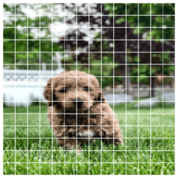

You will see the photo with thin white gaps between 196 small tiles. Some tiles are obviously an eye or a nose. Most are just fur, grass or trees, and on their own could belong to almost anything. That is exactly what the encoder layers will have to fix later, by letting each tile ask the others what they see.

Now we know how many patches we want. How do we actually cut them out, and turn each one into a vector? The naive way would be to slice the image into 196 tiles like we just did, flatten each tile's $16 \times 16 \times 3 = 768$ numbers into a list, and multiply every list by the same weight matrix. It turns out one layer already does all of that in a single call.

### Cutting patches with a convolution

A 2D convolution slides a small window, called the kernel, across an image. At each position it multiplies the pixels under the window by learned weights, adds them up and adds one learned bias, giving one number. Color images have three channels, red, green and blue, so the kernel covers all three at once. A $16 \times 16$ kernel over 3 channels looks at $16 \times 16 \times 3 = 768$ pixel values and turns them into one number. A layer can hold many kernels, each producing its own output channel, so with 768 output channels you get 768 numbers for every window position.

The two 768s here are a coincidence of this config. The first is how many pixel values one window sees, the second is `hidden_size`, the length we want each token vector to have. With 14 pixel patches a window sees $14 \times 14 \times 3 = 588$ values, but the output length is still whatever `hidden_size` says.

The stride is how far the window jumps between positions. If the kernel is 16 and the stride is also 16, the window jumps exactly one patch at a time. No overlap and no gaps. Each window position sees exactly one patch and turns it into 768 numbers. That is exactly what we wanted, one vector per patch, and it is called a **patch embedding**.


The padding is set to `"valid"`, which means no extra border is added around the image. Since 224 divides evenly by 16, there is nothing left over at the edges that would need a border.

So `nn.Conv2d(in_channels=3, out_channels=768, kernel_size=16, stride=16, padding="valid")` takes an input of shape $[B, 3, 224, 224]$ and gives $[B, 768, 14, 14]$. The output is still a grid, 14 by 14, where each cell holds a 768 long vector.

### Convolution by hand

That description is a lot of words for a simple operation. Let's do one small enough to compute in your head. A grayscale image, so 1 channel, of $4 \times 4$ pixels, a $2 \times 2$ kernel, stride 2 and no bias.

$$\text{image} = \begin{pmatrix} 3 & 5 & 1 & 9 \\ 2 & 7 & 4 & 6 \\ 8 & 0 & 5 & 3 \\ 1 & 6 & 2 & 4 \end{pmatrix} \qquad \text{kernel} = \begin{pmatrix} 1 & 0 \\ 0 & -1 \end{pmatrix}$$

The window starts at the top left and sees the patch $\begin{pmatrix} 3 & 5 \\ 2 & 7 \end{pmatrix}$. Multiply each pixel by the kernel weight in the same spot and add everything up

$$3 \cdot 1 + 5 \cdot 0 + 2 \cdot 0 + 7 \cdot (-1) = 3 - 7 = -4$$

Jump 2 pixels right. The window sees $\begin{pmatrix} 1 & 9 \\ 4 & 6 \end{pmatrix}$ and gives $1 - 6 = -5$. Jump down to the bottom left, $\begin{pmatrix} 8 & 0 \\ 1 & 6 \end{pmatrix}$ gives $8 - 6 = 2$. Bottom right, $\begin{pmatrix} 5 & 3 \\ 2 & 4 \end{pmatrix}$ gives $5 - 4 = 1$.

Four patches, four numbers, and they land in a $2 \times 2$ grid in the same arrangement as the patches they came from

$$\text{output} = \begin{pmatrix} -4 & -5 \\ 2 & 1 \end{pmatrix}$$


(If you met convolution in a signal processing class, you may remember the kernel being flipped first. Deep learning libraries skip the flip, strictly that is called cross correlation, but everyone calls it convolution. Since the weights are learned, the flip would make no difference.)

PyTorch gives the same result.

```python
import torch
import torch.nn as nn

img = torch.tensor([[3., 5., 1., 9.],
                    [2., 7., 4., 6.],
                    [8., 0., 5., 3.],
                    [1., 6., 2., 4.]]).reshape(1, 1, 4, 4)       # [B, C, H, W]

conv = nn.Conv2d(in_channels=1, out_channels=1, kernel_size=2, stride=2, bias=False)
conv.weight.data = torch.tensor([[1., 0.],
                                 [0., -1.]]).reshape(1, 1, 2, 2)  # [out_channels, in_channels, K, K]
print(conv(img).detach())
```

**Output:**

```text
tensor([[[[ -4., -5.],
          [  2.,  1.]]]])
```

This toy has one output channel, so each patch became one number. Our real layer has 768 output channels, 768 different kernels, so each patch becomes 768 numbers, one from each kernel. That is the patch vector.

### A convolution is a linear layer in disguise

Look at the first patch again. Read its pixels row by row into a list, $[3, 5, 2, 7]$, and do the same with the kernel, $[1, 0, 0, -1]$. The dot product of the two lists is

$$3 \cdot 1 + 5 \cdot 0 + 2 \cdot 0 + 7 \cdot (-1) = -4$$

the same number the convolution produced. That is not a coincidence. When the stride equals the kernel, every window sees its own patch and nothing else, so the convolution is exactly this: flatten each patch into a list, and multiply it by a weight matrix, the same matrix for every patch, then add the bias. With 768 kernels, the weight matrix has one row per kernel. In other words, a linear layer applied to every flattened patch.

This matters because the ViT paper describes the patch embedding this way. It says it will "flatten the patches and map to D dimensions with a trainable linear projection", with no convolution in sight. Our code uses a convolution. They are the same computation written two ways, and here is the proof. Cut the patches by hand, multiply them by the convolution's own weights reshaped into a matrix, add its bias, and compare.

```python
conv = nn.Conv2d(in_channels=3, out_channels=768, kernel_size=16, stride=16)
x = torch.randn(1, 3, 224, 224)

# the convolution way
out_conv = conv(x).flatten(2).transpose(1, 2)                     # [1, 196, 768]

# the paper way, flatten every patch and multiply by one matrix
patches = x.unfold(2, 16, 16).unfold(3, 16, 16)                  # [1, 3, 14, 14, 16, 16], windows along height (dim 2) then width (dim 3)
patches = patches.permute(0, 2, 3, 1, 4, 5)                      # [1, 14, 14, 3, 16, 16], each patch's channels and pixels together
patches = patches.reshape(1, 196, 3 * 16 * 16)                   # [1, 196, 768], one flat list per patch
W = conv.weight.reshape(768, -1)                                 # [768, 768], one row per kernel
out_linear = patches @ W.T + conv.bias                           # [1, 196, 768]

print(torch.allclose(out_conv, out_linear, atol=1e-4))
```

**Output:**

```text
True
```

(`flatten(2).transpose(1, 2)` on the first line turns the conv's grid into a list of 196 vectors so the two results can be compared. We explain it properly later in the chapter.)


The code below splits our dog image into 196 patches from earlier and shows them as sequence and the matrix form.

```python
import numpy as np
import matplotlib.pyplot as plt
from PIL import Image

image = Image.open("dog.jpg").convert("RGB").resize((224, 224))
x = np.array(image)                                      # [224, 224, 3]
P = 16
n = 224 // P                                             # 14

patches = x.reshape(n, P, n, P, 3).transpose(0, 2, 1, 3, 4)   # [14, 14, 16, 16, 3]
seq     = patches.reshape(n * n, P, P, 3)                     # [196, 16, 16, 3], k = r * 14 + c
flat    = seq.reshape(n * n, -1)                              # [196, 768], one row per patch 

fig, ax = plt.subplots(figsize=(7, 7))
ax.imshow(x)

for i in range(1, n):
    ax.axhline(i * P, color="white", lw=0.5)
    ax.axvline(i * P, color="white", lw=0.5)
for r in range(n):
    for c in range(n):
        ax.text(c*P + P/2, r*P + P/2, r*n + c, color="yellow", fontsize=6, ha="center", va="center")
ax.set_title("image → 14×14 = 196 patches"); ax.axis("off")
plt.show()

# first 28 patches as a sequence (rows 0 and 1 of the grid)
fig, axes = plt.subplots(1, 28, figsize=(20, 1.5))
for k in range(28):
    axes[k].imshow(seq[k]); axes[k].set_title(k, fontsize=7); axes[k].axis("off")
plt.suptitle("sequence order: patch 0, 1, 2, ... (row by row)", y=1.15)
plt.show()

# the whole sequence as a matrix: 196 patches × 768 pixel values
plt.figure(figsize=(10, 4))
plt.imshow(flat, aspect="auto", cmap="gray"
plt.xlabel("768 values = 16 × 16 × 3"); plt.ylabel("patch index 0–195")
plt.title("[196, 768]: input to the patch embedding")
plt.show()

print(x.shape, "→", patches.shape, "→", seq.shape, "→", flat.shape)
```

**Output:**

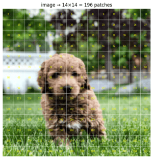
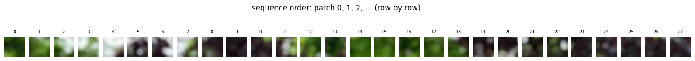
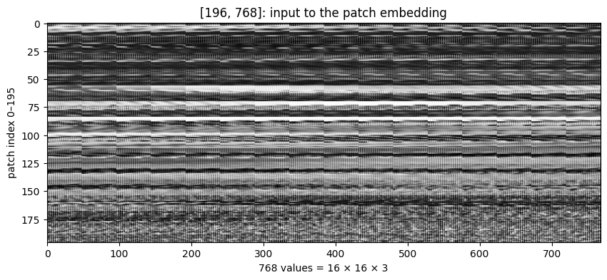

```text
(224, 224, 3) → (14, 14, 16, 16, 3) → (196, 16, 16, 3) → (196, 768)
```

So why use the convolution at all? Because it is one line, it cuts and multiplies in a single call, and it is heavily optimized on GPUs. And because the pretrained weights we load are stored in this shape.
### Why not a CNN?

We just used a convolution to cut patches, and before 2020 most of the best vision models were **convolutional neural networks**, or CNNs, built from many stacked convolutions. So why not use a whole CNN as the image encoder?

A CNN stacks many convolutions with small kernels, typically $3 \times 3$, that slide one pixel at a time, so the windows overlap heavily. Each layer only looks at a small neighborhood of the layer below. For the dog's ear to relate to its tail, information has to travel there layer by layer, the view widening a little each time.

That design bakes in two assumptions. Nearby pixels belong together, and a pattern means the same thing wherever it appears in the image. Assumptions built into a model's design, instead of learned from data, are called **inductive bias**. For images they are usually true, so a CNN learns well from relatively little data.

A ViT throws almost all of that away. Its only image specific parts are the patch cutting and the position vectors. From the very first layer, attention lets any patch look at any other patch, near or far. The price is that the model has to _learn_ from data that neighbors usually matter, because nobody told it.


The ViT paper measured this trade. Trained on ImageNet alone, about 1.3 million images, ViT lost to strong CNNs. Pretrained on JFT-300M, a private Google dataset of about 300 million images, it beat them, and the largest ViTs gained the most from the extra data.

Now remember chapter 1. Our encoder learns from billions of image and caption pairs taken from the web. Data is the one thing we have in abundance, and that is where ViT wins.

One thing not to confuse. Our patch layer is a convolution, but it is not a CNN. It is a single layer whose windows never overlap. It only cuts the image and projects each patch. All the seeing is left to the Transformer.

### When windows overlap

What would happen if ours did overlap, the way a CNN's windows do? That happens whenever the stride is smaller than the kernel. For image size $H$, kernel $K$ and stride $S$, the number of positions that fit along one side is

$$\left\lfloor \frac{H - K}{S} \right\rfloor + 1$$

where the $\lfloor \cdot \rfloor$ brackets mean "round down to a whole number", since a window that only half fits is not counted. The $+1$ counts the very first window, the one at the left edge before any jump.

With $K = 16$ and $S = 8$ on a 224 image that is $\frac{224 - 16}{8} + 1 = 26 + 1 = 27$. So $27 \times 27 = 729$ patches, each sharing half its pixels with its neighbor. More tokens, more compute. When $S = K$ the formula becomes $\frac{H - K}{K} + 1 = \frac{H}{K}$, which is our $H / P$ again.


(The figure compares stride 8 and stride 4 along one row of pixels. In 2D both sides count, so a 224 image with kernel 16 and stride 8 gives $27 \times 27 = 729$ patches.)

Overlap is what gives a CNN its slowly widening view, but in our patch layer it would only multiply the tokens, and attention pays for every token squared: 729 tokens instead of 196 means about 14 times more scores. So our patch layer keeps the stride equal to the kernel.

### From grid to sequence

Back to our patch layer. The convolution gave us one vector per patch. But look at the shape, $[B, 768, 14, 14]$. The patches are still arranged as a $14 \times 14$ grid, and the 768 numbers of each patch come _before_ the grid, because a convolution always puts its output channels right after the batch. That is not the list of tokens a Transformer expects.

The Transformer wants a list, not a grid. Number the dimensions of $[B, 768, 14, 14]$ as 0, 1, 2, 3. `flatten(2)` merges every dimension from index 2 onward into one, so $14 \times 14$ becomes $196$. The shape $[B, 768, 14, 14]$ becomes $[B, 768, 196]$. The grid is read row by row, so patch $(r, c)$ lands at position $14r + c$.

But now the embedding dimension (dimension 1) comes before the patch dimension (dimension 2). A Transformer expects one row per token, shape $[B, \text{tokens}, \text{embedding}]$. So we swap dimensions 1 and 2 with `transpose(1, 2)` and get $[B, 196, 768]$.


Now we have a sequence.

### Adding position

Flattening throws away where each patch was. Patch 0 was top left, patch 195 was bottom right, but the list does not say so.

Does that matter? Yes. Attention, which we build later, treats its input like a bag of tokens. Shuffle the patches and every patch gets exactly the same result, just in the shuffled order. Without positions, a picture and the same picture with its tiles scrambled would look identical to the model.

We fix this by adding a position vector to each patch

$$\mathbf{e}_i = \mathbf{x}_i + \mathbf{p}_i$$

where $\mathbf{x}_i$ is the embedding of patch $i$, $\mathbf{p}_i$ is the position vector for slot $i$, and $\mathbf{e}_i$ is what finally enters the Transformer. Since we add them, $\mathbf{p}_i$ must have the same length as $\mathbf{x}_i$, 768 numbers. A position is not a single number here, it is a whole vector.

These position vectors are not computed by a formula. They are learned. We create `nn.Embedding(num_positions, embed_dim)`, the same kind of embedding table we met at the start of this chapter, except the ids are now slot numbers instead of word ids. It holds one learnable 768 long vector per slot, a matrix of shape $196 \times 768$. Give it slot number $i$ and it hands back row $i$. Position vector 0 is always added to patch 0, vector 1 to patch 1, and so on. During training the model shapes these vectors into whatever helps it know where a patch sits.

To look them all up at once we need the numbers 0 to 195. We store them with `self.register_buffer("position_ids", torch.arange(num_positions).expand((1, -1)), persistent=False)`. A buffer is a tensor that belongs to the module and moves to the GPU with it, but is not a trainable weight. `expand((1, -1))` gives it a batch dimension of size 1, shape $[1, 196]$, where $-1$ means "keep this dimension as it is". `persistent=False` means it is not saved with the weights, since it is just the numbers 0 to 195 and can be rebuilt any time. Then the forward adds `self.position_embedding(self.position_ids)`, shape $[1, 196, 768]$, to the patches. The batch dimension of 1 is copied across all $B$ images automatically, which PyTorch calls broadcasting, so every image gets the same position vectors.

```python
    self.position_embedding = nn.Embedding(self.num_positions, self.embed_dim)
    self.register_buffer(
        "position_ids",
        torch.arange(self.num_positions).expand((1, -1)),   # [1, 196], the numbers 0 to 195
        persistent=False,
        )

    def forward(self, pixel_values):
        patch_embeds = self.patch_embedding(pixel_values)   # [B, D, 14, 14]
        embeddings = patch_embeds.flatten(2)                # [B, D, 196], dims 2 and 3 (the grid) merged into one
        embeddings = embeddings.transpose(1, 2)             # [B, 196, D], dim 1 (D) swapped with dim 2 (patches)
        embeddings = embeddings + self.position_embedding(self.position_ids)   # [B, 196, D], the [1, 196, D] positions broadcast over the batch
        return embeddings
```

### What the position vectors learn

Something strange should bother you here. The model is only ever given slot numbers, 0 to 195, in a line. Nobody tells it that slot 14 sits directly below slot 0, or that slot 13 is at the right edge and slot 14 back at the left. As far as the model knows, it is reading a sentence.

Yet the ViT paper found that after training, the position vectors of patches in the same row became similar to each other, and so did those in the same column, and nearby patches ended up more similar than distant ones. The model rediscovered the 2D grid on its own, from nothing but a list of slots, because knowing which patches are neighbors helps it see. The authors also tried handing the model 2D coordinates directly, and it did not do meaningfully better.

The trained weights of the paper's base model shows its sizes are exactly as our `VisionConfig` defaults: vectors of 768, patches of 16, images of 224, so a $14 \times 14$ grid of slots. Its position table is the trained version of the table we just described. Hugging Face stores it as a plain tensor instead of an `nn.Embedding`, but the numbers mean the same thing.

One difference. This model was built to classify, so it has the CLS token we talked about earlier, and its table holds $196 + 1 = 197$ rows. Row 0 belongs CLS, which doesn't correspond to any position in the image, so we drop it and keep the 196 patch slots.

For every slot, the code below computes the cosine similarity between that slot's position vector and every other slot's, and draws the result as a small heat map, placed where that slot sits in the image. You need `pip install transformers`, and the first run downloads about 350 MB of weights.

```python
import torch
import torch.nn.functional as F
import matplotlib.pyplot as plt
from transformers import ViTModel

vit = ViTModel.from_pretrained("google/vit-base-patch16-224", add_pooling_layer=False)

with torch.no_grad():
    pos = vit.embeddings.position_embeddings[0, 1:]     # [197, 768] -> [196, 768], row 0 is CLS, dropped
pos = F.normalize(pos, dim=-1)                          # length 1, so the dot product is the cosine
sim = pos @ pos.T                                       # [196, 196], every slot against every slot
side = int(sim.shape[0] ** 0.5)                         # 14 slots per side
sim = sim.reshape(side, side, side, side)               # [row, col] of one slot, then [row, col] of every other slot

fig, axes = plt.subplots(side, side, figsize=(8, 8))
for r in range(side):
    for c in range(side):
        axes[r, c].imshow(sim[r, c], vmin=-0.2, vmax=0.8, cmap="Oranges")   # how similar slot (r, c) is to every slot
        axes[r, c].axis("off")
plt.show()
```

If you see a message about unused `classifier` weights, that is the classification head we don't need, the same one greyed out in the figure at the start of this chapter.

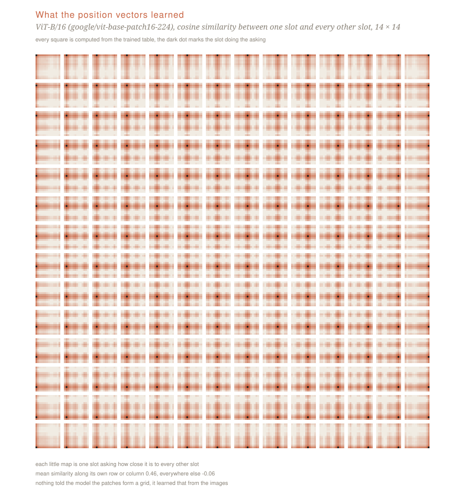

Each small map is one slot, and the dark dot marks where that slot sits. Wherever the map lights up, that slot's position vector is similar to the vector of the slot being lit, which is the model's way of saying the two are close. Look at any map and you will see a cross: its own row and its own column light up. On average, a slot's similarity to slots in its own row or column is 0.46, and to every other slot it is −0.06. Nothing told the model that 196 slots form a $14 \times 14$ grid. It learned that from the images.

### The full module

So the full forward is conv, flatten, transpose, add positions.

Here is the whole module.

```python
import torch
import torch.nn as nn

class VisionEmbeddings(nn.Module):
    def __init__(self, config):
        super().__init__()
        self.config = config
        self.embed_dim = config.hidden_size
        self.image_size = config.image_size
        self.patch_size = config.patch_size

        self.patch_embedding = nn.Conv2d(
            in_channels=config.num_channels,
            out_channels=self.embed_dim,
            kernel_size=self.patch_size,
            stride=self.patch_size,          # stride = kernel, patches never overlap
            padding="valid",
        )
        self.num_patches = (self.image_size // self.patch_size) ** 2
        self.num_positions = self.num_patches
        self.position_embedding = nn.Embedding(self.num_positions, self.embed_dim)
        self.register_buffer(
            "position_ids",
            torch.arange(self.num_positions).expand((1, -1)),   # [1, 196], the numbers 0 to 195
            persistent=False,
        )

    def forward(self, pixel_values):
        patch_embeds = self.patch_embedding(pixel_values)   # [B, D, 14, 14]
        embeddings = patch_embeds.flatten(2)                # [B, D, 196], dims 2 and 3 (the grid) merged into one
        embeddings = embeddings.transpose(1, 2)             # [B, 196, D], dim 1 (D) swapped with dim 2 (patches)
        embeddings = embeddings + self.position_embedding(self.position_ids)   # [B, 196, D], the [1, 196, D] positions broadcast over the batch
        return embeddings
```

The shapes in the comments use our config. With the real weights every 14 becomes 16 and every 196 becomes 256, and the code does not change.

```python
config = VisionConfig()
embeddings = VisionEmbeddings(config)
x = torch.randn(1, 3, 224, 224)       # one random "image"
print(embeddings(x).shape)
```

**Output:**

```text
torch.Size([1, 196, 768])
```

We can now pass the patches through the embedding layer, using pretrained ViT weights loaded into our `VisionEmbedding` class. The code shows three steps: each patch becomes a 768-dimensional content vector, a learned position vector is added, and the sum is what the transformer receives.

The code first turns the photo into a tensor called `pix`, shape $[1, 3, 224, 224]$, with every pixel value moved into the range from $-1$ to $1$. We explain these steps in the next chapter.

```python
import torch
import torch.nn.functional as F
import torch.nn as nn
from types import SimpleNamespace
from transformers import ViTModel
import matplotlib.pyplot as plt

# Definition of VisionConfig class
class VisionConfig:
    def __init__(
        self,
        hidden_size=768,
        intermediate_size=3072,
        num_hidden_layers=12,
        num_attention_heads=12,
        num_channels=3,
        image_size=224,
        patch_size=16,
        layer_norm_eps=1e-6,
        attention_dropout=0.0,
        num_image_tokens=None,
        **kwargs
    ):
        self.hidden_size = hidden_size
        self.intermediate_size = intermediate_size
        self.num_hidden_layers = num_hidden_layers
        self.num_attention_heads = num_attention_heads
        self.num_channels = num_channels
        self.image_size = image_size
        self.patch_size = patch_size
        self.layer_norm_eps = layer_norm_eps
        self.attention_dropout = attention_dropout
        self.num_image_tokens = num_image_tokens

# Definition of VisionEmbeddings class
class VisionEmbeddings(nn.Module):
    def __init__(self, config):
        super().__init__()
        self.config = config
        self.embed_dim = config.hidden_size
        self.image_size = config.image_size
        self.patch_size = config.patch_size

        self.patch_embedding = nn.Conv2d(
            in_channels=config.num_channels,
            out_channels=self.embed_dim,
            kernel_size=self.patch_size,
            stride=self.patch_size,
            padding="valid",
        )
        self.num_patches = (self.image_size // self.patch_size) ** 2
        self.num_positions = self.num_patches
        self.position_embedding = nn.Embedding(self.num_positions, self.embed_dim)
        self.register_buffer(
            "position_ids",
            torch.arange(self.num_positions).expand((1, -1)),
            persistent=False,
        )

    def forward(self, pixel_values):
        patch_embeds = self.patch_embedding(pixel_values)
        embeddings = patch_embeds.flatten(2)
        embeddings = embeddings.transpose(1, 2)
        embeddings = embeddings + self.position_embedding(self.position_ids)
        return embeddings

vit = ViTModel.from_pretrained("google/vit-base-patch16-224", add_pooling_layer=False)

cfg = SimpleNamespace(hidden_size=768, image_size=224, patch_size=16, num_channels=3)
emb = VisionEmbeddings(cfg).eval()
with torch.no_grad():                                   # copy ViT weights into our module
    emb.patch_embedding.weight.copy_(vit.embeddings.patch_embeddings.projection.weight)   # [768, 3, 16, 16]
    emb.patch_embedding.bias.copy_(vit.embeddings.patch_embeddings.projection.bias)       # [768]
    emb.position_embedding.weight.copy_(vit.embeddings.position_embeddings[0, 1:])        # [196, 768], CLS dropped

pix = torch.tensor(x).permute(2, 0, 1).float().div(255).sub(0.5).div(0.5)[None]   # [1, 3, 224, 224], ViT normalisation

with torch.no_grad():
    tokens = emb.patch_embedding(pix).flatten(2).transpose(1, 2)[0]   # [196, 768], content only
    pos    = emb.position_embedding.weight                            # [196, 768], location only
    out    = emb(pix)[0]                                              # [196, 768], content + location

print("out == tokens + pos:", torch.allclose(out, tokens + pos, atol=1e-5))
print(f"avg norm  patch: {tokens.norm(dim=-1).mean():.1f}   position: {pos.norm(dim=-1).mean():.1f}")

# the three [196, 768] matrices
fig, ax = plt.subplots(1, 3, figsize=(15, 4))
for a, m, t in zip(ax, [tokens, pos, out], ["patch embedding", "+ position embedding", "= final embedding"]):
    a.imshow(m.detach().cpu().numpy(), aspect="auto", cmap="coolwarm", vmin=-3, vmax=3)
    a.set_title(f"{t}  [196, 768]"); a.set_xlabel("768 dims"); a.set_ylabel("patch index")
plt.tight_layout(); plt.show()

# pick one patch and ask: which slots look like it?
r, c = 7, 7                                             # move this onto the dog
k = r * n + c
def sim_map(v):
    v = F.normalize(v, dim=-1)
    return (v @ v[k]).view(n, n)                        # cosine of patch k with all 196, back to 14×14

fig, ax = plt.subplots(1, 4, figsize=(16, 4))
ax[0].imshow(x); ax[0].add_patch(plt.Rectangle((c*P, r*P), P, P, fill=False, ec="red", lw=2))
ax[0].set_title(f"patch {k}")
for a, m, t in zip(ax[1:], [tokens, pos, out], ["patch only: similar content", "position only: nearby slots", "patch + position"]):
    a.imshow(sim_map(m).detach().cpu().numpy(), cmap="Oranges"); a.set_title(t)
for a in ax: a.axis("off")
plt.show()
```

**Output:**
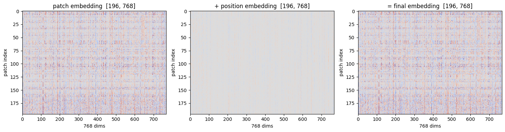
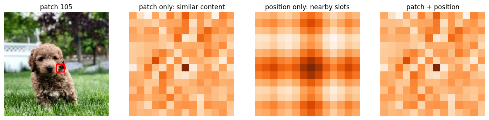

The patch embedding alone knows what is in a patch but not where, so similar-looking patches match anywhere in the image. The position embedding alone knows where but not what, so it matches nearby slots regardless of content. Adding them gives each of the 196 tokens both, and that $[196, 768]$ matrix is the input to the transformer layers.

### Where these vectors are going

In the first chapter we said a picture goes into the image encoder and a vector comes out. That was true when the Image Encoder was being trained for image-text alignment. To compare an image with a caption you need one vector per image, so during that training all the patch vectors are squeezed into a single vector by a small pooling layer at the end.

Our vision language model skips that squeeze. It keeps every patch vector that comes out of the encoder, resizes them to the language model's width with a single linear layer, and places them into the prompt as image tokens. To the language model, each patch really does become a word.

We now have 196 vectors. Each one knows what its patch looks like and where it sits. But each patch still knows nothing about any _other_ patch. The ear does not know there is a snout next to it. The encoder layers ahead will fix that by mixing the patches, and we are about to stack twelve of them.


The moment we stack that many layers, a new problem appears. The numbers flowing through them can drift in scale from layer to layer and from batch to batch, and training starts to wobble. So before we build these layers, we need a way to keep the numbers steady.

_Complete Chapter 2 Code: [Colab Notebook](https://colab.research.google.com/drive/11yBDXMkF1JCtOgpYVL2HCsUs5D1sUNJf?usp=sharing)_

---
# Chapter 3. Keeping the Numbers Steady

At the end of the last chapter we had 196 patch vectors, each 768 numbers long, ready to pass through a stack of twelve encoder layers. But there is a problem, as those numbers pass through layer after layer, their scale can drift. Some layers may make them larger, others smaller, and training starts to wobble. So before we build the encoder layer, we need to build the small piece that keeps this drift under control: the **norm layer** you saw in the ViT figure in the last chapter.

> **Main Idea: Before every layer, shift and rescale each token's vector so its numbers have a mean of 0 and a spread of 1.**

Think of it as a volume knob. Each layer passes its numbers on to the next one. If one layer whispers and the next one shouts, nobody can follow the conversation. The norm brings every voice back to the same level before it reaches the next layer.

### Why the numbers drift

For a deeper dive into [Normalization] check our previous lessons. 

Let's start with the smallest piece of a layer: a single neuron in a linear layer. A neuron is a tiny calculator. It multiplies each input number $x_i$ by its corresponding weight $w_i$, adds all those products together (that is the dot product of the input $\mathbf{x}$ with the weight vector $\mathbf{w}$), and then adds bias '$b$'.

$$y = \mathbf{w} \cdot \mathbf{x} + b$$

here, $y$ is the output of the neuron.

Let's try it. Take $\mathbf{w} = [0.5, -1, 2]$, $b = 1$ and the input $\mathbf{x} = [1, 2, 3]$. Then

$$\mathbf{w} \cdot \mathbf{x} = 0.5 - 2 + 6 = 4.5$$

$$y = 4.5 + 1 = 5.5$$

Now double the input to $[2, 4, 6]$. The dot product doubles as well:

$$\mathbf{w} \cdot \mathbf{x} = 1 - 4 + 12 = 9$$

$$y = 9 + 1 = 10$$

The dot product follows the scale of the input, the bias doesn't chage, so the full output simply does not double. The same idea shows up in the gradient.

Training works by nudging the weights. But which way should each weight move? Backpropagation answers that by asking how much the output $y$ changes when weight $w_i$ changes by a tiny amount. The answer is the input value that weight multiplies:

$$\frac{\partial y}{\partial w_i} = x_i$$

Each weight's gradient contains its corresponding input $x_i$ as a factor. Double the input and you double the gradient. The step that gradient-descent step doubles with it:

$$\mathbf{w} \leftarrow \mathbf{w} - \eta , \frac{\partial \mathcal{L}}{\partial \mathbf{w}}$$

where $\eta$ (eta) is the learning rate, which controls the size of each step, and $\mathcal{L}$ is the loss.


Now put this neuron somewhere in the middle of a network that is being trained. Its input comes from the previous layer. After every batch, that layer updates its weights, so the numbers it sends forward changes. Follow what happens, Our neuron's input has changed, which changes its output, and that changes the loss and the gradients that flow back through the network.

As a result, the weights in our layer may take a different-sized step from one update to the next.

Each layer's weights are tuned for inputs of a certain size, but that size keeps changing. Each layer ends up chasing a moving target. The loss jumps around instead of sliding down, forcing us to use a smaller learning rate so those jumps don't throw training off course.


A layer's input keeps changing because the layers before it keep changing during training. This drift is called **Internal Covariate Shift**, a term introduced in the 2015 paper [Batch Normalization](https://arxiv.org/abs/1502.03167).

Researchers still debate how much of the story this drift explains. A later study [(How Does Batch Normalization Help Optimization?)](https://arxiv.org/abs/1805.11604) found that normalization still improves training even when this drift is deliberately reintroduces. Its authors argued that the main benefit is a smoother loss: the loss changes more gently as the weights move, so the optimizer can take larger steps without destabilizing training. Both explanations point to the same practical remedy: keep the numbers entering each layer at a relatively steady scale.

### Twelve layers make it worse

A drift inside one layer is bad. A stack of layers multiplies it.

Here's why. Think about how spread out the numbers in a vector are. Every layer changes that spread by some factor, perhaps a little more than 1 or a little less, depending on its weights. Nothing forces that factor to be exactly 1, and training keeps changing it.

Now stack twelve layers. A factor of $1.2$ per layer becomes

$$1.2^{12} \approx 8.9$$

and a factor of $0.8$ per layer becomes

$$0.8^{12} \approx 0.069$$

A 20 percent change per layer sounds harmless, yet after twelve layers it produces numbers almost 9 times larger, or about 15 times smaller. The real model we load later has 27 layers. There, the same factors give about $137$ and about $0.0024$.

This is a deliberately simplified picture: a real transformer layer does much more than multiply the spread by a fixed number. The example isolates one failure mode so we can see why controlling scale matters.

Let's watch this happen. We build two stacks of twelve linear layers and send a random sequence of 196 tokens through each. In the first stack, every layer multiplies the spread by about 0.8. In the second, every layer multiplies it by about 1.2. Function`std()` measures the spread.

(The weights are random numbers, and `nn.init.normal_` controls their size by giving them a standard deviation of $\text{gain} / \sqrt{768}$. Each output is a sum of 768 input-weight products. With weights at this scale, the output's standard deviation is roughly `gain` times the input's standard deviation. So `gain` acts like a knob that makes a layer shrink or grow its input.)

```python
import torch
import torch.nn as nn

torch.manual_seed(0)
config = VisionConfig()
D = config.hidden_size

def make_stack(gain):
    layers = []
    for _ in range(config.num_hidden_layers):
        layer = nn.Linear(D, D, bias=False)
        nn.init.normal_(layer.weight, std=gain / D ** 0.5)   # each layer multiplies the spread by about gain
        layers.append(layer)
    return layers

x = torch.randn(1, 196, D)                                  # [1, 196, 768], spread about 1
for gain in (0.8, 1.2):
    h = x
    for layer in make_stack(gain):
        h = layer(h)
    print(f"gain {gain}: spread after {config.num_hidden_layers} layers = {h.std().item():.4f}")
```

**Output:**

```text
gain 0.8: spread after 12 layers = 0.0694
gain 1.2: spread after 12 layers = 8.8254
```

As we can see, after twelve layers one stack whispers and the other shouts.

But there is a problem. A layer in a real network behaves somewhere between these two extremes, and training keeps moving it. So the next layer can never know exactly what size of numbers is coming in. To fix this, we force the numbers entering every layer to be of a fixed size, no matter what the earlier layers did and to do that, we first need a way to measure "size".

### Mean and spread

For our purposes, these two numbers (mean and spread) are enough, where its center is, and how spread out it is. The Greek letters may look fancy, but they are just names for two things you already know, an average and a distance from that average.

The **mean** is the center of the list, the plain average. For a vector of $D$ numbers

$$\mu = \frac{1}{D}\sum_{i=1}^{D} x_i$$

where $\mu$ (mu) is the mean and $x_i$ is the $i$-th number of the vector.

The **variance** measures how wide the list is. It is the average squared distance from the mean

$$\sigma^2 = \frac{1}{D}\sum_{i=1}^{D} \left(x_i - \mu\right)^2$$

where $\sigma^2$ (sigma squared) is the variance. Squaring makes every distance positive, so both the numbers below and above the mean count. The square root of the variance, $\sigma$, is the **standard deviation**. It brings the result back to the units of the numbers themselves. The standard deviation is the spread that `std()` measured earlier.

Normalizing takes two steps. First, subtract the mean from every number so that the new mean is 0. Then divide every number by the standard deviation, so the new spread is 1

$$\hat{x}_i = \frac{x_i - \mu}{\sigma}$$

here $\hat{x}_i$ (x hat) is the $i$-th normalized number.

Try it on $\mathbf{x} = [2, 4, 6, 8]$. Find the mean:

$$\mu = \frac{2 + 4 + 6 + 8}{4} = 5$$

Subtract it from every number and you get $[-3, -1, 1, 3]$. The squared distances are $9, 1, 1, 9$, so the variance and the standard deviation are

$$\sigma^2 = \frac{9 + 1 + 1 + 9}{4} = 5$$

$$\sigma = \sqrt{5} \approx 2.236$$

Divide by the standard deviation gives

$$\hat{\mathbf{x}} \approx [-1.34, -0.45, 0.45, 1.34]$$

Check it. The four numbers add up to 0, so the mean is 0. Their squares are exactly $\frac{9}{5}, \frac{1}{5}, \frac{1}{5}, \frac{9}{5}$, and their average is

$$\frac{20}{5} \cdot \frac{1}{4} = 1$$

so the spread is 1.

Now try $[20, 40, 60, 80]$, the same vector scaled up by 10. The mean is 50 and the distances from the mean are $[-30, -10, 10, 30]$, that gives

$$\sigma^2 = \frac{900 + 100 + 100 + 900}{4} = 500$$

$$\sigma = \sqrt{500} \approx 22.36$$

Divide by the standard deviation, and you get exactly the same normalized values as before: $[-1.34, -0.45, 0.45, 1.34]$. For $[102, 104, 106, 108]$, the first vector moved up by 100. The mean is 105, the distances are again $[-3, -1, 1, 3]$, and the result is again the same.

Normalization removes two things: the overall size of the numbers and their shared offset. What it keeps is their relative pattern: which numbers are larger or smaller than the others, and how far apart they are relative to the overall spread.


In a batch of $B$ images, each with 196 tokens of 768 numbers, which numbers should we average over? There are two choices. We can take one feature and average it across the images in the batch, or we can take one token and average across its own 768 numbers. The first choice is the older one.

### Batch normalization

The first widely used answer was **Batch Normalization** ([Ioffe and Szegedy, 2015](https://arxiv.org/abs/1502.03167)), usually called batch norm. It was built for CNNs. Picture the batch as a table with one row per example and one column per feature. Batch norm works down each column: for each feature, it computes the mean and variance across all the examples in the batch:

$$\mu_f = \frac{1}{B}\sum_{b=1}^{B} x_{b,f} \qquad \sigma_f^2 = \frac{1}{B}\sum_{b=1}^{B} \left(x_{b,f} - \mu_f\right)^2$$

where $x_{b,f}$ is feature $f$ of example $b$, and $\mu_f$ and $\sigma_f^2$ are the mean and variance of feature $f$ across the $B$ examples.

It works very well for CNNs trained with large batches. But there is a catch: the normalized value of one example depends on whatever else happens to be in its batch.

Here is a small example. Put our dog photo in a batch of two images, and suppose its first feature is 2. If the other image has a 4 in that feature, the mean is 3, the distances are $-1$ and $1$, and the variance is 1, the dog's feature becomes:

$$\frac{2 - 3}{1} = -1$$

Now change the other image's feature to 0, the mean becomes 1, the distances are $1$ and $-1$, and the variance is still 1. This time the dog's feature becomes:

$$\frac{2 - 1}{1} = 1$$

Same dog, same number, opposite sign, only because the other image changed.

Real batches are larger, so the effect is milder, but it never completely disappears. The batch statistics also become noisier as the batch gets smaller. At inference, `BatchNorm` normally uses running averages collected during training rather than statistics computed from the current batch. The layer therefore behaves differently during training and inference.

Text(inputs) makes this even worse. Sentences have different lengths, so shorter ones filled with padding, extra tokens added to make every sentence in their batch the same length. Those padding tokens can affect the batch statistics.

What if we normalized each token using its own numbers?

### Layer normalization

**Layer normalization** ([Ba, Kiros and Hinton, 2016](https://arxiv.org/abs/1607.06450)), or layer norm, fixes this by switching direction.

Instead of working across the batch, it works across the features of each individual token. Each token gets its own mean and variance, computed from its own $D$ numbers. These are exactly the $\mu$ and $\sigma^2$ from the previous section on mean and spread. Nothing else in the batch is involved.

In our tensor of shape $[B, 196, 768]$, that means each of the $B \times 196$ token vectors is normalized independently, using its 768 features. Those features lie along the last axis, so in code the mean is taken with `dim=-1`.

A patch of sky and a patch of fur are each normalized using their own statistics. The result for one image does not change just because we put it in a batch of 1 or a batch of 1000. 


This is why Transformers almost always use layer norm, or a close cousin of it, rather than batch norm.

### The learned scale and shift

But forcing every token to mean 0 and spread 1 could erase something useful. Maybe a layer works best when some of its numbers are larger than others, or when the whole representation is shifted away from zero.

Normalization should steady the numbers, not decide them for the model.

To fix this, layer norm ends with a learned scale and a learned shift

$$y_i = \gamma_i , \hat{x}_i + \beta_i$$

where $\gamma_i$ (gamma) is the learned scale for feature $i$ and $\beta_i$ (beta) is the learned shift. There is one $\gamma_i$ and one $\beta_i$ for each of the $D$ features, so each is a vector of $D$ numbers, shared by every token. They start at $\gamma = 1$ and $\beta = 0$, so at first layer norm is pure normalization. Training then adjusts them to whatever values work best.

Take our normalized $[-1.34, -0.45, 0.45, 1.34]$ and use $\gamma = 2$ and $\beta = 1$ for every feature. Each number is doubled and then shifted upward by 1, giving approximately 
$$[-1.68, 0.11, 1.89, 3.68]$$

The mean is now 1 and the spread is 2.

Doesn't that bring the drift back? No. The important difference is that $\gamma$ and $\beta$ belong to the normalization layer itself. They are the same for every token and every input, and they change only through training. The earlier layers can produce representations at different scales, but normalization removes the input-dependent scale before applying the learned feature-wise scale and shift.
### Guarding against zero

One danger is left in the formula. We divide by $\sigma$. What if all the numbers in a token are equal, say $[5, 5, 5, 5]$? The mean is 5 and every distance from the mean is 0, so $\sigma = 0$, and we compute $\frac{0}{0}$. That gives NaN, and once NaN enters a computation it breaks everything that depends on it.

To prevent this, we add a tiny number $\epsilon$ (epsilon) to the variance before the square root. The full recipe of layer norm is

$$\hat{x}_i = \frac{x_i - \mu}{\sqrt{\sigma^2 + \epsilon}} \qquad y_i = \gamma_i , \hat{x}_i + \beta_i$$

where $\epsilon$ is `layer_norm_eps=1e-6` from our `VisionConfig`, that is, 0.000001.

With $\epsilon$, the division for $[5, 5, 5, 5]$ is safe

$$\frac{0}{\sqrt{0.000001}} = \frac{0}{0.001} = 0$$

For an ordinary token, like $[2, 4, 6, 8]$ with $\sigma^2 = 5$, adding 0.000001 changes nothing you would notice.

### Layer norm by hand

Here is the whole recipe in a few lines of code, we apply it to $[2, 4, 6, 8]$ and to the same vector scaled up by 10, with one token per row.

We compute the variance ourselves as the average of the squared distances from the mean. PyTorch's `var()` divides by $D - 1$ by default instead of $D$, a correction used when estimating a variance from a small sample. Layer norm divides by $D$. 

On 4 numbers the difference is large: $\frac{20}{3} \approx 6.67$ instead of $5$.


```python
def layer_norm(x, gamma, beta, eps):
    mean = x.mean(dim=-1, keepdim=True)                     # [2, 1], one mean per token
    var = ((x - mean) ** 2).mean(dim=-1, keepdim=True)      # [2, 1], divides by D, not D - 1
    x_hat = (x - mean) / torch.sqrt(var + eps)              # mean 0, spread 1
    return gamma * x_hat + beta

x = torch.tensor([[2., 4., 6., 8.],
                  [20., 40., 60., 80.]])                    # [2, 4], two tokens of 4 numbers
gamma, beta = torch.ones(4), torch.zeros(4)                 # the starting values
print(layer_norm(x, gamma, beta, eps=config.layer_norm_eps))

ln = nn.LayerNorm(4, eps=config.layer_norm_eps)
print(ln(x).detach())

flat = torch.tensor([[5., 5., 5., 5.]])                     # [1, 4], a token whose numbers are all equal
print(layer_norm(flat, gamma, beta, eps=config.layer_norm_eps))
print(layer_norm(flat, gamma, beta, eps=0.0))               # no guard
```

**Output:**

```text
tensor([[-1.3416, -0.4472, 0.4472, 1.3416], [-1.3416, -0.4472, 0.4472, 1.3416]]) tensor([[-1.3416, -0.4472, 0.4472, 1.3416], [-1.3416, -0.4472, 0.4472, 1.3416]]) tensor([[0., 0., 0., 0.]]) tensor([[nan, nan, nan, nan]])
```

The first two results show the values we worked out by hand, about $-1.34, -0.45, 0.45, 1.34$, and our function agrees with PyTorch's. The flat token gives four clean zeros with $\epsilon$, without the guard, it produces four NaNs.

We write this function once to understand what is happening. In the model we simply use `nn.LayerNorm(config.hidden_size, eps=config.layer_norm_eps)`, which performs the same computation and stores $\gamma$ and $\beta$ for us. It stores $\gamma$ as `weight` and $\beta$ as `bias`, and those are the names the pretrained checkpoint uses too.

Always pass `eps` explicitly. `nn.LayerNorm` defaults to `1e-5`, but the pretrained encoder was trained with `1e-6`. Leaving it out will not produce an error, the model will still load and run, but it will compute slightly different numbers from the ones used during training.

### Layer norm on our patches
Now apply it to the patch vectors produced by `VisionEmbeddings`, our module from the last chapter. We'll make one random image and a second copy with every pixel value multiplied by 10, Then we'll send both through `VisionEmbeddings`, and compare the spread of the first token before and after the norm.

```python
torch.manual_seed(0)
config = VisionConfig()
embeddings = VisionEmbeddings(config)
norm = nn.LayerNorm(config.hidden_size, eps=config.layer_norm_eps)

image = torch.randn(1, 3, 224, 224)                         # one random "image"
x = torch.cat([image, image * 10])                          # [2, 3, 224, 224], the image, then every pixel times 10
with torch.no_grad():
    h = embeddings(x)                                       # [2, 196, 768]
    out = norm(h)                                           # [2, 196, 768], every token normalized on its own

print(out.shape)
print("spread of token 0, before:", h[:, 0].std(dim=-1, unbiased=False))     # [2], one value per image
print("spread of token 0, after: ", out[:, 0].std(dim=-1, unbiased=False))   # [2]
print("mean of token 0, after:   ", out[:, 0].mean(dim=-1))                  # [2]
print("gamma", tuple(norm.weight.shape), "beta", tuple(norm.bias.shape))
```

**Output:**

```text
torch.Size([2, 196, 768])
spread of token 0, before: tensor([1.1104, 5.7675])
spread of token 0, after: tensor([1.0000, 1.0000])
mean of token 0, after: tensor([-4.9671e-09, 3.5701e-09])
gamma (768,) beta (768,)
```

The shape does not change, $[2, 196, 768]$ goes in and $[2, 196, 768]$ comes out. Layer norm preserves the Transformer's contract: $N$ vectors in, $N$ vectors of the same length out.

Before the norm, the second image's token has a much larger spread than the first: 5.7675 versus 1.1104. After the norm, both spreads are 1 up to rounding, $[1.0000, 1.0000]$. The means are tiny numbers such as $10^{-9}$ rather than an exact 0, because computers round their calculations.

Notice that the two normalized tokens are not identical. Earlier, $[2, 4, 6, 8]$ and $[20, 40, 60, 80]$ normalized to exactly the same numbers. Here the second token is not exactly 10 times the first. Multiplying the pixels by 10 multiplies the patch projection by 10, but the projection's bias and the position vector are added afterwards, unchanged. Normalization still brings both tokens the same overall scale, but it does not guarantee that their normalized patterns will be identical.

How big is a norm? $\gamma$ and $\beta$ each hold 768 numbers, so one norm has $2 \times 768 = 1{,}536$ parameters. Every encoder layer has two norms, and one final norm follows the stack. For our config that gives

$$2 \times 12 + 1 = 25 \text{ norms}$$

$$25 \times 1{,}536 = 38{,}400 \text{ parameters}$$

The real model has $2 \times 1{,}152 = 2{,}304$ parameters per norm and 27 layers, so

$$2 \times 27 + 1 = 55 \text{ norms}$$

$$55 \times 2{,}304 = 126{,}720 \text{ parameters}$$

That is tiny next to the millions of weights in attention and the MLP.

### Twelve layers, steady again

Now go back to the two stacks from the start of the chapter, and put a layer norm in front of every layer.

```python
torch.manual_seed(0)
x = torch.randn(1, 196, D)                                  # [1, 196, 768]
for gain in (0.8, 1.2):
    h = x
    for layer in make_stack(gain):
        norm = nn.LayerNorm(D, eps=config.layer_norm_eps)   # gamma 1, beta 0, pure normalization
        h = layer(norm(h))                                  # the norm resets the spread to 1 before every layer
    print(f"gain {gain}: spread after {config.num_hidden_layers} layers = {h.std().item():.4f}")
```

**Output:**

```text
gain 0.8: spread after 12 layers = 0.7990
gain 1.2: spread after 12 layers = 1.1975
```

The first stack now ends at 0.7990 and the second at 1.1975, which is close to the factor of a single layer. The last layer still changes the spread by its own factor, but it receives a normalized input each time. Nothing from the earlier layers pile up. Instead of multiplying twelve factors together, we only see the effect of the final layer.

### What the first layer really receives

So far our norms have only seen numbers we made up. Time for the real thing. The ViT we loaded in the last chapter is fully trained, and the first thing its first encoder layer does is a layer norm.

Let's give it the dog image from the last chapter.

First the photo has to be converted into the numbers this model expects. Dividing by 255 puts every pixel value between 0 and 1. Subtracting 0.5 and dividing by 0.5 then puts the values between −1 and 1. This is a normalization too, but there is an important difference. They are fixed numbers (0.5,0.5), same for every image. Layer norm, by contrast, computes its statistics separately from each token. The processor we build later will handle this step for us. Our real model uses the same normalization.

We keep the result in a tensor called `pix`, of shape $[1, 3, 224, 224]$: one image, 3 color channels, and 224 by 224 pixels. The code builds it from the dog photo in a few steps. It resizes the photo to $224 \times 224$, divides every value by 255, subtracts 0.5 and divides by 0.5. On the way, `permute(2, 0, 1)` moves the color channels in front of the height and the width, the order PyTorch layers expect, and `[None]` adds the batch dimension of 1 at the front. We will feed `pix` to the encoder again in the chapters ahead, so remember what it holds: the dog photo, written in the numbers the encoder expects. When we build the processor, it will produce this same tensor for any photo.

Then we take the `VisionEmbeddings` written in the last chapter and copy the trained patch weights and position vectors into it. We compare three versions of the same 196 vectors: the vectors as they leave the embeddings, the vectors after a plain norm with $\gamma = 1$ and $\beta = 0$, and the vectors after the trained norm with its learned $\gamma$ and $\beta$.

This model uses $\epsilon = 10^{-12}$ instead of $10^{-6}$.

To find the trained norm, the code looks for the first layer norm inside the model and prints its name. In our own encoder the corresponding norm will be called `layer_norm1`.

Hugging Face also adds a CLS token, so its first norm sees 197 tokens rather than 196. We run the norm on all 197 tokens too, drop the CLS token, and check that our 196 patch vectors are unchanged. This also gives us a useful test of the code from the last chapter. Hugging Face builds its patch vectors with its own implementation, while you built yours with `VisionEmbeddings`. If your patch cutting, flattening, transpose or position lookup is wrong anywhere, the two implementations will not match and the checks below will print `False`.

```python
# VisionConfig and VisionEmbeddings are the classes you wrote in the last chapter.
# If they are wrong, the "same with or without CLS" check below prints False.
import numpy as np
from PIL import Image
from transformers import ViTModel

vit = ViTModel.from_pretrained("google/vit-base-patch16-224", add_pooling_layer=False).eval()
config = VisionConfig()                # same sizes as this checkpoint
emb = VisionEmbeddings(config).eval()  # your module, with the trained weights copied in
with torch.no_grad():
    emb.patch_embedding.weight.copy_(vit.embeddings.patch_embeddings.projection.weight)# [768, 3, 16, 16]
    emb.patch_embedding.bias.copy_(vit.embeddings.patch_embeddings.projection.bias)    # [768]
    emb.position_embedding.weight.copy_(vit.embeddings.position_embeddings[0, 1:])        # [197, 768] -> [196, 768], CLS row dropped

photo = np.array(Image.open("dog.jpg").convert("RGB").resize((224, 224)))                 # [224, 224, 3]
pix = torch.tensor(photo).permute(2, 0, 1).float().div(255).sub(0.5).div(0.5)[None]      # [1, 3, 224, 224], values in [-1, 1]

norms = [(name, m) for name, m in vit.named_modules() if isinstance(m, nn.LayerNorm)]
ln_name, ln_real = norms[0]     # the first norm of the first encoder layer
print("first norm:", ln_name)
ln_plain = nn.LayerNorm(config.hidden_size, eps=vit.config.layer_norm_eps).eval()   # gamma 1, beta 0

with torch.no_grad():
    patches = emb(pix)[0]            # [1, 196, 768] -> [196, 768]
    plain = ln_plain(patches)        # [196, 768], every patch at mean 0, spread 1
    trained = ln_real(patches)       # [196, 768], then the trained scale and shift
    full = ln_real(vit.embeddings(pix))[0, 1:] 
    # [1, 197, 768] -> [196, 768], CLS normalized too, then dropped

print("same with or without CLS:", torch.allclose(trained, full, atol=1e-5))
print(f"gamma from {ln_real.weight.min():.2f} to {ln_real.weight.max():.2f}, "
      f"beta from {ln_real.bias.min():.2f} to {ln_real.bias.max():.2f}")

side = config.image_size // config.patch_size       # 14 patches per side
stages = {"before the norm": patches, "normalized": plain, "after gamma and beta": trained}
spreads = {t: m.std(dim=-1, unbiased=False).view(side, side) for t, m in stages.items()}   # [196] -> [14, 14] each
for t, s in spreads.items():
    print(f"{t:22s} spread from {s.min():.3f} to {s.max():.3f}")

vmax = max(s.max() for s in spreads.values()).item()  # one color scale for all three maps
fig, ax = plt.subplots(1, 4, figsize=(16, 4))
ax[0].imshow(photo); ax[0].set_title("image")
for a, (t, s) in zip(ax[1:], spreads.items()):
    im = a.imshow(s.numpy(), cmap="Oranges", vmin=0, vmax=vmax); a.set_title(t)
fig.colorbar(im, ax=ax[1:].tolist(), shrink=0.8)
for a in ax: a.axis("off")
plt.show()
```

**Output:**

```text
first norm: layers.0.layernorm_before
same with or without CLS: True
gamma from 0.03 to 0.23, beta from -0.14 to 0.20
before the norm          spread from 0.394 to 1.351
normalized               spread from 1.000 to 1.000
after gamma and beta     spread from 0.094 to 0.148
```

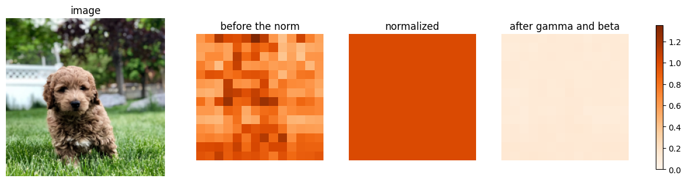

Each map shows the spread of one patch at the position where the patch came form in the picture. Let's read them one at a time.

**Before the norm,** the spread varies from patch to patch, from 0.394 to 1.351. The widest patch is about $1.351 / 0.394 \approx 3.4$ times wider than the narrowest. You will not find a clean outline of the dog in this map. The last chapter explains why: each vector is the patch's content plus its position vector, so its size reflects both what the patch contains and where that patch sits. This is exactly what the first layer would receive without a norm: numbers whose scale depends on the photo, the patch and its position. A different photo could produce a different pattern of scales, leaving the layer to deal with whatever happens to arrive.

**After the plain norm,** every patch has spread exactly 1.000, so the map becomes one flat color. The scale information is while the relative patterns inside each vector remain. Whatever the photo does to the magnitude of a patch, the first layer now receives every patch at the same normalized scale.

**After the trained $\gamma$ and $\beta$** the spread now ranges from 0.094 and 0.148. Training did not choose to keep spread 1. Instead the learned $\gamma$ values substantially shrink the normalized features. The exact spread of each patch depends on both its normalized values and the feature-wise $\gamma$ values applied to them. Attention multiplies these values by its own weights next, so the model is free to choose one scale here and compensate for it elsewhere.

The spreads are no longer exactly equal: they range from 0.094 to 0.148. Each feature has its own $\gamma$ and $\beta$, so different patches can end up with slightly different spreads depending on which feature values they contain. But compare the ranges. Before the norm, the widest patch was about 3.4 times wider than the narrowest. After it, the ratio is about $0.148 / 0.094 \approx 1.6$.

And there is one difference that matters more than the ranges. Before the norm, the scale of each patch was determined by the incoming representation. After normalization, the input-dependent scale has been removed, and the learned $\gamma$ and $\beta$ provide a stable, feature-wise transformation that is shared across inputs.

Show this model a dark photo, a bright photo or a photo of something completely different. The plain normalized representation will still have unit spread for every patch, while the learned norm will apply the same trained parameters to every image.

The second line of the output reads `True`. Hugging Face normalized 197 tokens, including CLS, while we normalized only the 196 patch tokens, yet the patches came out the same.

Why? Because each token is normalized using only its own 768 features. Removing the CLS token therefore cannot change the normalization of any patch token. With batch norm, other examples would affect the statistics. With layer norm, they do not.

**That is the main idea of this chapter**, now seen on a real photo through a real trained model: before each sublayer, each token is normalized using only its own features, so the scale of the representation no longer depends on whatever magnitude happened to come from the layers before it.

### Where the norms sit

This is where the 25 norms go in our encoder, using the names from the checkpoint of the real model we load later on. The layers are numbered from 0, the way the code counts them, just like the `layers.0` you saw in the output above.

```text
  patch vectors      [B, 196, 768]
  layer 0            layer_norm1 -> attention -> layer_norm2 -> MLP
  layer 1            layer_norm1 -> attention -> layer_norm2 -> MLP
  ...
  layer 11           layer_norm1 -> attention -> layer_norm2 -> MLP
  post_layernorm     [B, 196, 768]
```

(The two shortcuts inside every layer are left out of this picture. We will add them when we build the layer.)

Each norm sits in front of the sublayer. Attention and the MLP are two main pieces inside an encoder layer, and are often called sublayers. Both receive normalized inputs.

This arrangement, norm first and the sublayer after, is called **pre norm**. The ViT implementation uses it, and that is why Hugging Face named its first norm `layernorm_before`.

The original Transformer paper used the opposite arrangement, called **post norm**: the sublayer output was added to the residual stream and the result was then normalized. Pre norm became popular because it made the deep Transformer stack easier to optimize ([Xiong et al., 2020](https://arxiv.org/abs/2002.04745)).

However, Pre norm leaves one gap. The norms inside the layers normalize the inputs to attention and the MLP, but the main stream of vectors travels from layer to layer is not itself normalized.
This will make more sense once the shortcuts (residual connections) are introduced.

There is one last type of norm, `post_layernorm`, which normalizes the 196 vectors on their way out of the encoder.

The language model also normalizes before its sublayers, but with a slimmer cousin of layer norm called **RMSNorm**. It skips subtracting the mean and keeps only the rescaling, with its own $\epsilon$. We will build it with the decoder.

Notice what the norm does not do. Like the patch embedding, it works on each token independently. It reads one token's 768 features and nothing else. This is exactly why the CLS token could be dropped without changing any of the patch tokens. After the norm, the ear still knows nothing about the snout. The norm only makes sure that, when the patches finally start to talk, they all speak at the same volume. The talking itself is attention's job.


We now have the piece that keeps every layer's input to the sublayers steady. But steady inputs are not enough to make a deep stack train well. Every layer still transforms the representation, and on the way back the gradient has to pass through those transformations to reach the earlier layers. The deeper the stack, the more important it becomes to give the signal a direct path through the network. In the next chapter we will build the encoder layer around the norms, fill in the MLP, and add the two shortcuts that give the signal a direct road through all twelve layers.

_Complete Chapter 3 Code: [Colab Notebook](https://colab.research.google.com/drive/1bMzwpzutjxpOLLUykRZktsIGCQ96ZrrP?usp=sharing)_

---

# Chapter 4. Stacking Layers without Losing the Signal

At the end of the last chapter we had a norm in front of every sublayer, so each sublayer now receives its input at a steady scale. But steady inputs do not solve everything. Every layer still transforms its input, so what comes out of the last layer is a copy of a copy of a copy. Twelve times over.

On the way back, the gradient has to pass through every one of those transformations before it reaches the early layers. In this chapter we fix this problem in three steps: **we build the MLP, we add the two shortcuts, and then we put everything together into a full encoder**.

> **Main Idea: Every encoder layer keeps its input and only adds corrections to it, so the signal and the gradient both have a direct road through the whole stack.**

Think of the twelve layers as twelve editors working on one page. Without shortcuts, each editor reads the page, throws it away and writes a new one from memory. With shortcuts, the original page is passed along, and each editor only adds notes in the margin.

### What one layer does

You saw the four steps of a layer in the **ViT figure** earlier: a norm, attention, another norm and the MLP. Now we add a shortcut around each sublayer. Each shortcut goes around a norm and its sublayer, then adds the original input back to the result.


The layer does two things in order: It normalizes its input, runs attention on it, and adds the result back to the input. After that's done, it normalizes the new sum, runs the MLP on it, and adds the result back to the sum.

The same two steps, written as symbols:

$$\mathbf{h} = \mathbf{x} + \text{Attention}\big(\text{LN}_1(\mathbf{x})\big)$$

$$\mathbf{y} = \mathbf{h} + \text{MLP}\big(\text{LN}_2(\mathbf{h})\big)$$

here, $\mathbf{x}$ is one token's vector as it enters the layer, $\text{LN}_1$ and $\text{LN}_2$ are the two layer norms, $\mathbf{h}$ is the vector halfway through, and $\mathbf{y}$ is what the layer passes on. All three vectors have 768 numbers, so they can be added.

Here is the same idea with one number instead of 768. A token enters with $x = 2$, attention adds $0.5$ and the MLP adds $-0.3$:

$$h = 2 + 0.5 = 2.5$$

$$y = 2.5 - 0.3 = 2.2$$

The layer did not replace the 2. It nudges it.

### Who mixes and who works alone

The two sublayers do very different jobs.

**Attention** is the only part of the layer where tokens share information. It lets the ear patch look at the snout patch and pull in what it needs.

**The MLP** works on each token independently. Patch 5 goes through the MLP without ever seeing patch 90. The same MLP, with the same weights, is applied to each of the 196 vectors one at a time. MLP digests what attention gathered. That is its job: attention brings information into a token, and the MLP works with that information inside the token.

The same division of labor appears in standard LLMs, attention gathers information from other tokens while MLP processes each token independently. The key difference is that ViT usually lets every patch attend to every other path, where as decoder-only LLM restricts each token to itself and earlier tokens.

So far, everything we have built works on one token at a time: the patch embedding, the position vector, the norm, and now the MLP. Attention is the only exception.

### The MLP: expand, bend, compress

The MLP does three things to each token:

**Expand:** A linear layer called `fc1` turns the 768 numbers into 3072 numbers.
**Bend:** A function called GELU bends each of those numbers.
**Compress:** A second linear layer called `fc2` turns the 3072 numbers back into 768.

("fc" stands for fully connected, an older name for a linear layer. You will also see the MLP called the **feed forward network**.)

$$\text{MLP}(\mathbf{x}) = W_2 \thinspace \text{GELU}\big(W_1\mathbf{x} + \mathbf{b}_1\big) + \mathbf{b}_2$$

here, $W_1$ and $\mathbf{b}_1$ are the weights and biases of `fc1`, $W_2$ and $\mathbf{b}_2$ of `fc2`. 
$W_1$ has shape $[3072, 768]$ and $W_2$ has shape $[768, 3072]$. (PyTorch writes a linear layer's weight shape as output size first, then input size.)

*Why make the vector bigger in the middle?*

It gives the MLP more room to work. You can think of each of the 3072 middle numbers as a small detector that checks the token for one pattern. GELU decides how strongly each detector's answer counts, and `fc2` combines all 3072 answers back into 768 numbers.

Making the middle four times wider is the usual choice: 768 and 3072 in our config, 512 and 2048 in the original Transformer. The real model we load later uses 1152 and 4304. This size was chosen by a study that searched for the best shape for a given compute budget ([Getting ViT in Shape, 2023](https://arxiv.org/abs/2305.13035)).

LLMs use the same expand-and-compress pattern, although many modern models replace GELU with gated activations such as SwiGLU (Attention gathers context and the MLP transforms it withing each token).


### Why the bend matters

Why not skip the bend and keep just the two linear layers? Because two linear layers in a row are no good than a single linear layer.

Let's work an example for this. Say, first layer computes $y = 2x + 1$ and the second computes $z = 3y - 4$. Substituting the equations, we get:

$$z = 3(2x + 1) - 4 = 6x - 1$$

That is just one linear layer, with weight 6 and bias $-1$. At $x = 1$. The two layers give $y = 3$ and then $z = 3 \cdot 3 - 4 = 5$, and the single layer gives $6 \cdot 1 - 1 = 5$. Same answer.

The same thing happens with matrices of any size:

$$W_2\big(W_1\mathbf{x} + \mathbf{b}_1\big) + \mathbf{b}_2 = \big(W_2W_1\big)\mathbf{x} + \big(W_2\mathbf{b}_1 + \mathbf{b}_2\big)$$

The right side is a single matrix $W_2W_1$ of shape $[768, 768]$ plus a single bias. So without a bend, `fc1` and `fc2`, with their 4.7 million weights, can do nothing that one $768 \times 768$ matrix could not. Even a thousand linear layers in a row would still behave like one.

Without nonlinearities, stacking linear layers would still amount to a single linear transformation, limiting what the model could learn. This is why activation functions are essential in both vision and language models.

### ReLU and GELU

A function that bends the numbers between two linear layers is called an **activation function**.

The simplest one is **ReLU**, short for Rectified Linear Unit. It keeps positive numbers as they are and turns negative numbers into 0:

$$\text{ReLU}(x) = \max(0, x)$$

So $\text{ReLU}(3) = 3$ and $\text{ReLU}(-3) = 0$.

Put ReLU between our two small layers and they stop collapsing. At $x = 1$, the first layer gives 3, ReLU leaves it unchanged, and the second layer gives 5, the same as the line $6x - 1$. But at $x = -1$, the first layer gives $-1$, ReLU turns it into 0, and the second layer gives $3 \cdot 0 - 4 = -4$. The line $6x - 1$ would have given $-7$. The two now disagree, so the network is no longer a single straight line.

ReLU however has one weakness. For every negative input, its output is exactly 0, and so its gradient also becomes 0. A neuron that receives a negative number learns nothing from that token.

Our model uses a softer bend called **GELU**, short for Gaussian Error Linear Unit ([Hendrycks and Gimpel, 2016](https://arxiv.org/abs/1606.08415)). BERT, GPT-2 and the ViT all use it. GELU behaves like ReLU for large numbers, but bends smoothly near 0 instead of cutting off sharply:

$$\text{GELU}(x) = x \cdot \Phi(x)$$

here, $\Phi(x)$ (capital phi) tells us how likely a random number from the bell curve is to be smaller than $x$. For large positive $x$,  $\Phi(x)$ is close to 1, so GELU leaves $x$ almost unchanged. For a large negative $x$,  $\Phi(x)$  is close to 0, so GELU pushes the output towards 0. Around 0, $\Phi(x)$ is about $0.5$, so GELU keeps roughly half of the input.

Here are a few values side by side:

| $x$  | $\Phi(x)$ | $\text{GELU}(x)$ | $\text{ReLU}(x)$ |     |
| ---- | --------- | ---------------- | ---------------- | --- |
| $-1$ | $0.1587$  | $-0.1587$        | $0$              |     |
| $0$  | $0.5$     | $0$              | $0$              |     |
| $1$  | $0.8413$  | $0.8413$         | $1$              |     |
| $2$  | $0.9772$  | $1.9545$         | $2$              |     |

For values far from 0, GELU and ReLU behave similarly. Around 0 however, GELU is gentler: a small negative input produces a small negative output instead of being cut off at 0. GELU reaches a minimum of about $-0.17$, near $x = -0.75$.

There is one practical detail. $\Phi$ does not have a short expression that is convenient to compute, so many models use a $\tanh$ based approximation that is almost identical to GELU. The real model was trained with this tanh version. Its config specifies `gelu_pytorch_tanh`, and PyTorch gives us that version with `F.gelu(x, approximate="tanh")`. We therefore use the same curve the model was trained with.

If you are curious, the approximation is:
$$0.5 x \left(1 + \tanh\left(\sqrt{2/\pi} \big(x + 0.044715 x^3\big)\right)\right)$$
here $\tanh$ squashes a number into the range $(-1, 1)$. You will never need to calculate this by hand. PyTorch handles it for us.


Here is a complete MLP that is small enough to work through by hand: one number goes in, two numbers appear in the middle, and one number comes out. Let `fc1` have weights $[1, -1]$ and `fc2` have weights $[1, 1]$, with no biases. Feed it $x = 1$: `fc1` expands it to $[1, -1]$, GELU bends that to about $[0.841, -0.159]$ and `fc2` adds the two: $0.841 - 0.159 = 0.682$.

Without GELU, `fc2` would simply add $1$ and $-1$ and get 0, and the same cancellation would happen for every input. With GELU in the middle, the two values are changed before they are added, so the output depends on $x$ in a way no single linear layer can reproduce.

Let's check these numbers with PyTorch.

```python
import torch
import torch.nn as nn
import torch.nn.functional as F
import matplotlib.pyplot as plt

x = torch.linspace(-4, 4, 1001)                      # 1001 points from -4 to 4
relu = F.relu(x)
gelu = F.gelu(x)                                     # exact, x times Phi(x)
gelu_tanh = F.gelu(x, approximate="tanh")            # the version our model uses

print(f"lowest GELU value: {gelu.min():.4f} at x = {x[gelu.argmin()]:.3f}")
print(f"largest gap between exact and tanh GELU: {(gelu - gelu_tanh).abs().max():.6f}")

plt.plot(x, relu, label="ReLU")
plt.plot(x, gelu_tanh, label="GELU (tanh)")
plt.axhline(0, color="grey", lw=0.5); plt.legend(); plt.show()
```

**Output:**

```text
lowest GELU value: -0.1700 at x = -0.752
largest gap between exact and tanh GELU: 0.000473
```

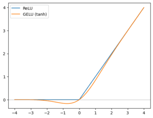

The lowest GELU value is about $-0.17$ near $x = -0.75$, and the largest gap between the two GELU curves anywhere from $-4$ to $4$ is $0.000473$.

Now let's confirm, at full size, that two linear layers really do collapse into one. We build `fc1` and `fc2`, combine them by hand into a single matrix, and bias, and compare their outputs. Then we put GELU in between them and check the result again.

```python
torch.manual_seed(0)
config = VisionConfig()
fc1 = nn.Linear(config.hidden_size, config.intermediate_size)
fc2 = nn.Linear(config.intermediate_size, config.hidden_size)
x = torch.randn(1, 196, config.hidden_size)                   # [1, 196, 768]

with torch.no_grad():
    two = fc2(fc1(x))                                         # [1, 196, 3072] -> [1, 196, 768]
    W = fc2.weight @ fc1.weight                               # [768, 3072] @ [3072, 768] -> [768, 768]
    b = fc2.weight @ fc1.bias + fc2.bias                      # [768]
    one = x @ W.T + b                                         # [1, 196, 768], a single linear layer
    bent = fc2(F.gelu(fc1(x), approximate="tanh"))            # [1, 196, 768], with the bend in the middle

print("two linear layers == one linear layer:", torch.allclose(two, one, atol=1e-4))
print("with GELU in between, still one layer? ", torch.allclose(bent, one, atol=1e-4))
```

**Output:**

```text
two linear layers == one linear layer: True
with GELU in between, still one layer? False
```

The first line is `True`: the two linear layers and the merged single layer produce the same 196 vectors. The second should reads `False`: once GELU sits in the middle, a single matrix can longer reproduce the result.

So the bend is what gives the MLP its extra expressive power. Without it, the second linear layer would be unable to add any new capability.

### The MLP module

Here is the module itself. Like the modules we built earlier, it gets its dimensions from the config.
`fc1` and `fc2` also match the names used by the pretrained checkpoint.

```python
class VisionMLP(nn.Module):
    def __init__(self, config):
        super().__init__()
        self.config = config
        self.fc1 = nn.Linear(config.hidden_size, config.intermediate_size)
        self.fc2 = nn.Linear(config.intermediate_size, config.hidden_size)

    def forward(self, hidden_states):
        hidden_states = self.fc1(hidden_states)                     # [B, N, 3072]
        hidden_states = F.gelu(hidden_states, approximate="tanh")
        hidden_states = self.fc2(hidden_states)                     # [B, N, 768]
        return hidden_states
```

The shapes show exactly what happens. `fc1` changes $[B, N, 768]$ into $[B, N, 3072]$ ($B$ is the batch size and $N$ is the number of tokens). GELU acts on each number independently, so the shape does not change. `fc2` then brings the last dimension back to 768, giving $[B, N, 768]$. Because a linear layer operates only on the last dimension, every token goes through the MLP independently.

**How many weights does the MLP have?** A linear layer has one weight for every input-output pair, plus one bias for each output:

$$\text{parameters} = d_{\text{in}} \cdot d_{\text{out}} + d_{\text{out}}$$

here, $d_{\text{in}}$ and $d_{\text{out}}$ are the input and output sized. A small layer that maps 2 numbers to 3 numbers has $2 \cdot 3 + 3 = 9$ parameters.

For our MLP:

| Layer | Calculation             | Parameters |
| ----- | ----------------------- | ---------- |
| `fc1` | $768 \cdot 3072 + 3072$ | 2,362,368  |
| `fc2` | $3072 \cdot 768 + 768$  | 2,360,064  |
| MLP   | sum of both             | 4,722,432  |

That is about 3000 times as many parameters as the layer norm from the previous chapter, which has only 1536. In the real model, one MLP holds 9,921,872 parameters, and the 27 MLPs together hold 267,890,544.

Let's run the module and check that each token really goes through it independently. We will change patch 5 while leaving every other patch untouched, and then see which outputs change.

```python
torch.manual_seed(0)
mlp = VisionMLP(config)
x = torch.randn(1, 196, config.hidden_size)                                     # [1, 196, 768]
with torch.no_grad():
    y = mlp(x)                                                                  # [1, 196, 768]
    x2 = x.clone()
    x2[0, 5] += 1.0                                                             # change patch 5 only
    y2 = mlp(x2)                                                                # [1, 196, 768]

print(y.shape)
print("fc1 parameters:", sum(p.numel() for p in mlp.fc1.parameters()))
print("fc2 parameters:", sum(p.numel() for p in mlp.fc2.parameters()))
print("MLP parameters:", sum(p.numel() for p in mlp.parameters()))
changed = (y2 - y).abs().amax(dim=-1)[0]                                        # [196], biggest change per patch
print("patches whose output changed:", (changed > 0).nonzero().flatten().tolist())
```

**Output:**

```text
torch.Size([1, 196, 768])
fc1 parameters: 2362368
fc2 parameters: 2360064
MLP parameters: 4722432
patches whose output changed: [5]
```

The output shape is $[1, 196, 768]$, preserving the Transformer contract. The three parameter counts match the table: 2,362,368, 2,360,064 and 4,722,432. And the last line should list only `[5]`.

We changed patch 5, and none of the other 195 outputs changed. The MLP therefore processes each patch independently, inside the MLP, the ear patch never sees the snout

### Residual connections

Now that we have the pieces of a layer, we can return to the problem we identified at the end of the last chapter.

In 2015, a team at Microsoft Research trained two plain CNNs on the same images, one with 20 layers and another with 56. You would expect the deeper network to perform at least as well, but it did worse. Not only on new images but even on the images it was trained on ([Kaiming et al,.](https://arxiv.org/abs/1512.03385)). This was surprising. The 56 layer network, could in principle, copy the 20 layer network and let its extra 36 layers simply pass their input through unchanged. But the training failed to find that solution. For a stack of layers that each transform its input, learning to do nothing turned out to be surprisingly difficult.

The solution was the **Residual Connection**, also called a skip connection. Instead of replacing its input, a block computes a correction and adds it to the input:

$$\mathbf{y} = \mathbf{x} + f(\mathbf{x})$$

here, $\mathbf{x}$ is what enters the block's input, $f(\mathbf{x})$ is the correction computed by the block (for us, a norm followed by attention or by the MLP), and $\mathbf{y}$ is the output. (The name comes from the fact that the block only learns the difference between its output and its input, that difference is called the residual.)


Suppose $x = 2$ and the block computes a correction of $0.1$, the output is $2.1$. If the correction is 0, the output remains 2. This make doing nothing easy to learn. The block only needs to produce zeros. With residual connections, the same team trained a network of 152 layers and won the ImageNet competition of 2015. Residual connections have since become a standard part of deep networks, including Transformers.

That explains the benefits in the forward direction. But shortcuts are just as important when the gradient travels back.

During training, the gradient passes through every layer, and each layer can scale or distort it. Without shortcuts, those effects multiply. Suppose two layers let through factors $0.1$ and $0.2$ let through $0.1 \cdot 0.2 = 0.02$ of the gradient (only 2%). If 12 layers each have a factor of 0.1 the gradient is multiplied by $0.1^{12}$, about one part in a trillion. The early layers would receive almost no useful gradient.

A residual connection changes this, because the input is added directly to the output, the gradient has a direct path through the layer. In our simple one-number example the factor becomes $1+f$.
For the same two layers: $(1 + 0.1)(1 + 0.2) = 1.32$

Expanding the product gives $1 + 0.1 + 0.2 + 0.02$. Each term represents a different path through the two layers, the $0.1$ goes through the first layer only, the $0.2$  goes through the second layer only, and the $0.02$ goes through both. No matter how small the layers' own factors become, the direct path with weight 1 remains.

Real layers operate on whole vectors, so their factors are matrices rather than single numbers. The idea is the same: the shortcut always gives the gradient a path along which it can pass without being transformed by the sublayer.

Every shortcut doubles the number of possible paths, because the signal can either pass through the sublayer or go around it. Our encoder has 24 shortcuts, two in each of its 12 layers, so there are $2^{24}$ possible paths, or about 16.8 million. One of those paths skips every sublayer entirely. It is the direct path from the input of the stack to its output. A study of residual networks found that during training most of the gradient travels along the shorter paths. This suggests that a deep residual network behave somewhat like many shallower networks working together ([Residual Networks Behave Like Ensembles of Relatively Shallow Networks](https://arxiv.org/abs/1605.06431)).

Our editor analogy gives us the same picture. Without shortcuts, each editor writes a new page from memory, so whatever the first editor wrote has to survive eleven rewrites. With shortcuts, the original page is passed along the entire line, while each editor adds notes in the margin. Feedback from the reader at the end can travel directly back along that original page instead of being passed through eleven separate rewrites.

A shortcut makes "change nothing" the easiest thing for a layer to learn, while also keeping a direct path open for the gradient.

### The encoder layer

Now we have everything to write the layer itself. There is however one problem: the layer needs attention, and we have not built attention yet. For now we will use a stand-in, a class with the same interface that returns zeros. 

Because of the shortcut, a sublayer that returns zeros have no effect: $\mathbf{x} + \mathbf{0} = \mathbf{x}$. The layer can therefore runs normally even though attention in not implemented yet, the MLP does the actual computation and the attention stand-in does nothing.

The stand-in also returns a second value, `None`. The real attention module will return attention weights in that position. We will use those weights later to see which patches attend to which others. When we replace the stand-in with the the real attention, we replace only this class, and the rest of this chapter keeps working.

The attribute names `self_attn`, `layer_norm1`, `mlp` and `layer_norm2` match the names in the pretrained checkpoint.

```python
class VisionAttention(nn.Module):
    # stand-in until the next chapter: returns zeros, so only the shortcut and the MLP act
    def __init__(self, config):
        super().__init__()
        self.config = config

    def forward(self, hidden_states):
        return torch.zeros_like(hidden_states), None   # [B, 196, 768] and no attention weights yet


class VisionEncoderLayer(nn.Module):
    def __init__(self, config):
        super().__init__()
        self.embed_dim = config.hidden_size
        self.self_attn = VisionAttention(config)
        self.layer_norm1 = nn.LayerNorm(self.embed_dim, eps=config.layer_norm_eps)
        self.mlp = VisionMLP(config)
        self.layer_norm2 = nn.LayerNorm(self.embed_dim, eps=config.layer_norm_eps)

    def forward(self, hidden_states):
        residual = hidden_states             # [B, 196, 768], kept for shortcut 1
        hidden_states = self.layer_norm1(hidden_states)
        hidden_states, _ = self.self_attn(hidden_states=hidden_states)
        hidden_states = residual + hidden_states  # shortcut 1, around attention

        residual = hidden_states             # [B, 196, 768], kept for shortcut 2
        hidden_states = self.layer_norm2(hidden_states)
        hidden_states = self.mlp(hidden_states)
        hidden_states = residual + hidden_states # shortcut 2, around the MLP
        return hidden_states                     # [B, 196, 768]
```

Read the `forward` method alongside the two equations from the beginning of the chapter. They describe exactly the same computation. `residual` keeps the original input while the norm and sublayer process a copy of it. The original is then added back to the sublayer's output. Notice that the norm only acts on the value entering the sublayer. The copy carried by the shortcut is never normalized.

Let's check that the layer behaves as expected. Because attention currently returns zero, the first half of the layer leaves its input unchanged. The final output should therefore be the original input plus the MLP's correction.

```python
torch.manual_seed(0)
layer = VisionEncoderLayer(config)
x = torch.randn(1, 196, config.hidden_size)           # [1, 196, 768]
with torch.no_grad():
    y = layer(x)                                      # [1, 196, 768]
    correction = layer.mlp(layer.layer_norm2(x))      # [1, 196, 768], what the MLP adds (attention adds 0 for now)

print(y.shape)
print("output == input + MLP correction:", torch.allclose(y, x + correction, atol=1e-5))
print(f"spread of input {x.std():.4f}, of the correction {correction.std():.4f}")
```

**Output:**

```text
torch.Size([1, 196, 768])
output == input + MLP correction: True
spread of input 0.9984, of the correction 0.1991
```

The shape remains $[1, 196, 768]$, and the second line reads `True`: the output is equal to input plus the MLP's correction. The last line compares the spread of the input, $0.9984$, with the spread of the correction, $0.1991$. The layer keeps the original signal and adds a correction to it.

### Twelve layers with and without shortcuts

Now let's see what the shortcuts do when we stack many layers together. To isolate the effect of the shortcut, we use a simpler block: a norm followed by an MLP, with the shortcut either enabled or disabled. We stack twelve of these blocks and ask two questions.

**Forward: does the input survive?** We compare the input of the with its output, using the cosine similarity from chapter 1. A value close to 1 means the output still points in the same direction as the input. A value close to 0 means the output has lost track of the input.

**Backward: does the gradient survive?** We send a known signal backward through the stack and measure how much of it reaches the input. We call this signal `pull`. The trick is to define the loss as the element-wise product of the output and `pull`, summed over all elements. That makes the gradient at the output exactly equal to `pull`. We can then compare the gradient that arrives at the input with the signal we originally sent.

Both experiments use the same random seed, so the two runs get the same weights, the same input and the same `pull`. Only the shortcut differs.

```python
class Block(nn.Module):
    # a norm and an MLP, with or without a shortcut around them
    def __init__(self, config, shortcut):
        super().__init__()
        self.norm = nn.LayerNorm(config.hidden_size, eps=config.layer_norm_eps)
        self.mlp = VisionMLP(config)
        self.shortcut = shortcut

    def forward(self, x):
        out = self.mlp(self.norm(x))     # [1, 196, 768]
        return x + out if self.shortcut else out


for shortcut in (False, True):
    torch.manual_seed(0)                 # same weighs, input and pull in both runs
    blocks = [Block(config, shortcut) for _ in range(config.num_hidden_layers)]
    x = torch.randn(1, 196, config.hidden_size, requires_grad=True) # [1, 196, 768]
    pull = torch.randn(1, 196, config.hidden_size) # [1, 196, 768], the gradient we send down from the top

    h = x
    for block in blocks:
        h = block(h)                      # [1, 196, 768]
    loss = (h * pull).sum()               # its gradient at the top is exactly pull
    loss.backward()

    kept = F.cosine_similarity(h.flatten(), x.flatten(), dim=0).item() # forward: how much of the input survives
    arrived = F.cosine_similarity(x.grad.flatten(), pull.flatten(), dim=0).item()   # backward: how much of the pull survives
    print(f"shortcut {str(shortcut):5s}: input kept {kept:.3f} | pull arrived {arrived:.3f}")
```

**Output:**

```text
shortcut False: input kept (cosine) 0.002 | gradient first block 3.55e-02, last block 2.61e-02, ratio 1.360
shortcut True : input kept (cosine) 0.824 | gradient first block 3.05e-02, last block 2.53e-02, ratio 1.209
```

Let's look at the two runs.

**Without shortcuts.** `input kept` is (cosine) `0.002`, while the gradient arriving at the first block is `3.55e-02`. After twelve transformations, the output has almost no directional similarity to the original input, and the backward signal reaching the early layers has become relatively weak. The early layers therefore have a harder time receiving a strong learning signal from the loss.

**With shortcuts.** `input kept` is `0.824`, showing that the output remains strongly aligned with the original input. The gradient at the first block is `3.05e-02`, compared with `2.53e-02` at the last block, so the gradient is also preserved much better across the stack. The identity path carries the original signal forward and provides a direct path for the gradient backward.

Why isnt the cosine similarity exactly `1`? Because the MLPs are still doing the real work. Each block adds its own correction in both directions. The shortcut does not prevent the layers from changing the signal; it simply makes those changes additive instead of forcing each layer to replace everything that came before it.

### The residual stream and the final norm

Follow a single token through all twelve layers. It starts as a vector $\mathbf{x}$. The first layer adds two corrections, the second adds two more, and so on. By the end of the stack the original vector has been joined by 24 separate corrections, one from each sublayer.

This main path through the network is called **residual stream**, which we mentioned in the last chapter ([A Mathematical Framework for Transformer Circuits](https://transformer-circuits.pub/2021/framework/index.html)). Every sublayer reads from the stream through its norm, and writes back into it by adding its output. The stream itself is never overwritten.

This also explains the gap we left open in the last chapter: the residual stream itself is never normalized. The norms only normalize the input to the sublayers. The shortcut carry the residual stream around those norms, so the stream itself is free to grow.

We can get an intuition for this with a simple example. When adding two unrelated lists of numbers, their variances roughly add. Suppose the stream starts with variance 1, and every layer adds a correction with variance $0.09$ (corresponding to a spread of 0.3). After twelve layers the variance would be about $1 + 12 \cdot 0.09 = 2.08$, so the spread grows from 1 to about $\sqrt{2.08} \approx 1.44$. 

Real corrections are not independent, so this calculation is only a rough illustration, The important point is that every layer adds something to the stream, so the stream can gradually grow.

That is why the encoder ends with one final norm, `post_layernorm`. It brings the 196 vectors in the residual stream back to a steady scale before they leave the encoder and are passed to the language model.

Many decoder-only LLMs use the same pre-norm arrangements, often followed by a final layer norm before the output projection produces next-token scores. The normalization scheme varies by model just as it does across vision transformers.

The last chapter mentioned that original Transformer used post norm, which normalizes the stream after every residual addition. We can now see the downside: the direct path through the stack would have to pass through a norm at every layer, so it would no longer be direct. Post norm stacks can still be trained, but they need more care at the beginning of the training, with a learning rate that starts very small and grows step by step, while pre norm stacks can train without it ([Xiong et al., 2020](https://arxiv.org/abs/2002.04745)). The trade-off is that pre-norm architectures need one additional norm at the end of the stack.


### The full vision model

The encoder is a simply a sequence of layers, and the output of one layer becomes the input to the next.

$$\mathbf{x}^{(\ell + 1)} = \text{Layer}_\ell\big(\mathbf{x}^{(\ell)}\big)$$

here, $\ell$ counts the layers from 0 to 11. So the output of the embeddings, $\mathbf{x}^{(0)}$, enters layer 0 and comes out as $\mathbf{x}^{(1)}$, which goes into layer 1, and so on, until $\mathbf{x}^{(12)}$ goes into `post_layernorm`.

Three small classes complete the vision encoder, which we keep in `vision_encoder.py`:

- `VisionEncoder` is the stack of layers.
- `VisionTransformer` puts the embeddings before the stack and the final norm after it.
- `VisionModel` wraps everything together again. This extra wrapper is needed because every vision parameter in the checkpoint starts with `vision_model.`, so our model needs an attribute with the same name.

The layers live in an `nn.ModuleList`, a python list that PyTorch knows how to track. Modules inside it are registered as part of the model, so their parameters are counted, moved to the GPU and loaded from the checkpoint. A regular Python list would not provide this behavior.

```python
class VisionEncoder(nn.Module):
    def __init__(self, config):
        super().__init__()
        self.config = config
        self.layers = nn.ModuleList(
            [VisionEncoderLayer(config) for _ in range(config.num_hidden_layers)]
        )

    def forward(self, inputs_embeds):
        hidden_states = inputs_embeds                             # [B, 196, 768]
        for encoder_layer in self.layers:
            hidden_states = encoder_layer(hidden_states)          # [B, 196, 768]
        return hidden_states


class VisionTransformer(nn.Module):
    def __init__(self, config):
        super().__init__()
        self.config = config
        self.embeddings = VisionEmbeddings(config)
        self.encoder = VisionEncoder(config)
        self.post_layernorm = nn.LayerNorm(config.hidden_size, eps=config.layer_norm_eps)

    def forward(self, pixel_values):
        hidden_states = self.embeddings(pixel_values)             # [B, 3, 224, 224] -> [B, 196, 768]
        last_hidden_state = self.encoder(inputs_embeds=hidden_states) # [B, 196, 768]
        return self.post_layernorm(last_hidden_state)             # [B, 196, 768]


class VisionModel(nn.Module):
    def __init__(self, config):
        super().__init__()
        self.config = config
        self.vision_model = VisionTransformer(config) # this name matches the checkpoint

    def forward(self, pixel_values):
        return self.vision_model(pixel_values=pixel_values)      # [B, 196, 768]
```

Before running it, let's count its parameters by hand. Every number below comes from pieces we have already counted.

| Part              | Calculation                                        | Parameters     |
| ----------------- | -------------------------------------------------- | -------------- |
| Convolution       | $768 \cdot 768$ weights + 768 biases               | 590,592        |
| Position table    | $196 \cdot 768$                                    | 150,528        |
| **Embeddings**    | $590{,}592 + 150{,}528$                            | **741,120**    |
| **One layer**     | two norms $2 \cdot 1536$ + one MLP $4{,}722{,}432$ | **4,725,504**  |
| **Twelve layers** | $12 \cdot 4{,}725{,}504$                           | **56,706,048** |
| **Final norm**    | $2 \cdot 768$                                      | **1536**       |
| **Total**         | $741{,}120 + 56{,}706{,}048 + 1536$                | **57,448,704** |

Each convolution kernel covers $3 \times 16 \times 16 = 768$ input values, which is why the convolution has $768 \cdot 768$ weights. The stand-in attention still has no parameters.

Structurally, this encoder resembles the repeating blocks of a standard LLM as both combine attention, MLP, norm and skip connections. The main difference are the input tokens, attention masking and what the model does with its final representations. Our Vision Encoder produces a vector for each image patch, capturing visual information from the across the image, which the language model can use to understand the image. A standard LLM (decoder-only) uses its final token representations to produce scores for the possible next tokens.

```python
torch.manual_seed(0)
model = VisionModel(config)
with torch.no_grad():
    out = model(torch.randn(1, 3, 224, 224))   # [1, 3, 224, 224] -> [1, 196, 768]
print(out.shape)

count = lambda m: sum(p.numel() for p in m.parameters())
vm = model.vision_model
print("embeddings     ", count(vm.embeddings))
print("one layer      ", count(vm.encoder.layers[0]))
print("all 12 layers  ", count(vm.encoder))
print("post_layernorm ", count(vm.post_layernorm))
print("total          ", count(model))
```

**Output:**

```text
torch.Size([1, 196, 768])
embeddings      741120
one layer       4725504
all 12 layers   56706048
post_layernorm  1536
total           57448704
```

A $[1, 3, 224, 224]$ image goes in and produces an output of the shape $[1, 196, 768]$. The five parameter counts matches our calculations from the table.


Most of the parameters are in the **MLPs**. The twelve MLPs hold $12 \cdot 4{,}722{,}432 = 56{,}669{,}184$ out of the total **57,448,704**, about **$99$%** . That will change in the next chapter, when attention adds four more linear layers to every layer, but even then the MLP will hold about two thirds of each layer's parameters.

### Our names against the real checkpoint

Before we load the trained weights, there is one more thing to verify: every parameter name in our model must match the corresponding name in the checkpoint.

The first list comes from the checkpoint. A `.safetensors` file contains a small header describing every tensor inside it, including its name and shape. `get_safetensors_metadata` can read that header without loading the tensor values.

The checkpoint contains more than just the vision encoder. It also contains a text encoder and a small pooling head at the end of the vision model that we do not need here. We therefore keep only the vision tensors and exclude the pooling head.

The second list comes from our own model, built using the real model's dimensions. We build it on PyTorch's `meta` device, which creates tensors with shapes but without allocating storage for their values. This lets us inspect a model of this size without using significant memory.

```python
import re
from huggingface_hub import get_safetensors_metadata

meta = get_safetensors_metadata("google/siglip-so400m-patch14-224")
ckpt = {name: tuple(info.shape)
        for f in meta.files_metadata.values()
        for name, info in f.tensors.items()
        if name.startswith("vision_model.") and not name.startswith("vision_model.head.")}   # the pooling head we skip

real = VisionConfig(hidden_size=1152, intermediate_size=4304, num_hidden_layers=27,
                    num_attention_heads=16, patch_size=14)
with torch.device("meta"):
    ours = VisionModel(real)                                      # shapes only, no numbers
mine = {k: tuple(v.shape) for k, v in ours.state_dict().items()}

missing = sorted(set(ckpt) - set(mine))
extra = sorted(set(mine) - set(ckpt))
wrong = sorted(k for k in set(ckpt) & set(mine) if ckpt[k] != mine[k])
pattern = lambda keys: sorted({re.sub(r"layers\.\d+\.", "layers.N.", k) for k in keys})   # one line per kind of tensor

print("checkpoint vision tensors:", len(ckpt), "| ours:", len(mine))
print("missing in ours:", len(missing), pattern(missing))
print("extra in ours:  ", extra)
print("wrong shape:    ", wrong)
```

**Output:**

```text
checkpoint vision tensors: 437 | ours: 221
missing in ours: 216 ['vision_model.encoder.layers.N.self_attn.k_proj.bias', 'vision_model.encoder.layers.N.self_attn.k_proj.weight', 'vision_model.encoder.layers.N.self_attn.out_proj.bias', 'vision_model.encoder.layers.N.self_attn.out_proj.weight', 'vision_model.encoder.layers.N.self_attn.q_proj.bias', 'vision_model.encoder.layers.N.self_attn.q_proj.weight', 'vision_model.encoder.layers.N.self_attn.v_proj.bias', 'vision_model.encoder.layers.N.self_attn.v_proj.weight']
extra in ours: []
wrong shape: []
```

Each norm and each linear layer has two tensors: a weight and a bias. A checkpoint layer has 2 norms, 4 attention layers and 2 MLP layers, so $2 \cdot 8 = 16$ tensors, and 27 layers have $27 \cdot 16 = 432$. Add 3 for the embeddings and 2 for `post_layernorm`, and the checkpoint has 437 vision tensors.

Our current layers do not have attention yet, so each one has 8 tensors instead of 16. That gives $27 \cdot 8 = 216$, plus the same 5 tensors outside the layers, for a total of 221.

The 216 missing tensors are the attention weights: a `weight` and a `bias` for each of `self_attn.k_proj`, `q_proj`, `v_proj` and `out_proj`, in all 27 layer. That is exactly what the next chapter adds. The `extra` and `wrong shape` lists are both empty, which meansevery parameter name currently implemented in our model exists in the checkpoint with the expected shape. (The `position_ids` buffer does not appear in either list because it was created with `persistent=False`, so it is not saved as a model parameter, just as we discussed in chapter 2.

Notice that we never typed the real model's dimensions directly into the classes. The values such as `fc1` with shape $[4304,1152]$, the position table with shape $[256,1152]$, and the convolution with shape $[1152,3,14,14]$ all come from the config. The same classes build both our small model and the real model; only the config changes.

### A real photo through a trained encoder

Our implementation still uses random weights, so it cannot tell us much about what a trained encoder does to a real image. The ViT we loaded in the previous two chapters can.

Its layers follow the same structure as ours: a norm, attention, a shortcut, another norm, the MLP, and another shortcut. Some of the parameter names are different, though. Hugging Face calls the two MLP linear layers `intermediate.dense` and `output.dense`, and it calls the second norm `layernorm_after`.

The block below performs two checks.

First, it copies the trained MLP from the ViT's first layer into our `VisionMLP` and compares their outputs. This ViT was trained with the exact GELU, while our class uses the tanh approximation, so we should expect a very small difference rather than exactly zero.

Second, it runs the dog image through all 12 trained layers and records the residual stream after each one. As before, we drop the CLS token. For every layer, we measure two things: the spread of the residual stream and the cosine similarity between the stream before and after the layer. The latter tells us how much of the layer's input remains in its output.

```python
layer0 = next(m for n, m in vit.named_modules() if re.search(r"(^|\.)layers?\.0$", n))   # layer 0, any version
inner = list(layer0.named_modules())

fc1_name, fc1_real = next((n, m) for n, m in inner if isinstance(m, nn.Linear)
                          and (m.in_features, m.out_features) == (768, 3072))           # expand
fc2_name, fc2_real = next((n, m) for n, m in inner if isinstance(m, nn.Linear)
                          and (m.in_features, m.out_features) == (3072, 768))           # compress
lns = [(n, m) for n, m in inner if isinstance(m, nn.LayerNorm)]
ln2_name, ln2_real = next(((n, m) for n, m in lns if "after" in n), lns[-1])            # the norm before the MLP

print("fc1:", fc1_name, "| fc2:", fc2_name, "| norm:", ln2_name, "| all norms:", [n for n, _ in lns])

mlp_real = VisionMLP(VisionConfig()).eval() # your class, trained weights copied in
with torch.no_grad():
    mlp_real.fc1.weight.copy_(fc1_real.weight); mlp_real.fc1.bias.copy_(fc1_real.bias)
    mlp_real.fc2.weight.copy_(fc2_real.weight); mlp_real.fc2.bias.copy_(fc2_real.bias)

    out = vit(pix, output_hidden_states=True)
    streams = [h[0, 1:] for h in out.hidden_states] # 13 x [196, 768], before layer 0, then after each layer, CLS dropped

    x_in = ln2_real(streams[0])              # [196, 768], a real normalized input
    ours = mlp_real(x_in)                    # [196, 768], tanh GELU
    ref = fc2_real(F.gelu(fc1_real(x_in)))   # [196, 768], exact GELU, as this ViT was trained
print(f"our MLP vs the trained ViT's MLP, largest difference: {(ours - ref).abs().max():.6f}")
print(f"typical size of the MLP output:                     {ref.abs().mean():.4f}")

spread = [s.std(dim=-1, unbiased=False).mean().item() for s in streams]          # 13 values
kept = [F.cosine_similarity(streams[i], streams[i + 1], dim=-1).mean().item()    # 12 values
        for i in range(len(streams) - 1)]
final = out.last_hidden_state[0, 1:].std(dim=-1, unbiased=False).mean().item()   # after the final norm

print(f"{'':10s} spread of stream   cosine with previous")
print(f"{'input':10s} {spread[0]:16.3f}")
for i in range(len(kept)):
    print(f"{'layer ' + str(i):10s} {spread[i + 1]:16.3f} {kept[i]:20.3f}")
print(f"{'final norm':10s} {final:16.3f}")

fig, ax = plt.subplots(1, 2, figsize=(11, 3.5))
ax[0].plot(range(13), spread, marker="o"); ax[0].axhline(final, ls="--", c="grey", label="after final norm")
ax[0].set_xlabel("layers done"); ax[0].set_title("spread of the main stream"); ax[0].legend()
ax[1].plot(range(1, 13), kept, marker="o"); ax[1].set_ylim(0, 1)
ax[1].set_xlabel("layer"); ax[1].set_title("how much of its input a layer keeps (cosine)")
plt.tight_layout(); plt.show()
```

**Output:**

```text
fc1=mlp.fc1 | fc2=mlp.fc2 | norm=layernorm_after
all norms=['layernorm_before', 'layernorm_after']

MLP difference: 0.010559
Typical MLP output size: 0.8526

             spread    cosine_prev
input        0.768          —
layer 0      1.114       0.638
layer 1      1.242       0.787
layer 2      1.464       0.799
layer 3      1.668       0.863
layer 4      2.187       0.855
layer 5      3.905       0.875
layer 6      5.298       0.900
layer 7      5.701       0.899
layer 8      6.246       0.849
layer 9      6.973       0.873
layer 10     8.431       0.818
layer 11    10.653       0.761
final norm   0.902
```


The largest difference between VisionMLP and the trained ViT's MLP is **0.010559**, while a typical output value has a magnitude of about **0.8526**. The small difference comes from using the tanh approximation instead of the exact GELU. Apart from that approximation, our MLP is reproducing the trained module correctly.

The residual stream starts with a spread of **0.768** and reaches **10.653** after the last layer. **The spread grows steadily layer by layer, increasing by roughly 14× overall, although the amount of growth varies from layer to layer.** This is what we would expect from a residual stream that keeps accumulating corrections. Nothing inside the stack forces the stream itself back to a fixed scale. The final norm changes that: the last line, **0.902**, shows the stream after post_layernorm has brought it back to a steady scale.

The cosine values range from **0.638** to **0.900**. Every layer therefore keeps a substantial part of the vector it receives. The trained ViT is not throwing away the representation at every layer and starting over. It keeps the existing stream and adds new information to it.

Unlike our stand-in, of course, these layers contain real attention. Some of those added corrections therefore come from other patches.

### Where the new pieces sit

Here is the encoder again, with everything we have built so far, shortcuts included.

```text
  image              [B, 3, 224, 224]
  embeddings         [B, 196, 768]
  layer 0            h = x + self_attn(layer_norm1(x))
                     y = h + mlp(layer_norm2(h))          [B, 196, 768]
  layer 1            same                                 [B, 196, 768]
  ...
  layer 11           same                                 [B, 196, 768]
  post_layernorm     [B, 196, 768]
```

Everything shown here is implemented except: `self_attn` is still the stand-in that returns zeros.


Our encoder now has its complete skeleton: twelve layers, each with two norms and two shortcuts, an MLP that processes each patch independently, and a final norm on the residual stream.

The editors are in place, and the page can now travel safely from the first editor to the last. But there is still something missing: the editors cannot share information yet. Look at what each patch can see. The norm reads one token at a time. The MLP also reads one token. The ear patch goes through all twelve layers and still knows nothing about the snout, because the only part that lets patches talk currently returns zeros. That is what we will fix in the next chapter. We will replace the stand-in with **real attention**, the part of the layer where every patch finally looks at every other patch.

_Complete Chapter 4 Code: [Colab Notebook](https://colab.research.google.com/drive/1RHEBLwaABQ-_HwI3vak5--NNSmvjt6J2?usp=sharing)_

---

# Chapter 5. Making the Patches Talk

At the end of the last chapter our encoder had its complete skeleton: 12 layers, each with two norms, two shortcuts and an MLP, followed by a final norm on the residual stream. But the `self_attn` module was still a placeholder. It could only return zeros, so every patch passed through all twelve layers without knowing anything about the others. Everything we have built so far processes one patch at a time. The patch **embedding**, the **position** vector, the **norm** and the **MLP** never look past their own patch. In this chapter we build the part that lets the patches communicate and share information with each other through something called **"Attention"**.

### Attention Is All You Need

The idea of **attention** first became important in machine translation. In 2014, translation models often compressed an input sentence into a single fixed-length vector. This made it harder to preserve information from long sentences.

[Bahdanau, Cho and Bengio](https://arxiv.org/abs/1409.0473) addressed this problem by allowing the model to look back at every source word while generating each output word.

In 2017, the seminal paper ["Attention Is All You Need"](https://arxiv.org/abs/1706.03762) introduced the the **Transformer**.
Instead of processing words one at a time, the Transformer used attention to process all tokens in parallel.

The Transformer later became the foundation for models such as **BERT**, **GPT** models, Vision Transformers, CLIP, and the vision language model we are building.


Attention is a way to lookup information.

A Python dictionary takes a key and returns the value stored under that exact key.
Attention works differently: it compares a **query** with every available **key**, coverts the scores into weights that add up to 1, and uses those weights to combine the corresponding **values**. Better matches receive larger weights and contribute more to the result.

Consider the word "*bank*" in these two sentences: *"we fished from the river bank"*, and "*we saved money at the bank*". In the first sentence the word "*bank*" can draw information from words such as "*river*" and "*fished*". In the second, it can draw information from "*money*" and "*saved*".

The word is the same, but the information it gathers changes with the sentence. This is how "*bank*" gets a different representation depending on its context.

Patches work the same way, Before attention the ear patch only knows what is inside its own small square of the photo: brown fur and an edge. On its own, that patch cannot tell what the fur belongs to. 

Through attention the ear patch gathers information from the other patches, the ear patch looks across the whole image, decides which patches are useful, and copies part of their information into its own vector. If the snout and the eyes turn out to be useful, their information is added to the ear's vector, which now describes more than "brown fur with an edge" and now also carries information like "next to a snout and an eye, near the top of a head". Every patch does this at the same time, so the snout is gathering from the ear too.

This gets repeated in every layer, starting from the richer vectors the previous layer produced so a patch can ask more specific questions as it goes deeper. We never tell the patches where to look, training decides what each patch looks for, what it offers to others and what it passes on.


> **Main Idea: Each patch compares its query with the keys of all patches, turns the resulting scores into weights that add up to one, and uses those weights to combine their values.**

#### Coming back to our example

Think of the 196 patches as 196 people in one room. Each person has a question card, a name tag showing what they know, and a notebook containing information they can share.

To answer a question, a person reads everyone's name tags and decides whose information is most useful. They then combine notes from the people whose tags best matches their questions.

#### Encoder, now with real attention 


The hatched stand-in attention from previous chapter now becomes the real `self_attn`. 
Inside it we have four linear layers: `q_proj`, `k_proj`, `v_proj` and `out_proj`, where this module splits its work across 12 attention heads.

Everything else in the model stays the same. Each new weight has a name that follows its path through the model tree. For example, the query projection weight is named `vision_model.encoder.layers.0.self_attn.q_proj.weight`.

These four linear layers give each encoder layer all 16 tensors expected by the checkpoint, instead of the 8 we had at the end of the last chapter. By the end of this chapter, we will have built all four layers and checked their names and shapes against our checkpoint. 

### What attention has to do

Let's look at the problem from the ear patch's point of view.

The ear patch contains 768 numbers describing its local image features, such as fur and edges, along with information about its position. But those numbers alone may not tell us that the patch belongs to a dog's ear. To understand that, the patch needs information from other parts of the image. It may need to look at nearby patches or patches much farther away.

*Which patches should it use?*

That depends on the image. In one photo, the snout might be two patches to the right. In another, it might be near the edge. A third photo might not contain a dog at all. We cannot decide in advance which patches matter. Each patch must use the current image to decide where to look and how much information to take from each patch.

Attention does this in three steps. It scores every patch on how useful that patch is to the patch asking question. It converts the scores into weights that add up to 1. And it combines the information from all patches using those weights.

### Query, key and value

Each patch uses three vectors to take part in attention, and each vector has a different role.

- The **query** represent what the patch is looking for. It is the question card: it says what this patch wants to find out, and only the patch that is asking uses it.
- The **key** represents what a patch offers for matching. It is the name tag: a short label that others read to decide whether this patch is worth listening to. Nobody copies anything from a name tag, it only helps them choose.
- The **value** contains the information a patch passes on. It is the notebook: the actual content handed over once someone has decided to listen.

#### How the three work together

Picture the ear patch holding its question card: "where is the rest of my head?", It holds the card up against every name tag in the room, including itself. A tag that answers the question well, like the snout's "middle of a face here", gets a high score. A tag like the sky's "plain blue" gets a low score. The ear then copies from every notebook, mostly from the patches that scored high and some from the rest. What's taken is a mix of notebooks, not the nametags.

The tag and the notebook are kept apart, and on purpose. What makes a patch easy to find is not the details about it. The snout's tag only needs to say "I am the middle of a face", while its notebook contains all the details, like its shape, color, shadows, and other information.
Every patch runs all the three parts at once, the ear asks with its own card while every other patch reads its tag, and copies from its notebook. In the read model, the cards, tags and notebooks are lists of $768$ numbers, which the training computes.

These vectors are created using three separate linear layers: `q_proj`, `k_proj` and `v_proj`.

Each of these layers takes $768$ numbers as inputs and produces $768$ numbers as outputs. And all three layers receive the same input: the patch vector after `layer_norm1`.

The equations of these layers are as follows:

$$\mathbf{q}_i = W^{Q}\mathbf{x}_i + \mathbf{b}_Q \qquad \mathbf{k}_i = W^{K}\mathbf{x}_i + \mathbf{b}_K \qquad \mathbf{v}_i = W^{V}\mathbf{x}_i + \mathbf{b}_V$$

Here, $\mathbf{x}_i$ is the vector for patch $i$ after `layer_norm1`.
The vectors $\mathbf{q}_i$, $\mathbf{k}_i$ and $\mathbf{v}_i$ are its **query**, **key** **and** **value**.

Each weight matrix $W$ has shape $[768, 768]$ and each bias vector $\mathbf{b}$ holds $768$ numbers, these are the same kinds of weights and biases we used in the **MLP**. 

The original Transformer paper writes the three weight matrices as $W^Q$, $W^K$ and $W^V$.

#### Lets work through a small example

Suppose a patch has the input vector $\mathbf{x} = [1, 2]$.

We use a query weight matrix that keeps the first number and drops the second.

$$W_Q = \begin{pmatrix} 1 & 0 \\ 0 & 0 \end{pmatrix}$$

Assume the bias is $0$. The query becomes:

$$\mathbf{q} = [1 \cdot 1 + 0 \cdot 2, 0 \cdot 1 + 0 \cdot 2] = [1, 0]$$
we will use this query in the next section.


*Why do we need three separate vectors instead of using the original patch vector $\mathbf{x}$ for everything?*

Suppose we scored two patches using only their original vectors:
$$\mathbf{x}_i \cdot \mathbf{x}_j$$


The score between the ear and the snout would then be the same as the score between the snout and the ear. A patch would tend to match patches that look similar to itself. But the ear does not necessarily need information from another ear. It might need information from the snout, the eyes, or the outline of the head. Separate queries and keys allow a patch to look for something different from what it represents. The separate value vector also lets a patch share information that differs from the features used to match it.

### Attention for one query, by hand

**Lets calculate attention for one query.**

First, we calculate the dot product between the query and every key. We then divide each score by the square root of the vector length. We will explain why this scaling is important ahead in this chapter.

Next, softmax coverts the scores into weights, we then multiply each value by its weights and add the results together.

The equations are:

$$a_j = \text{softmax}_j\left(\frac{\mathbf{q} \cdot \mathbf{k}_j}{\sqrt{d_h}}\right) \qquad \mathbf{o} = \sum_{j} a_j,\mathbf{v}_j$$

here $\mathbf{q}$ is the query, $\mathbf{k}_j$ and $\mathbf{v}_j$ are the key and value of patch $j$, $d_h$ is the length of the query and the key vectors, $a_j$ is the **attention weight** assigned to patch $j$, and $\mathbf{o}$ is the output.

Softmax runs over all the patches $j$, it makes every weights positive and ensures that all those weights add up to 1.

We will now use our query $\mathbf{q} = [1, 0]$, so $d_h = 2$, and consider three patches:

$$\mathbf{k}_0 = [1, 0] \quad \mathbf{k}_1 = [0, 1] \quad \mathbf{k}_2 = [1, 1] \qquad \mathbf{v}_0 = [1, 0] \quad \mathbf{v}_1 = [0, 1] \quad \mathbf{v}_2 = [2, 2]$$

The dot products are $1$, $0$ and $1$.

Dividing by $\sqrt{2} \approx 1.4142$ gives the scores

$$[0.7071, 0, 0.7071]$$

Next we apply softmax, and we need the exponential of each scores

$e^{0.7071} \approx 2.0281$ and $e^{0} = 1$

 The sum of the exponentials is: $2.0281 + 1 + 2.0281 = 5.0562$

Dividing each exponential by this sum gives the attention weights:

$$\left[\frac{2.0281}{5.0562}, \frac{1}{5.0562}, \frac{2.0281}{5.0562}\right] \approx [0.401, 0.198, 0.401]$$

The weights add up to 1. Now we use these weights to combine the values:

$$\mathbf{o} = 0.401 \cdot [1, 0] + 0.198 \cdot [0, 1] + 0.401 \cdot [2, 2] \approx [1.203, 1.000]$$

Keys 0 and 2 receive larger weights because their dot products with the query are larger. Key 1 receives the smallest weight because its dot product is 0. Notice that key 1 still gets some weights. Softmax does not produce an exact zero for any of these finite scores. Also, the output is not equal to any one of the three values, it is a new vector formed by combining all three, with more influence from the values that received larger weights.


PyTorch also gives us the same result.

```python
import torch
import torch.nn as nn
import torch.nn.functional as F
import matplotlib.pyplot as plt

q = torch.tensor([1., 0.])             # [2], one query
K = torch.tensor([[1., 0.],
                  [0., 1.],
                  [1., 1.]])           # [3, 2], three keys
V = torch.tensor([[1., 0.],
                  [0., 1.],
                  [2., 2.]])           # [3, 2], three values

scores = K @ q / q.shape[0] ** 0.5     # [3], one score per key, divided by sqrt(2)
weights = F.softmax(scores, dim=-1)    # [3], add up to 1
out = weights @ V                      # [2], a blend of the values

print("scores ", scores)
print("weights", weights, "sum", weights.sum().item())
print("output ", out)
```

**Output:**

```text
scores tensor([0.7071, 0.0000, 0.7071])
weights tensor([0.4011, 0.1978, 0.4011])
sum 1.0 output tensor([1.2033, 1.0000])
```

They match the hand calculation: scores of about 0.7071, 0 and 0.7071, weights 0.401, 0.198 and 0.401 with a sum of 1, and an output $[1.203, 1.000]$.

### Every patch at once

So far, we have calculated attention for one query. In our encoder, all 196 patches ask questions at the same time. Each patch compares its query with all 196 keys, including its own key.
We can put all the queries into a matrix $Q$ with one query per row. We do the same for the keys and values, creating matrices $K$ and $V$.

Now we can calculate every query-key dot product in one matrix multiplication: $QK^\top$.
The result is a score table with one row per query and one column per key. It is similar to the image-by-caption score table $S$ from our chapter 1.

We apply softmax along each row, every row then contains the attention weights for one patch. We multiply the weight table by $V$ to combine the values for all patches at once.

The complete equation for attention becomes:

$$\text{Attention}(Q, K, V) = \text{softmax}!\left(\frac{QK^\top}{\sqrt{d_h}}\right)V$$

here $Q$, $K$ and $V$ have shape $[N, d_h]$, where $N$ is the number of patches and $d_h$ is the vector length. The output also has the shape $[N, d_h]$ giving us one output vector per patch.

We can check the shapes using our three-patch example, if all three patches have queries, then $Q$ has shape $[3, 2]$ and $K^\top$ would be $[2, 3]$. The matrix multiplication works like this:

$$[3, \underline{2}] \times [\underline{2}, 3] \rightarrow [3, 3]$$

The two inner dimensions must match, they disappear in the output leaving a $[3,3]$ score table, each entry represents one query-key pair.

We then multiply the score table's attention weights by the value matrix: $$[3, 3] \times [3, 2] \rightarrow [3, 2]$$
The result contains one two-number output vector for each of the three patches.

For our encoder, $N = 196$. The score table contains: $196^2 = 38416$ score per attention head.

This is the reason we divided the image into patches in chapter 2. The number of attention scores grows with the square of the number of patches.

When queries, keys, and values all come from the same sequence, the operation is called **Self-Attention**, which is where the name `self_attn` comes from. Some models also use **Cross-Attention**, where one sequence attends to a separate sequence. For example, a text sequence can attend to an image sequence.

Our encoder uses self-attention, processing the image patches as one sequence where each patch gathers information from every other patch.

### Why divide by the square root of the head size

The reason we divide the dot products by $\sqrt{d_h}$ is that a dot product adds up $d_h$ individual products. As the vector gets longer, the number of terms increases, so the scores tend to grow.

Suppose the numbers in the query and key vectors are random, with mean 0 and variance 1, each product $q_i k_i$ then also has mean 0 and variance 1.

In chapter 4 we saw that the variances of independent terms add together. So the dot product of two such vectors has variance $d_h$, giving it a standard deviation of $\sqrt{d_h}$.

This is the reasoning described in a footnote of the original Transformer paper.

In our config, $d_h = 64$, so the raw products have an expected standard deviation of approx $\sqrt{64} = 8$. Dividing by 8 brings the standard deviation back to 1.

*Why does this matter?*

Softmax applies an exponential to each score. Large differences between scores can make one weight dominate the others.

Consider two scores, 8 and 0. Softmax gives the first score this weight:

$$\frac{e^{8}}{e^{8} + e^{0}} = \frac{2980.96}{2981.96} \approx 0.9997$$

Almost all the attention goes to one key. 

Now take scores 1 and 0. The first score receives: $$\frac{e}{e + 1} \approx 0.731$$

The second score still receives about $0.269$. But now, the attention is less concentrated.

There is another problem with very large scores: the gradients become small.
The derivative of a softmax probability $p$ with respect to its own score is $p(1 - p)$.

When $p = 0.9997$ that value is about $0.0003$.
When $p = 0.731$ it is $0.731 \cdot 0.269 \approx 0.197$.

The second gradient is 600x larger. When softmax assigns almost all the weights to one key, the model can have a harder time learning from changes in the scores.


This is related to the temperature we discussed in chapter 1. There we used a scaling factor to sharpen a softmax distribution that was too flat. Here we divide by $\sqrt{d_h}$ to prevent the distribution from becoming too sharp at the start of training.

The standard deviation of the dot products grows with $\sqrt{d_h}$ not $d_h$. Dividing the full vector length would make the scores too small. Softmax would then assign nearly equal weights to all 196 patches, leaving attention with little ability to distinguish between them.

We can test this with random vectors of our head size.

```python
torch.manual_seed(0)
config = VisionConfig()
d_h = config.hidden_size // config.num_attention_heads        # 64

q = torch.randn(10000, d_h)                                   # [10000, 64]
k = torch.randn(10000, d_h)                                   # [10000, 64]
dots = (q * k).sum(dim=-1)                                    # [10000], one dot product per pair
print(f"spread of raw dot products:    {dots.std():.3f}   (sqrt({d_h}) = {d_h ** 0.5:.1f})")
print(f"spread after dividing by {d_h ** 0.5:.0f}: {(dots / d_h ** 0.5).std():.3f}")

query = torch.randn(d_h)                                      # [64]
keys = torch.randn(196, d_h)                                  # [196, 64]
raw = keys @ query                                            # [196]
print(f"largest softmax weight, raw:    {F.softmax(raw, dim=-1).max():.3f}")
print(f"largest softmax weight, scaled: {F.softmax(raw / d_h ** 0.5, dim=-1).max():.3f}")
```

**Output:**

```text
spread of raw dot products:     8.002 (sqrt(64) = 8.0)
spread after dividing by 8:     1.000
largest softmax weight, raw:    0.937
largest softmax weight, scaled: 0.037
```

We generate 10,000 random query-key pairs. The raw dot products have a standard deviation of 8.002, after dividing by 8 the standard deviation will be close to 1.

We compare one query against 196 keys. Without scaling, the largest attention weight is much more concentrated. With scaling, the largest weight is smaller, and the attention spreads across more keys.

> Scaling keeps the scores at a useful range. It allows softmax to distinguish between patches without becoming too concentrated at the start of training.

For the real model, the head size is $1152/16=72$. It therefore divides the scores by: $\sqrt{72} \approx 8.49$.

### Many heads instead of one

A single attention table gives each patch one way to choose where to look but a patch may need several kinds of information at once. It might need information from nearby patches, patches with similar colors, and patches that form the outline of the dog's head.

**Multi-head attention** addresses this by running several smaller attention operations in parallel. Each operation is called a **head**, and each head has its own attention table.

Back in the room example, each person now carries several question cards instead of one, with a matching name tag and notebook section for each. Every head asks its own question. One head might ask "who is right next to me" and give almost all its weights to the neighbors. Another might ask "where is the outline of the head" and look at patches far across the image. Each head has its own budget of $1$, so each one can focus fully on its own question without taking attention away from others.

The answers are not averaged together but each head returns its own small output. These outputs are placed side by side in the patch's vector. The ear ends up with a report on its neighbor, a report on the outline, and so on, each in its own slot. Later in the chapter `out_proj` combines these reports into one result.
 
Our config has $12$ heads. We split each $768$-number query, key, and value into $12$ groups of $64$ numbers:

$$d_h = \frac{D}{H} = \frac{768}{12} = 64$$

**D** is `hidden_size`, **H** is `num_attention_heads`, and $d_h$ is the **head size**, also called `head_dim`.

For the real model, the calculation is $1152/16=72$

Head $0$ uses numbers $0$ through $63$ of each query, key, and value. Head $1$ uses numbers $64$ through $127$, and so on, until head $11$.

Each head calculates its own $196\times196$ score table, applies its own softmax, and combines its own values. The heads operate independently during this step.

For example, the query projection for head $1$ comes from rows $64$ through $127$ of $W^Q$. This gives that head a projection matrix of shape $[64,768]$. The key and value projections work the same way.

We do not assign specific jobs to individual heads. During training, each head learns whichever attention patterns help the model perform its task. Some heads develop patterns that are easy to interpret, while others are harder to explain.

**Multi-head attention** also does not increase the total number of dot-product multiplications compared with using one head of the same total width.

One head with $768$ numbers per vector would perform:

$$196 \cdot 196 \cdot 768 = 29503488$$

multiplications to calculate its scores.

Twelve heads with $64$ numbers per vector perform:
$$12 \cdot 196 \cdot 196 \cdot 64=29503488$$

### Splitting into heads and gluing them back


Splitting a vector into heads is a change of shape, we are not creating new numbers or throwing any away.

After `q_proj`, the queries have shape $[B,196,768]$, where $B$ is the batch size, $196$ is the number of patches, and 768 is the hidden size. The operation `view(B, 196, 12, 64)` divides the last dimension into 12 groups of 64. The shape becomes $[B,196,12,64]$. Next, `transpose(1, 2)` swaps the patch and head dimensions. The shape becomes $[B,12,196,64]$.

Now each head contains a sequence of 196 vectors, each with 64 numbers. We can run all $12$ heads in parallel. After attention, the output has shape $[B,12,196,64]$. We transpose it back to $[B,196,12,64]$ then combine the last two dimensions to get back to $768$ numbers per patch.

But there is a small problem: after a transpose, the tensor may no longer be stored in memory, it only changes the order in which PyTorch reads them by changing the tensor's **strides**: how many memory position PyTorch skips to reach the next element along each dimension. After a transpose, the tensor is no longer stored in the order it is read, and we say it is not **contiguous**. `view` can only merge dimensions whose numbers sit side by side in memory so it raises an error on such a tensor.

Calling `.contiguous()` copies the numbers into memory in the order the tensor is read. After that, `view` or `reshape` can merge the heads.


Take two tokens, a and b, each with four numbers, split into two heads.

Memory holds `a0 a1 a2 a3 b0 b1 b2 b3`

After transpose, PyTorch reads as: `a0 a1 b0 b1 a2 a3 b2 b3`

but memory has not changed until `.contiguous()` copies it.
 
We call `.contiguous()` after the first transpose too, so the heads are stored in memory in the same layout as a fresh attention output.

```python
torch.manual_seed(0)
B, N, D = 1, 196, config.hidden_size
H = config.num_attention_heads
q = torch.randn(B, N, D)                                      # [1, 196, 768]

qh = q.view(B, N, H, d_h)                                     # [1, 196, 12, 64], 768 read as 12 groups of 64
qh = qh.transpose(1, 2).contiguous()                          # [1, 12, 196, 64], stored head by head, like a fresh attention output
print(qh.shape)
print("head 1 of patch 5 == dims 64 to 127 of patch 5:", torch.equal(qh[0, 1, 5], q[0, 5, 64:128]))

back = qh.transpose(1, 2)                                     # [1, 196, 12, 64]
print("contiguous after transpose?", back.is_contiguous())
try:
    back.view(B, N, D)
except RuntimeError as e:
    print("view fails:", str(e)[:60], "...")
back = back.contiguous().reshape(B, N, D)                     # [1, 196, 768], heads side by side again
print("glued back == original:", torch.equal(back, q))
```

**Output:**

```text
torch.Size([1, 12, 196, 64])
head 1 of patch 5 == dims 64 to 127 of patch 5: True
contiguous after transpose? False
view fails: view size is not compatible with input tensor's size and stride
glued back == original: True
```

The shape is $[1, 12, 196, 64]$, and head 1 of patch 5 holds exactly numbers 64 to 127 of that patch. After the transpose back, the tensor is not contiguous, so `view` fails with an error as we had discussed earlier. After `.contiguous()` the heads glue back into a tensor identical to the original.

### Mixing the heads with out_proj

After we merge the heads, the first 64 numbers of each patch come from head 0, the next 64 come from head 1, and so on.

The numbers sit next to each other, but each head has worked independently. We still need a way to combine the information they found.

That is the job of `out_proj`, another linear layer that maps 768 numbers to 768 numbers. Each output number can use information from all 768 input numbers, allowing the layer to mix information from every head.

The equation is:

$$\mathbf{y}_i = W_O,\text{Concat}\big(\mathbf{o}^{(1)}_i, \dots, \mathbf{o}^{(H)}_i\big) + \mathbf{b}_O$$

Here, $\mathbf{o}^{(h)}_i$ is the output of head $h$ for patch $i$. Each head produces $d_h$ numbers, $\text{Concat}$ joins the outputs of all $H$ heads into one vector of $D$ numbers. The weight matrix $W_O$ has shape $[768, 768]$ and $b_O$ is the bias vector. $\mathbf{y}_i$ is what attention for patch $i$. The original Transformer paper calls this weight matrix $W^O$.

Let's use a small example with two heads, each producing one number.
Suppose head 1 outputs 0.5 and head 2 outputs 2. The merged vector is: $[0.5, 2]$. 

We use the following output projection, with no bias:
$$W_O = \begin{pmatrix} 1 & 1 \\ 1 & -1 \end{pmatrix}$$

the output is: $$[0.5 + 2, 0.5 - 2] = [2.5, -1.5]$$
Both output numbers depend on the outputs of both heads. This is how `out_proj` combines information across heads.

### The Attention module

We now have everything we need to implement `VisionAttention`.

This class replaces the placeholder from the last chapter. It keeps the same interface: it accepts `hidden_states` and returns two things, the attention output and the attention weights.

The four linear layers use the exact names expected by the checkpoint: `q_proj`, `k_proj`, `v_proj`, and `out_proj`. These are the four missing layer names we identified in chapter 4.

Here is the data flow through the module, using our config's shapes.

```text
  hidden_states          [B, 196, 768]
  q_proj, k_proj, v_proj [B, 196, 768] each
  split into heads       [B, 12, 196, 64] each
  q times k transposed   [B, 12, 196, 196]    one table per head
  softmax over keys      [B, 12, 196, 196]    every row adds up to 1
  times v                [B, 12, 196, 64]
  heads glued back       [B, 196, 768]
  out_proj               [B, 196, 768]
```

The module takes $N$ vectors of 768 numbers and returns $N$ vectors of 768 numbers. This keeps the same input-output shape as the other parts of our Transformer layer.


```python
class VisionAttention(nn.Module):
    def __init__(self, config):
        super().__init__()
        self.config = config
        self.embed_dim = config.hidden_size
        self.num_heads = config.num_attention_heads
        self.head_dim = self.embed_dim // self.num_heads
        self.scale = self.head_dim ** -0.5
        self.dropout = config.attention_dropout

        self.k_proj = nn.Linear(self.embed_dim, self.embed_dim)
        self.v_proj = nn.Linear(self.embed_dim, self.embed_dim)
        self.q_proj = nn.Linear(self.embed_dim, self.embed_dim)
        self.out_proj = nn.Linear(self.embed_dim, self.embed_dim)

    def forward(self, hidden_states):
        B, N, _ = hidden_states.size()  # [B, N, D]
        q = self.q_proj(hidden_states)
        k = self.k_proj(hidden_states)
        v = self.v_proj(hidden_states)

        q = q.view(B, N, self.num_heads,
        self.head_dim).transpose(1, 2)  # [B, H, N, d_h]
        
        k = k.view(B, N, self.num_heads,
        self.head_dim).transpose(1, 2)  # [B, H, N, d_h]
        
        v = v.view(B, N, self.num_heads,
        self.head_dim).transpose(1, 2)  # [B, H, N, d_h]

        attn = torch.matmul(q, k.transpose(2, 3)) * self.scale  # [B, H, N, N]
        attn = F.softmax(attn, dim=-1, dtype=torch.float32).to(q.dtype)
        attn = F.dropout(attn, p=self.dropout, training=self.training)

        out = torch.matmul(attn, v)                             # [B, H, N, d_h]
        out = out.transpose(1, 2).contiguous()                  # [B, N, H, d_h]
        out = out.reshape(B, N, self.embed_dim)                 # [B, N, D]
        out = self.out_proj(out)
        return out, attn


torch.manual_seed(0)
attn_layer = VisionAttention(config)
x = torch.randn(1, 196, config.hidden_size)                     # [1, 196, 768]
with torch.no_grad():
    out, weights = attn_layer(x)
print(out.shape, weights.shape)
print("every row adds up to 1:", torch.allclose(weights.sum(dim=-1), torch.ones(1, 12, 196)))
print("attention parameters:", sum(p.numel() for p in attn_layer.parameters()))
```

In the code:

`self.scale = self.head_dim ** -0.5` calculates the scaling factor. With a head size of 64, the result is:
$$64^{-0.5} = \frac{1}{8} = 0.125$$Multiplying by 0.125 is the same as dividing by $\sqrt{64} = 8$.

`k.transpose(2, 3)` swaps the last two dimensions of the key tensor. Its shape changes from $[B, H, N, d_h] \rightarrow [B, H, d_h, N]$.

`torch.matmul` multiplies the last two dimensions while keeping the batch and head dimensions. For each image and each head, it calculates: $$[N, d_h] \times [d_h, N] \rightarrow [N, N]$$This gives us one attention score table per head.

The softmax runs along `dim=-1`, which represents the keys. Every row therefore adds up to 1.

We also calculate softmax in 32-bit floating-point precision, then convert the result back to the query's data type using `.to(q.dtype)`. This helps maintain numerical stability when the model uses lower-precision data types.

As we discussed in chapter 1, a 16-bit float has a maximum finite value of $65504$. PyTorch's softmax already subtracts the maximum score from each row before exponentiating. Computing the softmax in 32-bit precision gives the calculation more room and helps avoid numerical problems.

**Dropout** randomly sets some attention weights to zero during training. This helps prevent the model from relying too heavily on particular attention connections.

Our config uses `attention_dropout = 0.0`, as does the real model, so dropout has no effect here. The argument `training=self.training` also ensures that dropout is disabled when the module is in evaluation mode.

Finally, the module returns `attn` along with the output. In the previous chapter, our placeholder returned `None` in that position. Now we have the real attention weights, which we can use to inspect where patches look.

**Output:**

```text
torch.Size([1, 196, 768])
torch.Size([1, 12, 196, 196]) every row adds up to 1: True
attention parameters: 2362368
```

The output shape $[1,196,768]$, and the attention weights shape $[1,12,196,196]$.

The weight tensor contains one $196×196$ attention table for each of the $12$ heads.

The second line prints `True`, confirming that every row in every attention table adds up to $1$.

The final line shows the total number of parameters to be $2,362,368$. We can calculate that number by hand.

| Layer      | Calculation           | Parameters |
| ---------- | --------------------- | ---------- |
| `q_proj`   | $768 \cdot 768 + 768$ | 590,592    |
| `k_proj`   | $768 \cdot 768 + 768$ | 590,592    |
| `v_proj`   | $768 \cdot 768 + 768$ | 590,592    |
| `out_proj` | $768 \cdot 768 + 768$ | 590,592    |
| Attention  | $4 \cdot 590592$      | 2,362,368  |

There is a useful comparison here. The entire attention module has exactly as many parameters as the `fc1` layer from the last chapter.

Four $768\times768$ weight matrices contain the same number of weights as one $768\times3072$ matrix. Their biases also have the same total size because $4\cdot768=3072$.

### Attention cannot see order

In chapter 2, we said that attention treats its input as a bag of tokens. If we shuffle the patches, attention produces the same output for each patch, but the outputs appear in the new order.

Now we can see why. The three input projections and `out_proj` process each token independently. Shuffling the input rows simply shuffles their outputs. The attention score table changes too: its rows and columns are shuffled to match the new token order. Softmax still operates on each row, and the weighted sum still combines the same values. Since addition does not depend on order, each patch gets the same result as before. Its output simply moves to the patch's new position in the sequence.

We can check this with our small example. Swap key 0 with key 1, and swap their corresponding values too.

The scores become: $$[0, 0.7071, 0.7071]$$the weights become: $$[0.198, 0.401, 0.401]$$The output is still approximately: $$[1.203, 1.000]$$The order of the inputs changed, but the result did not.


Let's test the same property with our full attention module.

```python
torch.manual_seed(0)
perm = torch.randperm(196)  # a random shuffle of the 196 patches
with torch.no_grad():
    out, _ = attn_layer(x)  # [1, 196, 768]
    out_shuffled, _ = attn_layer(x[:, perm]) # [1, 196, 768], same patches, shuffled order
print("shuffle in, same results shuffled out:", torch.allclose(out_shuffled, out[:, perm], atol=1e-5))
```

**Output:**

```text
shuffle in, same results shuffled out: True
```

The output prints `True`.

Attention can use the features in each patch, but attention alone cannot tell *where a patch came from*. The position vectors we added in chapter 2 provide that information.

Without position embeddings, the encoder would not know whether the snout was to the right of the eye or above it. **Position embeddings give the model the information it needs to learn spatial relationships between patches**.

### No mask inside the encoder

Our attention module lets every patch read every other patch. It does not block any patch based on its position in the sequence.

When a model learns to predict the next token, it must not see tokens that come later in the sequence. Otherwise, it could use information that should not yet be available. Language models solve this with an **attention mask**. Thee mask blocks attention to future tokens by changing their scores before softmax.

An image encoder does not have the same requirement, the patches are parts of an image, not a sequence in which later patches must be hidden. Every patch can use information from the entire image.

That is why our encoder does not need a causal attention mask.

### The Complete Encoder

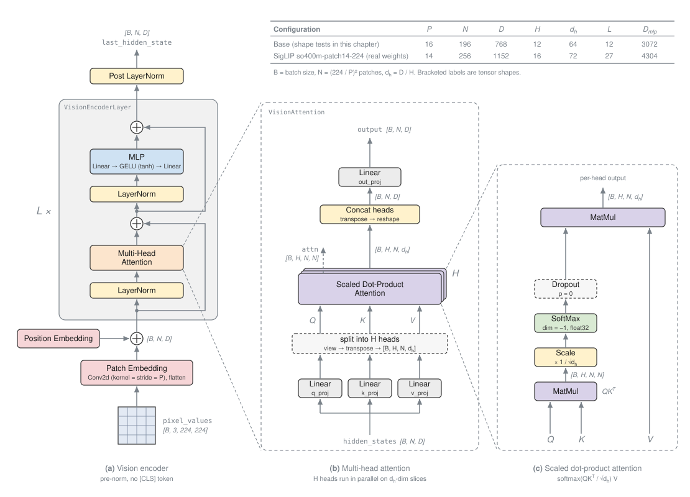

We have now implemented the real attention module. The new class uses the same name as the placeholder, `VisionAttention`.

`VisionEncoderLayer` looks up `VisionAttention` by name whenever it creates a layer. Any model we build from this point onward will therefore use real attention.

However, the `model` object we created in the previous chapter still contains the old placeholder. Changing the class definition does not replace modules inside an existing model. We must build the model again.

Let's first count the parameters by hand.

Each encoder layer gains $2362368$ attention parameters.

| Part              | Calculation                                        | Parameters     |
| ----------------- | -------------------------------------------------- | -------------- |
| **Embeddings**    | from chapter 4                                     | **741,120**    |
| **One layer**     | norms $3072$ + attention $2362368$ + MLP $4722432$ | **7,087,872**  |
| **Twelve layers** | $12 \cdot 7087872$                                 | **85,054,464** |
| **Final norm**    | $2 \cdot 768$                                      | **1,536**      |
| **Total**         | $741120 + 85054464 + 1536$                         | **85,797,120** |

The MLP accounts for approximately $66.6 \%$ of each layer's parameters. Attention accounts for $33\%$ while the two norms together account for less than $0.05\%$.

If you compare this to the ViT paper that has about 86 million parameters for its base model, our model is slightly smaller because it does not have a CLS token, a CLS position embedding, or a classification head.

Now we can repeat the checkpoint check from the last chapter. Previously, we were missing 216 tensors. We have added the attention layers, so those tensors should now be present.

We also skip any checkpoint tensor named `position_ids`, in case one is stored in the checkpoint. As we saw in chapter 2, our `position_ids` is a buffer that is not saved in the model's state dictionary.

The block below checks the tensor names and shapes and counts the parameters in the real model.

| Part           | Calculation                                            | Parameters      |
| -------------- | ------------------------------------------------------ | --------------- |
| Convolution    | $1152 \cdot 3 \cdot 14 \cdot 14$ weights + 1152 biases | 678,528         |
| Position table | $256 \cdot 1152$                                       | 294,912         |
| **Embeddings** | $678528 + 294912$                                      | **973,440**     |
| Attention      | $4 \cdot (1152 \cdot 1152 + 1152)$                     | 5,313,024       |
| MLP            | from chapter 4                                         | 9,921,872       |
| Two norms      | $2 \cdot 2 \cdot 1152$                                 | 4,608           |
| **One layer**  | $5313024 + 9921872 + 4608$                             | **15,239,504**  |
| **27 layers**  | $27 \cdot 15239504$                                    | **411,466,608** |
| **Final norm** | $2 \cdot 1152$                                         | **2,304**       |
| **Total**      | $973440 + 411466608 + 2304$                            | **412,442,352** |

The real model has 27 layers and a hidden size of 1152. It has about 412 million parameters, which is why the checkpoint name includes `so400m`.

The name refers to the shape-optimized Vision Transformer studied in [Getting ViT in Shape](https://arxiv.org/abs/2305.13035). 

```python
import re
from huggingface_hub import get_safetensors_metadata

torch.manual_seed(0)
model = VisionModel(config)        # built now, so it uses the real VisionAttention
count = lambda m: sum(p.numel() for p in m.parameters())
vm = model.vision_model
print("one layer      ", count(vm.encoder.layers[0]))
print("total          ", count(model))

repo = "google/siglip-so400m-patch14-224"
meta = get_safetensors_metadata(repo)
ckpt = {name: tuple(info.shape)
        for f in meta.files_metadata.values()
        for name, info in f.tensors.items()
        if name.startswith("vision_model.") and not name.startswith("vision_model.head.")
        and not name.endswith("position_ids")}

real = VisionConfig(hidden_size=1152, intermediate_size=4304, num_hidden_layers=27,
                    num_attention_heads=16, patch_size=14)
with torch.device("meta"):
    ours = VisionModel(real)
mine = {k: tuple(v.shape) for k, v in ours.state_dict().items()}

print("checkpoint vision tensors:", len(ckpt), "| ours:", len(mine))
print("missing in ours:", sorted(set(ckpt) - set(mine)))
print("extra in ours:  ", sorted(set(mine) - set(ckpt)))
print("wrong shape:    ", sorted(k for k in set(ckpt) & set(mine) if ckpt[k] != mine[k]))
print("real model parameters:", sum(v.numel() for v in ours.state_dict().values()))
```

**Output:**

```text
one layer       7087872
total           85797120
checkpoint vision tensors: 437 | ours: 437
missing in ours: []
extra in ours:   []
wrong shape:     []
real model parameters: 412442352
```

The first two lines matches our earlier parameter counts: $7087872$ for one layer and $85797120$ for the complete model. Next, check the checkpoint. In the last chapter, it contained $437$ tensors, while our model had only $221$. Now both counts are $437$.

The three lists being empty shows:

- `missing in ours`: no checkpoint tensors are missing from our model.
- `extra in ours`: our model has no unexpected tensors.
- `wrong shape`: every tensor has the expected shape.

The $216$ missing attention tensors are now present. Each of the $27$ layers has four attention projections, each with a weight and a bias. That gives us $27\cdot4\cdot2=216$ tensors.

The final line reports the total number of parameters: $412,442,352$.

Attention also has a significant memory cost in the real model. Each layer has $16$ heads, and each head calculates a table containing: $256^{2}=65536$ scores.

Across all 16 heads, that is: $16\cdot65536=1048576$ attention scores for one image in one layer.

Now consider the high-resolution version of this model family, has $4096$ patches.

One attention head must then calculate: $4096^{2}=16,777,216$ scores. That is $256$ times as many scores as before, even though the number of patches has increased by only $16$ times.

If we store the $16$ attention tables for one layer as 32-bit floats, they require:

$$16\cdot16777216\cdot4=1,073,741,824$$

bytes, or about 1 GB, for a single image.

This is the main cost of attention at high resolutions: the number of scores grows with the square of the number of patches. We will encounter the same issue when we build the language model.

### Real weights in our model, and the image through it

Our model now has the correct parameter names and shapes. The next step is to load the actual trained weights.

The checkpoint comes from **SigLIP**, an image encoder trained using the sigmoid loss we discussed in chapter 1. The vision-language model we will load later starts with this same image encoder and trains it further. This is the encoder our model will use.

The code below reads the vision tensors from the checkpoint and loads them into our `VisionModel` with `strict=True`.

In strict mode, PyTorch raises an error if any parameter name is missing or unexpected, or if a tensor has the wrong shape. In chapter 4, we checked the names and shapes listed in the checkpoint header. This time, we load the actual weights.

We then load Hugging Face's implementation of the same model using the same checkpoint. Finally, we pass the dog image through both implementations and compare their outputs.

We reuse `pix` from the chapter 3. It uses the same normalization expected by this model: pixel values are mapped to the range from −1 to 1.

```python
from huggingface_hub import hf_hub_download
from safetensors import safe_open
from transformers import SiglipVisionModel

state = {}
for fname in meta.files_metadata:                            # read only the vision tensors from the checkpoint
    with safe_open(hf_hub_download(repo, fname), framework="pt") as f:
        for k in f.keys():
            if k in ckpt:
                state[k] = f.get_tensor(k).float()

siglip = VisionModel(real).eval()
siglip.load_state_dict(state, strict=True)                    # fails loudly if any name or shape is wrong
print("all", len(state), "tensors loaded into our VisionModel")

ref = SiglipVisionModel.from_pretrained(repo).eval()          # Hugging Face's own implementation, same weights

with torch.no_grad():
    ours_out = siglip(pix)                                    # [1, 3, 224, 224] -> [1, 256, 1152]
    ref_out = ref(pixel_values=pix).last_hidden_state         # [1, 256, 1152]
print(ours_out.shape)
print(f"largest difference from Hugging Face: {(ours_out - ref_out).abs().max():.2e}")
print(f"typical size of an output number:     {ref_out.abs().mean():.3f}")
```

**Output:**

```text
**Loading...**
torch.Size([1, 256, 1152])
largest difference from Hugging Face: 4.62e-04
typical size of an output number: 1.042
```

The first line of the output reports that all 437 tensors were loaded. If any tensor name or shape were wrong, `load_state_dict` would raise an error.

The dog image produces an output of shape $[1,256,1152]$. This means the encoder returns 256 patch vectors, each containing 1152 numbers. As we predicted in chapter 2, the 256 patches form a 16×16 grid.

The third line in the output reports the largest absolute difference between our output and Hugging Face's output. The fourth line reports the average absolute size of the reference output values.

Compare these two numbers. The largest difference should be several orders of magnitude smaller than the typical output value. This shows that both implementations compute the same function, up to small numerical differences.

These differences come from floating-point rounding. The two implementations may perform the same operations in a different order, and floating-point calculations can produce slightly different results depending on that order.

Our implementation now runs a real trained vision encoder. The patch convolution from chapter 2 and the attention module from this chapter work together to reproduce the output of Hugging Face's model.

### Where the dog's patch looks


**Now we can inspect the attention weights and see which patches look at which parts of the image.**

Every attention layer produces a table showing how much each patch attends to every other patch. We can use these tables to see where a particular patch gathers information.

The encoder layer normally discards the attention weights: `hidden_states, _ = self.self_attn(...)`.

We can capture them using a **forward hook**. A forward hook is a small function that PyTorch calls after a module runs. It receives the module's inputs and outputs, allowing us to inspect them without changing the module itself.

We attach hooks to three attention layers: the first layer, layer 0; a middle layer, layer 13; and the final layer, layer 26.

Each hook saves `out[1]`, the attention weights. Their shape is $[1,16,256,256]$: one image, 16 heads, and a $256×256$ table for each head.

We average the weights across the 16 heads. Then we select the row for one patch. This gives us 256 attention weights, one for every patch in the image.

We can place those weights back onto the $16×16$ patch grid to visualize where the selected patch looks.

The code selects row 7, column 5. This is patch $7\cdot16+5=117$, which covers the dog's left eye in our photo.

You can change `r` and `c` to inspect another patch, such as the ear, the snout, or a patch containing grass.

Before plotting the results, we need to consider **attention sinks**.

In large Vision Transformers, some patches receive a large amount of attention from other patches, even when they contain little useful visual information. Research suggests that trained Vision Transformers can use a few low-information background patches as scratch space for information about the image. This behavior is discussed in [Vision Transformers Need Registers](https://arxiv.org/abs/2309.16588).

Language models show a related behavior. They often assign a large amount of attention to the first token, a pattern studied in [Efficient Streaming Language Models with Attention Sinks](https://arxiv.org/abs/2309.17453).

One possible explanation is the softmax operation. Every row of attention weights must add up to 1. Even when a head has no particularly useful information to retrieve, it still has to distribute its attention somewhere.

These sink patches can dominate an attention map and make other patterns harder to see.

To make the maps easier to inspect, we use a simple rule to identify possible sinks. This is a threshold we choose for our visualization, not a universal definition of an attention sink.

Since each row adds up to 1, the average attention received by each of the 256 patches would be:

$$\frac{1}{256}≈0.0039$$

We label a patch as a sink if it receives more than five times this average:

$$\frac{5}{256}≈0.0195$$

The top row of the plot shows the original attention maps. The bottom row shows the same maps after we set the sink weights to zero and rescale the remaining weights so they add up to 1.

```python
store = {}
layers_to_show = [0, real.num_hidden_layers // 2, real.num_hidden_layers - 1]   # first, middle, last
hooks = [siglip.vision_model.encoder.layers[i].self_attn.register_forward_hook(
             lambda m, inp, out, i=i: store.__setitem__(i, out[1]))            # out[1] is the attention table
         for i in layers_to_show]
with torch.no_grad():
    siglip(pix)
for h in hooks:
    h.remove()

side = real.image_size // real.patch_size                    # 16 patches per side
P = real.patch_size                                           # 14 pixels
n_tok = side * side                                           # 256
r, c = 7, 5                                                   # the dog's left eye; move it anywhere
k = r * side + c

fig, ax = plt.subplots(2, 4, figsize=(16, 8))
for row in range(2):
    ax[row, 0].imshow(photo)
    ax[row, 0].add_patch(plt.Rectangle((c * P, r * P), P, P, fill=False, ec="red", lw=2))
ax[0, 0].set_title(f"patch {k}")

for col, i in enumerate(layers_to_show, start=1):
    a = store[i][0].mean(dim=0)                               # [16, 256, 256] -> [256, 256], averaged over heads
    received = a.mean(dim=0)                                  # [256], share of all attention each patch receives
    sinks = received > 5 / n_tok                              # [256], patches getting over 5x their fair share

    m = a[k]                                                  # [256], where patch k looks
    print(f"layer {i:2d}: {int(sinks.sum())} sink patches, "
          f"they take {m[sinks].sum():.1%} of patch {k}'s attention")
    m_clean = m.masked_fill(sinks, 0)
    m_clean = m_clean / m_clean.sum()                         # rescale what is left to add up to 1

    for row, (mm, title) in enumerate([(m, f"layer {i}, raw"),
                                       (m_clean, f"layer {i}, {int(sinks.sum())} sink patches removed")]):
        ax[row, col].imshow(photo)
        ax[row, col].imshow(mm.view(side, side).numpy(), extent=(0, 224, 224, 0), alpha=0.6, cmap="Oranges")
        ax[row, col].set_title(title)

for a_ in ax.flat:
    a_.axis("off")
plt.tight_layout(); plt.show()
```

**Output:**

```text
layer 0: 5 sink patches, they take 49.0% of patch 117's attention
layer 13: 4 sink patches, they take 19.0% of patch 117's attention
layer 26: 7 sink patches, they take 40.3% of patch 117's attention
```

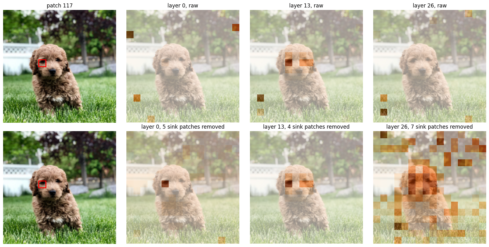

**Layer 0:** The output reports the number of sink patches and the percentage of patch 117's attention that goes to them.

**Layer 13:** The same measurements show how much attention goes to the sink patches in the middle of the encoder.

**Layer 26:** The final line shows the number of sink patches and the share of the eye patch's attention that they receive in the last layer.

Now look at the plot.

The first column shows the original photo, with patch 117 marked by a red square. The other columns show the attention maps for layers 0, 13, and 26. The top row shows the raw attention weights, while the bottom row shows the maps after removing the identified sinks.

The darker the orange, the more attention the eye patch gives to that region.

The ViT paper studied how far different attention heads look across an image. Some heads already attend to distant patches in the early layers. Others focus on nearby patches. On average, the attention distance tends to increase in deeper layers.

In layer 0, the eye patch focuses mostly on itself and its neighbors. In layer 13, attention goes to other parts of the dog's head. In layer 26, the attention spreads across the dog's head and body rather than the surrounding grass.

This is the information exchange we wanted to build. **A patch containing brown fur could belong to a dog, a bear, or a carpet. After attention, the patch can use information from the rest of the image to build a more useful representation of the fur**.

#### What an attention map does not tell us

A weight says how much of a value was mixed in, not how useful that value was. The sink patches are the clearest case: they take a large share of the eye's attention while carrying little visual information, these patches mix as they go. After layer 0, the vector at each position already holds information gathered from other patches, so in layer 26 a weight on a position is not a weight on that square of the photo alone. Attention is only one part of each layer. Its output passes through `out_proj`, the shortcut carries the patch's own vector around it, and the MLP changes the result again. On top of that we averaged over 16 heads, which blurs heads that look in different directions.

### Where the new pieces sit

Here's a look at the complete encoder, this time with the shapes used by the real model.

```text
  image              [B, 3, 224, 224]
  embeddings         [B, 256, 1152]
  layer 0            h = x + self_attn(layer_norm1(x))      every patch reads every patch
                     y = h + mlp(layer_norm2(h))            each patch alone
  layer 1            same                                   [B, 256, 1152]
  ...
  layer 26           same                                   [B, 256, 1152]
  post_layernorm     [B, 256, 1152]
```

Inside every `self_attn` module, the data flows through these shapes:

```text
  q_proj, k_proj, v_proj    [B, 256, 1152] each
  split into 16 heads       [B, 16, 256, 72] each
  scores and softmax        [B, 16, 256, 256]
  blend of the values       [B, 16, 256, 72]
  heads glued, out_proj     [B, 256, 1152]
```


There are no placeholders left in the Encoder now.

The patches can now exchange information through all $27$ layers. Each patch uses its **query** to compare itself with the other patches, assigns weights to their **keys**, and combines their **values**. The attention output then joins the residual stream through the shortcut.

By the end of the encoder, **a patch containing brown fur can represent more than the appearance of the fur itself. It can also carry information gathered from the rest of the dog**.

But there is still a gap in our model.

We fed the encoder `pix`, a tensor we prepared using a resize operations. We also have only the image side of the model. The other side needs a text question, converted into tokens, with room reserved for the image.

In the next chapter, we build the **processor**. It will prepare an image in exactly the format the encoder expects and convert a text question into a sequence of tokens, with 256 positions reserved for the image.

---

# Chapter 6. Preparing the Image and the Question

At the end of the last chapter our vision encoder was complete, all 27 layers ran real attention using the trained weights, and the dog photo came out as 256 vectors that matched Hugging Face's implementation. But two things were still missing.

We fed the encoder `pix`, which we prepared by resizing the image and applying arithmetic to prepare it. But the encoder is only half of the model, the language model on the other side reads token IDs, not pictures. Nothing turns our question into IDs yet, and we have not made room in the question's sequence for the picture.

In this chapter we build the **processor**, the code that runs before the model and prepares both inputs.

> **Main Idea: The processor converts a photo into the exact tensor the encoder was trained on, coverts the question into token IDs and reserves one empty seat for every image patch.**

Think of the model's input as one long row of seats in a theater. Before the show, the Processor does two jobs. First, it prepares every image so that it arrives in the same format. And second, it creates the same chart. The first 256 seats are reserved for the image patches and the rest for the words of your question.

### What a processor does

A processor has no learned weights, it follows a fixed recipe of steps before the model sees anything. Since nothing in the processor learns, training cannot improve it.

During training millions of images and prompts passed through a processor before reaching the model. The model's weights adapted to the exact values that came out of the processor. If our processor resizes images differently, scales pixel values differently or formats the prompt differently, the model receives numbers it has never seen.

The problem is that nothing crashes when that happens, the tensor shapes can still be correct and the code can still run, while the answers gets worse without any obvious error. We saw a similar silent mistake in chapter 3, when we left out `eps` in `nn.LayerNorm`, the model still loaded and ran, but with PyTorch’s default `1e-5` instead of the `1e-6` it was trained with. This time we can check each step against the official recipe.

The processor takes two inputs, a photo and a prompt and returns three tensors:

- `pixel_values` contains the image as numbers. Its shape is $[B, 3, 224, 224]$: $B$ images, 3 color channels, 224 rows and 224 columns of pixels.
- `input_ids` contains the prompt as token IDs. Its shape is $[B, T]$: $B$ prompts, each containing $T$ tokens. 256 of these positions are reserved for the image.
- `attention_mask` has shape $[B, T]$. It marks which token IDs represent real tokens and which are only padding.

The two sides work independently, the image side does not look at the text, and the text side does not look at the pixels. They come together only in the dictionary returned by the processor.


A photo and a prompt enter the processor, the image side and the text side run separately and the processor returns `pixel_values, input_ids` and `attention_mask`.


### Why every image must become 224 by 224

Our dog photo is 3000 pixels wide and 3000 pixels tall, which makes 9,000,000 pixels. With three numbers per pixel, that is 27 million numbers.

The patch convolution from chapter 2 could accept it, because a convolution slides its window across the input regardless of its size. We counted the windows along one side as $$\lfloor (H - K)/S \rfloor + 1$$
With $H = 3000$ and 14 pixel patches ($K = S = 14$)
this gives $\lfloor 2986 / 14 \rfloor + 1 = 213 + 1 = 214$ windows.

Since $214 \times 14 = 2996$, the last 4 pixels are dropped,
which makes $214^2 = 45{,}796$ patches.

Two things would break here.

The first is the position table, We built it with `num_positions = num_patches`, so it has exactly one row per patch position: 256 rows for the real model.
The table produces an output of shape $[1, 256, 1152]$, which we add to the patch vectors, But we cannot add 45,796 patch vectors to just 256 position vectors. PyTorch would give an error because their shapes do not match.

The second problem is computational cost, attention compares every patch with every other patch, so with 45,796 patches one attention head would compute $45{,}796^2 \approx 2.1$ billion scores in every layer.

Using a smaller image does not solve the problem either, a $448\times448$ image produces $448 / 14 = 32$ patches per side and $32^2 = 1024$ patches, which is still four times the model's 256 position vectors.

The solution is to resize every photo to the exact size used during training: $224 \times 224$. This gives us $224 / 14 = 16$ patches along each side and $16 \times 16 = 256$ patches in total. Each patch now has a matching row in the position table.

Resizing does not preserve the original proportions, a wide photo gets squeezed sideways to fit the square, and a tall one gets squeezed from top to bottom. PaliGemma, the vision language model whose weights we load, was trained with this resizing method, so we use it too. Other models crop the center of the photo or add a border instead, each model has its own recipe.

PaliGemma also comes in versions trained on 448 and 896 pixel images. These versions have larger position tables with 1024 and 4096 rows, and their processors resize images to 448 or 896 pixels. Everything else stays the same, only the size changes.


### Resizing a photo

Shrinking 3000 pixels down to 224 means that each new pixel must represent many pixels from the original image. Along one side that is $3000 / 224 \approx 13.4$ old pixels for every new pixel, so each new pixel covers an area of about $13.4 \times 13.4 \approx 179$ old pixels.

*How do we calculate the color of each new pixel?*
There are several ways, and the general term for them is **resampling**: computing new pixel values from the original pixels.

For example, Suppose we have four pixel values $[10, 20, 30, 40]$ and we want to shrink them to two pixels.

**Nearest neighbor** selects one original pixel for each new pixel and discards the others. In this example it might keep $[10, 30]$.

**Averaging** calculates the average of the original pixels covered by each new pixel.

The results are:
$$\frac{10 + 20}{2} = 15~~\text{and}~~\frac{30 + 40}{2} = 35\text~~{giving}~~[15, 35]$$

**Bilinear** and **bicubic** resampling use weighted averages, where each new pixel combines nearby original pixels but the pixels do not all contribute equally. The closest pixels receive the largest weights, and the weights follow a smooth curve. Bilinear resampling uses straight lines to calculate the weights while bicubic resampling uses a cubic curve that helps keep edges sharper.

Nearest neighbor is fast, but it can cause problems when an image is heavily reduced. If we shrink by a factor of about 13, it keeps only one of roughly 179 original pixels and ignores the rest. Fine details such as fur or a fence, can turn into coarse patterns that were not in the original image, an effect called **aliasing**. 

**PIL**, the Python Imaging Library we use, avoids this problem: when it shrinks an image, it stretches the weighting curve so that every original pixel covered by a new pixel contributes to the result.

Our processor uses bicubic resampling through `Image.Resampling.BICUBIC`, because PaliGemma's training images were resized this way. So we use the same method, however, two libraries can both use bicubic resampling and still produce slightly different pixels, because they may round values differently or use slightly different weighing curves. We will see this difference in a moment and make it disappear at the end of the chapter.


The row $[10, 20, 30, 40]$ shrinks to 2 pixels three ways: nearest neighbor keeps $[10, 30]$, averaging gives $[15, 35]$ and bicubic resampling uses a smooth weight curve across neighboring pixels. The lower example shows a fine stripe pattern reduced by a factor of 13. Nearest neighbor produces false wide stripes, while PIL's stretched curve produces a smoother gray result.

### From a picture to numbers

After resizing, we still have a PIL image, an object designed for working with pictures (drawing them, saving them). The expression `np.array(image)` convers it into  a regular array of numbers with shape $[224, 224, 3]$: **224** rows (height), **224** columns (width) and **3** values per pixel, for **RGB** (red, green and blue).

Each value is an 8 bit unsigned integer, and 8 bits can represent $2^8 = 256$ different values, so each color channel ranges from 0 to 255. A pure black pixel is $[0, 0, 0]$, a pure white pixel is $[255, 255, 255]$, and a brown pixel might be $[150, 100, 60]$.

Our photo now contains $224 \times 224 \times 3 = 150{,}528$ numbers, this is the grid of "a few hundred thousand numbers" we introduced at the very start.

There is one detail to watch out for, PIL and NumPy order the image dimensions differently.
PIL's `image.size` returns (width, height) while a NumPy array's shape is (height, width, channels).

That is why the `resize` function we will write later in the chapter accepts `size=(height, width)` but passes `(width, height)` to PIL. Our target is a square, so mixing up the two would not change the result here, but the function stays correct for images of any shape.

### Rescale and normalize

The encoder does not receive pixel values from 0 to 255. Instead, every value is converted to the range from $-1$ to $1$, in two steps.

**Rescaling** divides every value by 255, which moves the values into the range from $0$ to $1$.

**Normalization** subtracts a mean and divides by a standard deviation.
To refresh your memory, the mean is the average of a list of numbers, and the standard deviation measures how spread out those numbers are.

Here the mean and standard deviation are fixed values, we do not calculate them from the image. Both are $0.5$, and we use the same values for all three color channels.

Combining both steps, we divide each value by 255, subtract 0.5, and then divide by 0.5:

$$x' = \frac{x / 255 - 0.5}{0.5}$$

where $x$ is the original pixel value, from 0 to 255, and $x'$ is the value the encoder receives.

Let's follow some values through these steps.

- 0 becomes $0 / 255 = 0$, then $\frac{0 - 0.5}{0.5} = -1$.
- 255 becomes $255 / 255 = 1$, then $\frac{1 - 0.5}{0.5} = 1$.
- 51 becomes $51 / 255 = 0.2$, then $\frac{0.2 - 0.5}{0.5} = -0.6$.

We can further simplify the formula to $$x' = \frac{x}{127.5} - 1$$
since dividing by 255 and then by 0.5 is the same as dividing by 127.5.

We can check it on 51: $51 / 127.5 = 0.4$, and $0.4 - 1 = -0.6$.

Before performing these calculations, we must covert the values to floating point numbers.
An 8 bit unsigned integer can store only whole numbers from 0 to 255, so it cannot store 0.2 or $-1$.
In NumPy, subtracting 1 from an 8 bit value of 0 can wrap around to 255 instead of producing $-1$.

The `rescale` function coverts the values to 32 bit floating point numbers with `.astype(np.float32)`, the `normalize` function then subtracts the mean and divides by the standard deviation. It accepts one mean and one standard deviation per channel, so it also supports models that use different values for each color channel.

**Why move the values around 0?**

Let's look at what happens immediately after the processor: the first operation in the encoder is the patch convolution, and there is no normalization layer before it. The first normalization, `layer_norm1`, comes only after the convolution and the addition of the position vectors.

This means the processor controls the scale of the numbers that enter the convolution.

We saw in chapter 3, “Layer norm on our patches”, what happens when this scale is wrong. We multiplied an image by 10, and the patch projection grew 10 times while the convolution’s bias and the position vectors (added afterwards) stayed the same. The spread of the first token went from $1.1104$ to $5.7675$, not 10 times bigger, and the normalized tokens no longer matched.

Using raw pixel values from 0 to 255 would cause an even bigger mismatch, the values would be about 127 times and none would be negative. The convolution’s weights were learned with inputs between $-1$ and $1$, with much larger inputs, its outputs would lose the meaning they had during training. The position vectors would also become tiny compared with the patch content.

**Why use fixed numbers instead of mean?**

Layer normalization calculates the mean and spread of each token from its own values, but the processor deliberately does not.

Imagine a dark gray photo in which every pixel value is 51, and a light gray photo in which every pixel value is 204. With our fixed recipe the first photo becomes $-0.6$, while the second becomes $204 / 127.5 - 1 = 0.6$, the encoder can therefore distinguish the dark photo from the light one.

If we subtracted each photo's own mean, both photos would become arrays of zeros, and the difference between the dark and light photos would disappear.

Fixed values ensure that every photo is scaled in the same way, so differences in brightness remain.

**Where does 0.5 come from?**

Each model chooses its own mean and standard deviation, and its processor must use the same values. SigLIP (our encoder) was trained with a mean of 0.5 and a standard deviation of 0.5 for every channel.

Many older models use the average color statistics of the ImageNet dataset. Their means are $[0.485, 0.456, 0.406]$ and their standard deviations are $[0.229, 0.224, 0.225]$ for RGB color channels.

Do not let the name, `IMAGENET_STANDARD_MEAN` confuse you, HuggingFace uses it for the three values of 0.5. These are not ImageNet's actual average color statistics, HuggingFace calls those `IMAGENET_DEFAULT_MEAN`.

The code in this chapter builds on the code from the last chapter. It uses `real`: the config of the real model, and `pix`: the tensor we created earlier. The loop below follows three pixel values through rescaling and normalization.

```python
import numpy as np
import torch
from PIL import Image

IMAGENET_STANDARD_MEAN = [0.5, 0.5, 0.5]
IMAGENET_STANDARD_STD = [0.5, 0.5, 0.5]

for x in (0, 51, 255):
    after_rescale = x / 255
    after_normalize = (after_rescale - 0.5) / 0.5
    print(f"pixel {x:3d} -> {after_rescale:.1f} -> {after_normalize:+.1f}")
```

**Output:**

```text
pixel   0 -> 0.0 -> -1.0
pixel  51 -> 0.2 -> -0.6
pixel 255 -> 1.0 -> +1.0
```

Each line follows one pixel value through the three steps: 0 ends at $-1.0$, 51 at $-0.6$ and 255 at $+1.0$, matching the numbers we worked out by hand.

### Channels first, then a batch

The array has shape $[224, 224, 3]$ for height, width and channels, but PyTorch layers expect the channels first, $[3, 224, 224]$.

We get this with `image.transpose(2, 0, 1)`, the three numbers specify where each new axis comes from. The new axis 0 takes old axis 2 (channels), new axis 1 takes old axis 0 (height), and new axis 2 takes old axis 1 (width).

So $[224, 224, 3]$ becomes $[3, 224, 224]$. (NumPy's `transpose` takes the whole new order at once, PyTorch's `permute` method does the same).

Here is a small example: an image one pixel tall and two pixels wide, with pixels $[10,20,30]$ and $[40,50,60]$, has shape is $[1,2,3]$. After `transpose(2, 0, 1)`, its shape becomes $[3, 1, 2]$, and each color channel has its own small image: red holds $[10,40]$, green $[20,50]$, and blue $[30,60]$.

No values have changed; they only moved into a different order.

The processor handles a list of images, one image at a time. After resizing, every image has the same shape, $[3,224,224]$, so `np.stack` can combine them into one array of shape $[B,3,224,224]$. The function `torch.tensor` then converts this array into the tensor we call `pixel_values`.

This is another reason to resize first, because images with different dimensions cannot be stacked into one regular array.

Here is the complete process:


Follow the orange square, its red value starts at 51, dividing by 255 turns it into $0.20$, and normalization turns it into $−0.60$.

The bar at the bottom shows how the full range changes at each step. The values go from $0$ to $255$, then $0$ to $1$, then $−1$ to $1$. In the final step, the three color channels are separated and stacked front to back.

### The image side in code

We can now turn these steps into small functions, and with `process_images` which runs them in order on a list of images.

We test it on our dog photo and compare the result with two references: our own `pix` tensor and HuggingFace's image processor for the SigLIP encoder.

```python
def resize(image, size, resample=None):
    height, width = size
    return image.resize((width, height), resample=resample)

def rescale(image, scale, dtype=np.float32):
    return (image * scale).astype(dtype)

def normalize(image, mean, std):
    mean = np.array(mean, dtype=image.dtype)
    std = np.array(std, dtype=image.dtype)
    return (image - mean) / std

def process_images(images, size, resample, rescale_factor, image_mean, image_std):
    height, width = size
    images = [resize(image=image, size=(height, width), resample=resample) for image in images]
    images = [np.array(image) for image in images]                     # [H, W, C], values 0 to 255
    images = [rescale(image, scale=rescale_factor) for image in images] # values 0 to 1
    images = [normalize(image, mean=image_mean, std=image_std) for image in images]   # values -1 to 1
    images = [image.transpose(2, 0, 1) for image in images]            # [H, W, C] -> [C, H, W]
    return images


dog = Image.open("dog.jpg").convert("RGB")
print("original size (width, height):", dog.size)

pixel_values = process_images(
    [dog],
    size=(real.image_size, real.image_size),
    resample=Image.Resampling.BICUBIC,
    rescale_factor=1 / 255.0,
    image_mean=IMAGENET_STANDARD_MEAN,
    image_std=IMAGENET_STANDARD_STD,
)
pixel_values = torch.tensor(np.stack(pixel_values, axis=0))            # [1, 3, 224, 224]
print(pixel_values.shape, pixel_values.dtype)
print(f"min {pixel_values.min():.3f}, max {pixel_values.max():.3f}")
print(f"same as pix: {torch.allclose(pixel_values, pix, atol=1e-5)}")

from transformers import SiglipImageProcessor
official = SiglipImageProcessor.from_pretrained("google/siglip-so400m-patch14-224")
ref = official(images=dog, return_tensors="pt")["pixel_values"]        # [1, 3, 224, 224]
print(f"largest difference from Hugging Face's image processor: {(pixel_values - ref).abs().max():.2e}")
```

**Output:**

```text
original size (width, height): (3000, 3000)
torch.Size([1, 3, 224, 224]) torch.float32
min -1.000, max 1.000
same as pix: True
largest difference from Hugging Face's image processor: 7.84e-03
```

The photo's original size is `(3000, 3000)`, using PIL's `(width, height)` order the image is square, so resizing does not squeeze it in either direction.

`pixel_values` has shape $[1,3,224,224]$ and data type is `float32`. Its smallest value is $−1.000$, and largest is $1.000$, so the image uses the full range. At least one channel value is 0, and at least one is 255.

Our tensor is the same as **`pix`**, we built `pix` by resizing the image to `(224, 224)`, dividing by 255, subtracting 0.5, and dividing by 0.5, and we said the processor would handle these steps later. This is that processor doing the same steps.

**PIL** uses bicubic resampling when no method is given, as in our earlier `resize` call, so the resizing method also matches too.

The largest difference from HuggingFace's image processor is $7.84×10^{−3}$. One brightness level out of 255 is $1/255$ after rescaling, and dividing by 0.5 during normalization doubles it to $2/255\approx0.00784$.

So no value differs more than one brightness level, and at least one differs by exactly one.
HuggingFace's image processor does not resize with PIL by default, and two implementations can both use bicubic resampling and still round some pixels differently. This small difference does not matter to the model.

**The image side is complete. Now let's prepare the question!**

### From words to tokens

We know that a Transformer reads a sequence of tokens and each token has an **ID**, a whole number that selects a row in an embedding table.

*But, how does a sentence become tokens?*

The tool that performs this conversion is called a **Tokenizer**.

The prompt for our example is `"what color is the dog?"`/`"answer en what color is the dog?"`

PaliGemma was trained on many tasks, each with a short prefix, and “answer en” tells it to answer the question that follows in English.

The simplest approach is **one token per character**. Our prompt contains 32 characters, including spaces, so it produces 32 tokens, and the vocabulary stays small, with only a few hundred symbols for English.

However, when the sequences become longer, Attention calculates scores for pairs of tokens, so its cost grows with the square of the sequence length. With 32 tokens it calculates $32^2=1024$ scores, and with the 8 tokens $8^2=64$ scores, which is 16 times fewer.

A single character also carries very little meaning, like a single pixel.

**One token per word** produces shorter sequences, but the vocabulary becomes much larger. The words "dog", "dogs", "doggo", and "Dog" would each need its own row in the vocabulary. Every language adds more words and new names and typos can also cause problems because a word that never appeared during training would have no ID.

Modern tokenizers split text into **pieces of words**: common words often become a single token, while rare words are split into smaller, common pieces. This method is called **subword tokenization**.

The pieces are not chosen at random, they are learned from a large collection of text. One popular method is **byte pair encoding**, or **BPE**. It starts with individual characters and repeatedly joins the neighboring pair that appears most often.

Here is an example, Suppose our training text contains three words: 
##### "low", "lower", and "lowest

We start with individual characters,
so "lower" becomes `l o w e r`. 
The pairs `l-o` and `o-w` both appear in all three words.

Suppose we join `l-o` first, creating the piece `lo`, and count the pairs again.

The pair `lo-w` now appears three times, so we join it into `low`.

After these two merges, "lower" becomes `low e r`
and "lowest" becomes `low e s t`.

A word that never appeared in the training text, such as "slower", can still be split into pieces:
`s low e r`.

This process continues until the vocabulary reaches the desired size.

Our language model is Gemma and its tokenizer was built using **SentencePiece**, a library that learns token pieces with BPE or a related method.

The vocabulary contains 256,000 pieces, its large because it supports many languages. If the tokenizer meets a character it does not recognize, it falls back to the character's raw bytes, so it can still tokenize text it has never seen before.

SentencePiece represents a space (symbol: ▁). The piece `▁dog` means "dog with a space in front of it". This marker allows the tokenizer to reconstruct the original text including its spaces.

When we tokenize our prompt, we will get eight pieces: `answer`, `▁en`, `▁what`, `▁color`, `▁is`, `▁the`, `▁dog`, and `?`.

Notice that `answer` has no ▁ marker because there is no space before it.

A large vocabulary has a cost, the embedding table contains one row per token so a vocabulary of 256,000 tokens requires 256,000 rows. We will return to this table when we build the language model.


The prompt `"answer en what color is the dog?"` is split three ways: 32 characters, 7 words plus `?`, and 8 subword pieces with ▁ marking spaces. The 8 pieces become 8 IDs, and each ID selects a row in the embedding table.

### Special tokens

Some tokens do not come from splitting ordinary text, they are markers with specific jobs called **special tokens**.

The tokenizer treats each special token as a single unit,`<bos>` is always one token, never split into `<`, `bos`, and `>`.

There are three special tokens which are important to us:

- `<bos>`, or beginning of sequence, marks the start of the text. Gemma was trained with `<bos>` at the beginning of its text, so it expects this token.
- `<eos>`, or end of sequence, marks the end of a generated answer. The model writes it when it finishes its answer, we will need it when we build the text-generation loop.
- `<pad>` is a filler token used to make prompts of different lengths the same size.

The special token `<image>` reserves the picture's seats.

### Tokens for boxes and masks

PaliGemma can do more than answer questions, It detects objects and return the coordinates of a box around them, It can also segment objects by describing their outlines.

Both types of output use tokens, so the vocabulary includes two additional families.

The first family contains 1,024 location tokens, from `<loc0000>` to `<loc1023>`. These represent positions in the image, Each side is divided into 1,024 steps, and a bounding box is written as four location tokens one per edge. For example, an edge halfway down the image is represented by a token near `<loc0512>`.

The second family contains 128 segmentation tokens, from `<seg000>` to `<seg127>`. These describe the shape of an outline, and a small, separate decoder converts them back into a mask..

We will not use either family in this chapter, but they help explain the size of the vocabulary. Let's count Gemma's pieces, the two additional families, and the `<image>` token:

$$256{,}000 + 1{,}024 + 128 + 1 = 257{,}153$$

The total includes 256,000 ordinary Gemma pieces, 1,024 location tokens, 128 segmentation tokens, and one `<image>` token.

The `<image>` token comes last. Since IDs start at 0, its ID is $257,153−1=257,152$.

Our processor adds these tokens to the tokenizer using `add_tokens`, however the tokenizer we download already belongs to Gemma and contains all $1,024+128+1=1,153$ additional tokens.

As a result, the vocabulary size does not change: you will see 257,153 printed both before and after we add the tokens.

This is exactly what we want, a token's ID selects its row in the embedding table, and Gemma's table was trained with `<image>` at row 257,152. If we started with a plain Gemma tokenizer instead, `add_tokens` would assign new IDs to our additional tokens. These IDs would come after Gemma's existing pieces, and `<image>` would end up at a different row from the one used during training. The code would still run, but the IDs would be wrong.

### Leaving seats for the image

We can now format the prompt the way PaliGemma expects it, which comes from the paper ([Beyer et al., 2024](https://arxiv.org/abs/2407.07726)):

- one `<image>` token for every image patch, giving us 256 tokens
- `<bos>`
- the prompt, which the paper calls the **prefix**
- a newline, `\n`

We can build the entire string with one line of code:

`f"{image_token * image_seq_len}{bos_token}{prefix_prompt}\n"`

In Python, multiplying a string by a number repeats it, so `"<image>" * 256` produces `<image>` token 256 times in a row.

The model's answer comes after the newline, and the paper calls this part **suffix**.

During training, the model is given a question along with its correct answer, followed by `<eos>`. By learning from these examples the model gets to know how to generate answers to questions.
During inference, the model generates the answer itself, the newline separates the question from the answer and the model learns to start answering immediately after it. PaliGemma was trained with the newline as its own token, not joined to the last character of the prompt. Our output will show it on its own as well.

*Why do we use `answer en`?*

PaliGemma is trained on several tasks, so each prompt starts with a short task prefix that identifies the task. For example, `caption en` asks for an English caption, `answer en` followed by a question asks for an English answer, and `detect` followed by an object asks the model to locate it with a bounding box.

The model we load, `paligemma-3b-pt-224`, is the pretrained base model. The `pt` means pretrained, `3b` means 3 billion parameters, and `224` refers to the image size in pixels.

The model works best when we format prompts in the same way as the prompts split during training, the `<image>` tokens are placeholders that carry no meaning on their own and their job is to reserve 256 positions in the sequence, one for each of the 256 vectors produced by the vision encoder.

*Why reserve these positions instead of adding the image vectors to the sequence later?*

Because the rest of the pipeline works with token IDs. The tokenizer counts IDs, padding operates on IDs, and the attention mask is built from IDs. The position of every token is also determined by its place in the ID sequence.

**By adding 256 placeholders to the prompt, we include the image in this bookkeeping from the start.** The sequence already has its final length, every token has a reserved position, and the attention mask already covers the image.

*How many positions do we need?*

We need one for each patch, we calculated the number of patches earlier by dividing the image size by the patch size and squaring the result:

$$N_{\text{image}} = \left(\frac{224}{14}\right)^2 = 16^2 = 256$$

where 224 is the image size and 14 is the patch size used by the real model.

In code, we calculate this as `(real.image_size // real.patch_size) ** 2`. This is the value stored in `VisionConfig` under `num_image_tokens`.

The total sequence length includes the image positions, one `<bos>` token, the prompt tokens, and one newline:

$$T = N_{\text{image}} + 1 + N_{\text{prompt}} + 1$$

$N_{\text{prompt}}$ is the number of tokens in the prompt and $T$ is the total sequence length.

Our prompt contains 8 tokens, so the total is:
$$T = 256 + 1 + 8 + 1 = 266$$


The figure shows our prompt `"answer en what color is the dog?"`, with 8 prompt tokens, 266 IDs, and 266 ones in the attention mask. The empty frames on the left represent the 256 image positions. Next, the yellow `<bos>` token followed by the blue prompt tokens and the green newline on its own.

Gemma's tokenizer adds a `<bos>` token to the beginning of every text by default. We have already included `<bos>` in our string, so the processor calls the tokenizer with `add_special_tokens=False`. Otherwise, the tokenizer would add a second `<bos>` before the 256 image tokens.

The sequence would then contain 267 tokens instead of 266 and no longer match the format used during training.

### Padding and the attention mask

If we are processing two prompts at the same time, but one is shorter than the other, their rows of token IDs would have different lengths, so we wont be able to stack them into a single tensor.

The solution is **padding**: the tokenizer fills the shorter row with `<pad>` tokens until both rows have the same length.

The model must ignore these padding tokens as the **attention mask** tells it which positions contain real tokens and which contain padding. It is a row of ones and zeros alongside the token IDs: 1 marks a real token, and 0 marks padding.

Here is a small example with only two image positions, one prompt contains three tokens, `a b c`, and the other just one, `d`.


The setting `padding="longest"` tells the tokenizer to pad each row to match the length of the longest prompt in the batch.

With our actual image size, an 8-token prompt next to a 5-token prompt would produce rows of 266 and 263 tokens, so the shorter row would get 3 padding tokens, and its attention mask would hold 263 ones and 3 zeros.

Whether the padding tokens appear at the start or the end of a row depends on the tokenizer's settings; our example places them at the end.

If we process only one prompt, there is nothing to pad, so the attention mask contains only ones. The setting `truncation=True` adds another safeguard, If a text is longer than the tokenizer’s maximum length, the tokenizer cuts it down, Our prompt is nowhere near that limit.

### The text side in code

The following code loads PaliGemma's tokenizer and builds `VLMProcessor`, which combines the image and text sides.

The tokenizer is stored in a gated repository on the HuggingFace Hub, you must accept the license on the model's page and log in with a token that has access. The first lines of code below handles the login.

The call `add_tokens([self.IMAGE_TOKEN], special_tokens=True)` marks `<image>` as a special token, so the tokenizer treats it as one unit instead of splitting it into smaller pieces.

The code then runs the processor on the dog photo and our prompt and prints the tokens and tensor shapes so we can check them.

```python
from huggingface_hub import login
login()                                                                # paste a token with access to PaliGemma

from transformers import AutoTokenizer
tokenizer = AutoTokenizer.from_pretrained("google/paligemma-3b-pt-224")
print("tokens before we add anything:", len(tokenizer))


def add_image_tokens_to_prompt(prefix_prompt, bos_token, image_seq_len, image_token):
    return f"{image_token * image_seq_len}{bos_token}{prefix_prompt}\n"


class VLMProcessor:
    IMAGE_TOKEN = "<image>"

    def __init__(self, tokenizer, num_image_tokens, image_size):
        super().__init__()
        self.image_seq_length = num_image_tokens
        self.image_size = image_size

        tokenizer.add_tokens([self.IMAGE_TOKEN], special_tokens=True)
        extra_tokens = [f"<loc{i:04d}>" for i in range(1024)]          # bounding box coordinates
        extra_tokens += [f"<seg{i:03d}>" for i in range(128)]          # segmentation masks
        tokenizer.add_tokens(extra_tokens)
        self.image_token_id = tokenizer.convert_tokens_to_ids(self.IMAGE_TOKEN)
        self.tokenizer = tokenizer

    def __call__(self, text, images, padding="longest", truncation=True):
        pixel_values = process_images(
            images,
            size=(self.image_size, self.image_size),
            resample=Image.Resampling.BICUBIC,
            rescale_factor=1 / 255.0,
            image_mean=IMAGENET_STANDARD_MEAN,
            image_std=IMAGENET_STANDARD_STD,
        )
        pixel_values = torch.tensor(np.stack(pixel_values, axis=0))    # [B, 3, 224, 224]

        input_strings = [
            add_image_tokens_to_prompt(
                prefix_prompt=prompt,
                bos_token=self.tokenizer.bos_token,
                image_seq_len=self.image_seq_length,
                image_token=self.IMAGE_TOKEN,
            )
            for prompt in text
        ]
        inputs = self.tokenizer(input_strings, return_tensors="pt", padding=padding,
                                truncation=truncation, add_special_tokens=False)   # BOS is already in the string
        return {"pixel_values": pixel_values, **inputs}


num_image_tokens = (real.image_size // real.patch_size) ** 2           # 256
processor = VLMProcessor(tokenizer, num_image_tokens, real.image_size)
print("tokens after:", len(tokenizer), "| <image> id:", processor.image_token_id)

prompt = "answer en what color is the dog?"
prompt_ids = tokenizer(prompt, add_special_tokens=False)["input_ids"]
print("prompt tokens:", len(prompt_ids), tokenizer.convert_ids_to_tokens(prompt_ids))

inputs = processor(text=[prompt], images=[dog])
ids = inputs["input_ids"][0]                                           # [266] for an 8 token prompt
print("pixel_values", tuple(inputs["pixel_values"].shape))
print("input_ids   ", tuple(inputs["input_ids"].shape), "| expected", num_image_tokens + 1 + len(prompt_ids) + 1)
print("attention_mask all ones:", bool(inputs["attention_mask"].all()))
print("image seats:", int((ids == processor.image_token_id).sum()))
print("first 3 tokens:", tokenizer.convert_ids_to_tokens(ids[:3].tolist()))
print("last tokens:   ", tokenizer.convert_ids_to_tokens(ids[num_image_tokens:].tolist()))
```

**Output:**

```text
tokens before we add anything: 257153
tokens after: 257153 | <image> id: 257152
prompt tokens: 8 ['answer', '▁en', '▁what', '▁color', '▁is', '▁the', '▁dog', '?']
pixel_values (1, 3, 224, 224)
input_ids    (1, 266) | expected 266
attention_mask all ones: True
image seats: 256
first 3 tokens: ['<image>', '<image>', '<image>']
last tokens:    ['<bos>', 'answer', '▁en', '▁what', '▁color', '▁is', '▁the', '▁dog', '?', '\n']
```

Our tokenizer contains 257,153 tokens both before and after we add the extra tokens, because PaliGemma’s tokenizer already contains all of them. The `<image>` token “has ID 257,152, the last ID in the vocabulary, as we discussed earlier.

**Prompt** produces 8 pieces, with ▁ marking spaces. The piece `answer` has no marker because Gemma's tokenizer does not add an invisible space at the beginning of a text.

This is why tokenizing the prompt by itself produces the same 8 pieces as tokenizing it inside the full string, so we can count the prompt tokens separately.

`pixel_values` has the shape $[1,3,224,224]$, and `input_ids` has shape $[1,266]$, matcing the total we calculated: $256+1+8+1=266$.

In **mask** every value is 1, we processed only one prompt so no padding was needed.

**The seats** have exactly $256$ IDs match $257,152$, the ID of the `<image>` token, there is one for each image patch.

The sequence starts with `<image>` tokens, its last 10 tokens are `<bos>`, the 8 prompt pieces, and `'\n'` on its own. 

This matches the format described in the paper.

### Checking against the official processor

We have rebuilt the processor's behavior by hand. HuggingFace also provides an official one,  `PaliGemmaProcessor`, built from the same model files.

In the final code block, we run the official processor on the same photo and prompt, we then compare its outputs with ours using `torch.equal`. This function checks whether two tensors are exactly equal, not merely close to each other.

For the pixel values, we use HuggingFace's image processor with `backend="pil"`, making it resize the image with PIL, just as our code does and removes the small brightness difference we saw earlier.

```python
from transformers import PaliGemmaProcessor, AutoImageProcessor

official = PaliGemmaProcessor.from_pretrained("google/paligemma-3b-pt-224")
ref = official(text=prompt, images=dog, return_tensors="pt")
pil_ip = AutoImageProcessor.from_pretrained("google/paligemma-3b-pt-224", backend="pil")   # resizes with PIL, as we do
ref_pixels = pil_ip(images=dog, return_tensors="pt")["pixel_values"]

print("same input_ids:   ", torch.equal(inputs["input_ids"], ref["input_ids"]))
print("same pixel_values:", torch.equal(inputs["pixel_values"], ref_pixels))
```

**Output:**

```text
[transformers] You are passing both `text` and `images` to `PaliGemmaProcessor`. The processor expects special image tokens in the text, as many tokens as there are images per each text. It is recommended to add `<image>` tokens in the very beginning of your text. For this call, we will infer how many images each text has and add special tokens.

same input_ids:    True
same pixel_values: True
```

The official processor expects the text to contain the `<image>` tokens. Our prompt does not include them, so the official processor adds them automatically, just as ours does, and the warning tells us so.

The result for the **IDs** is `True`, all 266 token IDs match exactly, including the image positions, `<bos>`, the prompt, and the newline.

The **pixel** result is also `True`, all 150,528 pixel values match exactly, and the small difference we saw earlier came from the resizing implementation.

Our processor now produces exactly the inputs PaliGemma was trained on.

### Where the new pieces sit

```text
  photo (any size), "answer en what color is the dog?"
  
  processor
    image side         resize to 224 x 224, ÷ 255, normalize, channels first
      pixel_values     [1, 3, 224, 224]
    text side          256 × <image>, <bos>, prompt, \n, then tokenize
      input_ids        [1, 266]
      attention_mask   [1, 266]
  vision encoder       pixel_values -> [1, 256, 1152]
  language model       input_ids -> not built yet
```

The pixels can now pass through everything we built in the first five chapters. The token IDs are ready, but they still need the language model.


**The dog photo is resized to 224 × 224 and converted into `pixel_values`. These values pass through the completed vision encoder, which produces 256 vectors. Below them is the row of 266 positions: 256 empty image positions, `<bos>`, the 8 prompt pieces, and `\n`. The 256 vectors hover above the empty image positions because they cannot fit into them yet.**

The seating chart is ready, but the image positions are still empty.

The encoder converts `pixel_values` into 256 vectors, each containing 1152 numbers. The language model will convert each of the 266 token IDs into a vector of its own, and Gemma’s vectors contain 2048 numbers each.

Vectors with different lengths cannot be placed in the same sequence, even after we make their lengths match, we must place the image vectors in exactly the 256 positions reserved for them while the text tokens keep their own positions.

In the next chapter, we will build the bridge between the two sides: a small layer that resizes the image vectors to the language model’s width, and the code that places them into the positions the processor reserved.

That is the point where a picture becomes part of a sentence.


---

# Chapter 7. Putting the Picture into the Sentence

At the end of the last chapter the processor had finished its job, it turned the dog photo into `pixel_values` and the question into 266 token IDs. **256** were reserved for image positions, one for `<bos>`, **8** for prompt tokens and one for new newline.

The vision encoder turns the pixels into 256 vectors, each with 1152 numbers, but the language model expects vectors of 2048 numbers, and the image vectors also need to go into the positions reserved for them.

In this chapter, we connect the vision encoder to the language model and place the image vectors in the correct positions.

> **Main Idea: A single linear layer converts each image vector from 1152 numbers to 2048. We then place the 256 vectors, in order, into the 256 reserved image positions. Each text token keeps its own position.**

Let's return to our theater example where every seat was designed for a guest carrying 2048 numbers, but each image guests arrive with only 1152. First we resize them, then an usher places them in the 256 reserved seats, one after another. The text guests take the seats assigned to their tokens.

Our vision language model has three main parts:

- **The Vision tower**, the vision encoder built in the earlier chapters.
- **The Multimodal projector**, which connects the vision tower to the language model, we build it in this chapter.
- **The Language Model**, which processes the combined sequence and generates the answer.

We will build the language model later, but we need one of its components now, the embedding table, which converts token IDs into vectors. From the real PaliGemma checkpoint we load three parts, the vision tower, the projector and the embedding table, which together are enough to build the complete input sequence.

The code uses the vision encoder classes `VisionConfig` and `VisionModel`, the `dog` photo, `prompt`, `processor`, `tokenizer` and `inputs`, which we have already built earlier.

### The config of the whole model

The `VisionConfig` held the settings of the vision encoder, PaliGemma store the settings of the whole model in `config.json`. One configuration for the vision side, one for the text side, and a few shared settings. We create two classes to hold these settings.

**`TextConfig`** stores the settings of the language model.

Three fields matter most,
`vocab_size`: the number of rows in the embedding table
`hidden_size`: the length of each text vector, 2048, and
`pad_token_id`: the ID used for padding.

**`VLMConfig`** holds both configurations and the shared settings: `image_token_index` (the ID of `<image>`), `projection_dim` (2048, its the length of an image vector after projection), `hidden_size` (2048, used to scale the image vectors later) and `pad_token_id`.

The last five lines of `VLMConfig` connect the two configurations. We build the vision configuration, then we pass the shared `pad_token_id` to the text configuration so the embedding table knows which row belongs to `<pad>`, we also calculate the number of image tokens:

$$N_{\text{image}} = \left(\frac{224}{14}\right)^2 = 16^2 = 256$$

We copy `projection_dim` into the vision configuration because the projector reads both dimension from there.

The default values are only fallbacks, the actual values come from `config.json`, which replaces defaults such as `image_token_index=256000` and `vocab_size=257152`. Like `VisionConfig`, each class uses `**kwargs` to ignore extra fields in the file.

`siglip` holds 412,442,352 parameters, at 4 bytes each that's 1,649,769,408 bytes, or about 1.6 GB, and the `state` variable holds another copy.

`globals().pop(name, None)` removes each object, and `gc.collect()` frees the memory (`gc` is Python’s garbage collector).

```python
import gc, json
import torch
import torch.nn as nn
from huggingface_hub import hf_hub_download, get_safetensors_metadata
from safetensors import safe_open

for name in ("ref", "siglip", "vit", "state", "official"): # free memory held by earlier chapters
    globals().pop(name, None)
gc.collect()

PALI = "google/paligemma-3b-pt-224"


class TextConfig:
    def __init__(
        self,
        vocab_size=257216,
        hidden_size=2048,
        intermediate_size=16384,
        num_hidden_layers=18,
        num_attention_heads=8,
        num_key_value_heads=1,
        head_dim=256,
        max_position_embeddings=8192,
        rms_norm_eps=1e-6,
        rope_theta=10000.0,
        attention_bias=False,
        attention_dropout=0.0,
        pad_token_id=None,
        **kwargs
    ):
        self.vocab_size = vocab_size
        self.hidden_size = hidden_size
        self.intermediate_size = intermediate_size
        self.num_hidden_layers = num_hidden_layers
        self.num_attention_heads = num_attention_heads
        self.num_key_value_heads = num_key_value_heads
        self.head_dim = head_dim
        self.max_position_embeddings = max_position_embeddings
        self.rms_norm_eps = rms_norm_eps
        self.rope_theta = rope_theta
        self.attention_bias = attention_bias
        self.attention_dropout = attention_dropout
        self.pad_token_id = pad_token_id


class VLMConfig:
    def __init__(
        self,
        vision_config=None,
        text_config=None,
        ignore_index=-100,
        image_token_index=256000,
        vocab_size=257152,
        projection_dim=2048,
        hidden_size=2048,
        pad_token_id=None,
        **kwargs
    ):
        self.ignore_index = ignore_index
        self.image_token_index = image_token_index
        self.projection_dim = projection_dim
        self.hidden_size = hidden_size
        self.pad_token_id = pad_token_id

        self.vision_config = VisionConfig(**vision_config)
        self.text_config = TextConfig(**{**text_config, "pad_token_id": pad_token_id})
        self.vocab_size = self.text_config.vocab_size
        self.vision_config.num_image_tokens = (self.vision_config.image_size // self.vision_config.patch_size) ** 2
        self.vision_config.projection_dim = projection_dim


with open(hf_hub_download(PALI, "config.json")) as f:
    cfg = VLMConfig(**json.load(f))

v, t = cfg.vision_config, cfg.text_config
print(f"vision: hidden {v.hidden_size}, layers {v.num_hidden_layers}, heads {v.num_attention_heads}, "
      f"patch {v.patch_size}, image tokens {v.num_image_tokens}")
print(f"text:   hidden {t.hidden_size}, layers {t.num_hidden_layers}, heads {t.num_attention_heads}, "
      f"kv heads {t.num_key_value_heads}, vocab {t.vocab_size}")
print(f"image_token_index {cfg.image_token_index}, pad_token_id {cfg.pad_token_id}, projection_dim {cfg.projection_dim}")
```

**Output:**

```text
vision: hidden 1152, layers 27, heads 16, patch 14, image tokens 256
text:   hidden 2048, layers 18, heads 8, kv heads 1, vocab 257216
image_token_index 257152, pad_token_id 0, projection_dim 2048
```

**Vision side:** Hidden size is 1152, with 27 layers, 16 attention heads and patch size 14. The 256 image tokens are the $16^2$ tokens we computed by hand above.

**Text side:** Each text vector has 2048 numbers. The language model has 18 layers, 8 attention heads and 1 key-value head.

**Shared settings:** The image token ID is 257,152, which is the ID assigned to `<image>`. The padding token ID is 0, the projector outputs 2048 numbers, matching the text hidden size, because both types of vectors must have the same size to share one sequence.

**Vocabulary:** The tokenizer has 257,153 tokens, but the embedding table has 257,216 rows. 

$$257{,}216 - 257{,}153 = 63~\text{more}$$

No token ID points to the extra rows, so they are never looked up.

Notice that $257{,}216 = 64 \cdot 4{,}019$, the table size is a multiple of 64.

One common reason for this is performance: **GPUs can process matrices more efficiently when their dimensions are aligned to certain sizes**.

The unused rows cost $63 \cdot 2048 = 129{,}024$ parameters, a small overhead.

### Loading the three pieces

#### The projector

The projector is a single linear layer that converts 1152 numbers to 2048:

$$\mathbf{v}' = W_p,\mathbf{v} + \mathbf{b}_p$$

where $\mathbf{v}$ is an image vector from the vision tower, $W_p$ is the weight matrix of shape $[2048, 1152]$ (PyTorch stores the output dimension first in the weight matrix), $\mathbf{b}_p$ is the bias with 2048 numbers, and $\mathbf{v}'$ is the projected vector.

Consider a small example, a projector that converts 2 numbers into 3:

$$W_p = \begin{pmatrix} 1 & 0 \\ 0 & 1 \\ 1 & 1 \end{pmatrix} \qquad \mathbf{b}_p = [0, 0, 1]$$

For the input $\mathbf{v} = [1, 2]$, the output is:

$$\mathbf{v}' = [1 \cdot 1 + 0 \cdot 2 + 0,; 0 \cdot 1 + 1 \cdot 2 + 0,; 1 \cdot 1 + 1 \cdot 2 + 1] = [1, 2, 4]$$

Each output number depends on all the input numbers through learned weights, plus a bias.

As we saw in chapter 4, "The MLP module", a linear layer has $d_{\text{in}} \cdot d_{\text{out}}$ weights and $d_{\text{out}}$ biases:

|Part|Calculation|Parameters|
|---|---|---|
|Weights|$1152 \cdot 2048$|2,359,296|
|Biases|$2048$|2,048|
|**Projector**|$2{,}359{,}296 + 2{,}048$|**2,361,344**|

The same weights and biases are used for all 256 image vectors, and a linear layer operates on the last dimension, so each vector is projected independently, just like in the MLP the ear patch and the snout patch do not interact inside the projector. They have already interacted inside the vision encoder.

*Why is one linear layer enough?*

The vision tower has already extracted useful image features, so the projector only needs to map them into the language model’s vector space, and during training the language model learned to read them. Some other vision language models, such as LLaVA-1.5, use a small MLP of two linear layers for this.

The projector reads its dimensions from `vision_config.hidden_size` and `vision_config.projection_dim`. That is why `VLMConfig` copies `projection_dim` into the vision configuration, the layer is called `linear`to match the checkpoint.

#### What the checkpoint contains

Earlier we used `get_safetensors_metadata` to read a checkpoint's names and shapes without loading its values. Large checkpoints are split across files called **shards**, and the `meta.weight_map` dictionary tells us which shard contains each tensor.

Let's count the tensors we expect, with one tensor for each weight or bias:

**The vision tower** has 437 tensors.

**The projector** has 2 tensors, `linear.weight` and `linear.bias`.

**The language model** has an embedding table, 18 layers with 9 weight tensors each (4 for attention, 3 for the MLP, 2 for the norms, no biases) and a final norm, so $$1 + 18 \cdot 9 + 1 = 164$$
Together the three parts contain$$437 + 2 + 164 = 603$$tensors, or 604 if the checkpoint also stores the vision `position_ids` buffer.

Notice that we have not counted an output layer for the language model. We will see why at the end of this chapter.

The `pick(wanted)` function loads only the tensors we request, Its argument `wanted` is a function that checks each tensor name and returns `True` or `False`.
`pick` opens only the shards containing the requested tensors, reads those tensors and convers them to `float32` with `.float()`. `hf_hub_download` still downloads an entire shard the first time it is needed, even if we read only a few tensors from it.

#### The three pieces

**Vision Tower**: The checkpoint names a tensor `vision_tower.vision_model.encoder.layers.0.self_attn.q_proj.weight`, but our `VisionModel` calls it `vision_model.encoder.layers.0.self_attn.q_proj.weight`. 

The expression `k.split("vision_tower.", 1)[1]` removes the prefix,
and `strict=True` checks that every expected tensor is present, with no unexpected tensors or shape mismatches. These are not the SigLIP weights from chapter 5, however PaliGemma trained the vision encoder further. Its dimensions are unchanged, so it still has 412,442,352 parameters.

**The Projector**: Removing the `multi_modal_projector.` prefix gives us `linear.weight` and `linear.bias`, exactly the names our class expects.

**The Embedding Table**: We create it with `nn.Embedding(257216, 2048, 0)`. The third argument `padding_idx`, is 0. This tells PyTorch that row 0 belongs to `<pad>`, so that row starts at zero and is not updated during training.

We then copy the checkpoint weights into the table inside `torch.no_grad()`. The copy overwrites the whole table, row 0 included.

Finally, `del emb_weight` frees the temporary copy, which alone occupies $526{,}778{,}368 \cdot 4 = 2{,}107{,}113{,}472$ bytes, or **2.1 GB**.

#### What we loaded

|Piece|Calculation|Parameters|
|---|---|---|
|Vision tower|from chapter 5, "The Complete Encoder"|412,442,352|
|Projector|$1152 \cdot 2048 + 2048$|2,361,344|
|Embedding table|$257{,}216 \cdot 2048$|526,778,368|
|**Loaded in this chapter**|$412{,}442{,}352 + 2{,}361{,}344 + 526{,}778{,}368$|**941,582,064**|

These parameters occupy $941{,}582{,}064 \cdot 4 = 3{,}766{,}328{,}256$ bytes, or **3.8 GB** in `float32`.

We know that a large vocabulary requires a large embedding table, here the table has about $526{,}778{,}368 / 412{,}442{,}352 \approx 1.28$ times as many parameters as the entire vision encoder.

The 18 decoder layers and the final norm add another 1,981,884,416 parameters.

The whole model has:

$$412{,}442{,}352 + 2{,}361{,}344 + 526{,}778{,}368 + 1{,}981{,}884{,}416 = 2{,}923{,}466{,}480 ~\text{parameters}$$

That is roughly 2.9 billion, the "**3b**" in the model name.

It is about 11,693,865,920 bytes or **11.7 GB** in `float32`.


(the bars are drawn to scale, except for the projector, which would be half a pixel wide.)


```python
class MultiModalProjector(nn.Module):
    def __init__(self, config):
        super().__init__()
        self.linear = nn.Linear(config.vision_config.hidden_size,
                                config.vision_config.projection_dim, bias=True)

    def forward(self, image_features):
        return self.linear(image_features)                           # [B, 256, 1152] -> [B, 256, 2048]


meta = get_safetensors_metadata(PALI)
names = list(meta.weight_map)                                        # every tensor name in the checkpoint
print("tensors in the checkpoint:", len(names))
print("top level names:", sorted({".".join(n.split(".")[:2]) for n in names}))

def pick(wanted):                                                    # read only the tensors we ask for
    keys = [n for n in names if wanted(n)]
    out = {}
    for fname in sorted({meta.weight_map[k] for k in keys}):
        with safe_open(hf_hub_download(PALI, fname), framework="pt") as f:
            for k in keys:
                if meta.weight_map[k] == fname:
                    out[k] = f.get_tensor(k).float()
    return out

vision_state = {k.split("vision_tower.", 1)[1]: w
                for k, w in pick(lambda n: "vision_tower." in n and not n.endswith("position_ids")).items()}
vision_tower = VisionModel(cfg.vision_config).eval()
vision_tower.load_state_dict(vision_state, strict=True)
print("vision tower loaded:", len(vision_state), "tensors")

proj_state = {k.split("multi_modal_projector.", 1)[1]: w
              for k, w in pick(lambda n: "multi_modal_projector." in n).items()}
projector = MultiModalProjector(cfg).eval()
projector.load_state_dict(proj_state, strict=True)
print("projector loaded:", list(proj_state), "| parameters", sum(p.numel() for p in projector.parameters()))

emb_key, emb_weight = next(iter(pick(lambda n: n.endswith("embed_tokens.weight")).items()))
embed_tokens = nn.Embedding(cfg.text_config.vocab_size, cfg.text_config.hidden_size, cfg.pad_token_id)
with torch.no_grad():
    embed_tokens.weight.copy_(emb_weight)                            # [257216, 2048]
del emb_weight
print("embedding table loaded from", emb_key, tuple(embed_tokens.weight.shape))
```

**Output:**

```text
tensors in the checkpoint: 603
top level names: ['language_model.model', 'multi_modal_projector.linear', 'vision_tower.vision_model']
vision tower loaded: 437 tensors
projector loaded: ['linear.bias', 'linear.weight'] | parameters 2361344
embedding table loaded from language_model.model.embed_tokens.weight (257216, 2048)
```

This matches our count of 603, so this checkpoint does not store `position_ids`.

It lists `language_model.model`, `multi_modal_projector.linear` and 
`vision_tower.vision_model`. 

All **437** vision tensors load with `strict=True`, so our names and shapes match.

The projector loads `linear.bias` and `linear.weight`, with **2,361,344** parameters as calculated. 

The embedding table comes from `language_model.model.embed_tokens.weight`, with shape `(257216, 2048)`.

### The dog image and the question as vectors

Let's run the three components on the dog image and the question.

**Text side** has `embed_tokens(input_ids)` which looks up each token ID in the embedding table. It does not perform any matrix multiplication, each ID selects one row, turning a tensor of 
shape `[1, 266]` into `[1, 266, 2048]`.

The 256 image positions all have ID 257,152, so they initially receive identical copies of the same embedding row. These are placeholders that we will replace with the projected image vectors.

In the **Image side** the vision tower turns `[1, 3, 224, 224]` into `[1, 256, 1152]`, the projector then converts it into `[1, 256, 2048]`. For each vector the projector performs 
$1152 \cdot 2048 = 2{,}359{,}296$ multiplications, so across all 256 vector that is
$256 \cdot 2{,}359{,}296 = 603{,}979{,}776$ multiplications handled in a single call.

```python
input_ids = inputs["input_ids"]                                      # [1, 266], from chapter 6
pixel_values = inputs["pixel_values"]                                # [1, 3, 224, 224]

with torch.no_grad():
    inputs_embeds = embed_tokens(input_ids)                          # [1, 266, 2048], the seats get an embedding too
    image_features = vision_tower(pixel_values)                      # [1, 256, 1152]
    projected = projector(image_features)                            # [1, 256, 2048], now as wide as a word

print("text embeddings ", tuple(inputs_embeds.shape))
print("image features  ", tuple(image_features.shape))
print("after projector ", tuple(projected.shape))
```

**Output:**

```text
text embeddings  (1, 266, 2048)
image features   (1, 256, 1152)
after projector  (1, 256, 2048)
```

We now have one text vector per token, including the image placeholders. The vision tower has produced 256 vectors with 1152 numbers each, and the projector has converted them into 256 vectors with 2048 numbers each.

The vector lengths now match, but the text and image vectors are still in separate tensors. We have 266 text vectors and 256 image vectors to combine.

### Building the final sequence

We create a tensor of zeros with shape $[B, T, D]$, where $B$ is the batch size, $T$ is the number of positions (266) and $D$ is the vector length (2048).

For our prompt, the tensor contains $1 \cdot 266 \cdot 2048 = 544{,}768$ zeros. We fill it by copying the text embeddings into their positions, inserting the image vectors into the reserved image positions, and setting the padding positions to zero.

#### Three masks

We create three masks from the token IDs. Each has shape `[B, T]` and holds `True` or `False` for every position: `image_mask` is `True` where the ID is 257,152 (`<image>`), `pad_mask` is `True` where the ID is 0 (`<pad>`), and `text_mask` is `True` everywhere else.

For our prompt, the three masks contain 256, 0 and 10 `True` values (the 10 are `<bos>`, the 8 prompt tokens and the newline).
Since $256 + 0 + 10 = 266$, every position belongs to exactly one mask.
If no padding token ID is configured, the code uses `-1` instead, no token ID matches it, so no position is marked as padding.

The embeddings have an extra dimension, `[B, T, D]`. The operation `unsqueeze(-1)` changes a mask’s shape from `[B, T]` to `[B, T, 1]`, and `expand(-1, -1, embed_dim)` stretches it to `[B, T, D]`, where each `-1` keeps the corresponding dimension unchanged.

For example, with two tokens and three numbers per vector, the mask $[\text{True}, \text{False}]$ becomes

$$\begin{pmatrix} \text{True} & \text{True} & \text{True} \\ \text{False} & \text{False} & \text{False} \end{pmatrix}$$

`expand` does not copy any data, it sets the new dimension’s **stride** (the step in memory between neighboring elements) to 0, so the same value is read 2048 times.

#### The text: `torch.where`

`torch.where(mask, a, b)` takes value from `a` where the mask is `True` and from `b` where it is `False`. With the mask $[\text{True}, \text{False}, \text{True}]$, $a = [1, 2, 3]$ and $b = [0, 0, 0]$, the result is $[1, 0, 3]$. `inputs_embeds` and `final_embedding` both have shape `[1, 266, 2048]`, so their positions line up exactly and each text vector can be copied straight into its position.

#### The image: `masked_scatter`

We cannot copy the image vectors that way, there are only 256 of them so there is no image vector at position 260, and in a padded batch the image positions might start at a position other than 0.

`masked_scatter(mask, source)` visits the `True` positions in order and fills them with the values of `source`, also read in order. With target $[0, 0, 0, 0]$, mask $[\text{False}, \text{True}, \text{True}, \text{False}]$ and source $[7, 8]$, the result is $[0, 7, 8, 0]$.

In our sequence, the 2048 numbers of patch 0 fill image position 0, those of patch 1 fill position 1, and so on up to patch 255.

The counts match exactly, the expanded image mask has $256 \cdot 2048 = 524{,}288$ `True` values, and the source contains $1 \cdot 256 \cdot 2048 = 524{,}288$ numbers. `masked_scatter` silently ignores extra source values and if the processor reserved only 255 positions instead of 256, nothing would crash, but the last patch would be dropped.

Every value now has its place:

$$524{,}288 + 10 \cdot 2048 + 0 = 524{,}288 + 20{,}480 = 544{,}768$$

#### Padding

The last step uses `torch.where` to set every padding position to zero.

One more step happens before the image vectors go in, the code divides them by $\sqrt{2048}$, for a reason we will see later in the chapter.


(The figure shows 6 of the 256 image positions and 6 of the 2048 numbers in each vector.)

Let’s test the merge on our prompt, then on a batch that adds the shorter prompt `"caption en"`, which introduces padding.

```python
def merge_input_ids_with_image_features(image_features, inputs_embeds, input_ids, config):
    _, _, embed_dim = image_features.shape
    batch_size, sequence_length = input_ids.shape
    dtype, device = inputs_embeds.dtype, inputs_embeds.device
    pad_token_id = config.pad_token_id if config.pad_token_id is not None else -1

    scaled_image_features = image_features / (config.hidden_size ** 0.5)
    final_embedding = torch.zeros(batch_size, sequence_length, embed_dim, dtype=dtype, device=device)

    text_mask = (input_ids != config.image_token_index) & (input_ids != pad_token_id)   # [B, T]
    image_mask = input_ids == config.image_token_index                                   # [B, T]
    pad_mask = input_ids == pad_token_id                                                 # [B, T]

    text_mask_expanded = text_mask.unsqueeze(-1).expand(-1, -1, embed_dim)              # [B, T, 1] -> [B, T, D]
    image_mask_expanded = image_mask.unsqueeze(-1).expand(-1, -1, embed_dim)            # [B, T, D]
    pad_mask_expanded = pad_mask.unsqueeze(-1).expand(-1, -1, embed_dim)                # [B, T, D]

    final_embedding = torch.where(text_mask_expanded, inputs_embeds, final_embedding)
    final_embedding = final_embedding.masked_scatter(image_mask_expanded, scaled_image_features)
    final_embedding = torch.where(pad_mask_expanded, torch.zeros_like(final_embedding), final_embedding)
    return final_embedding


n_img = cfg.vision_config.num_image_tokens                           # 256
with torch.no_grad():
    final = merge_input_ids_with_image_features(projected, inputs_embeds, input_ids, cfg)   # [1, 266, 2048]

print(final.shape)
print("seats 0 to 255 hold the dog, in order:", torch.equal(final[0, :n_img], projected[0] / cfg.hidden_size ** 0.5))
print("positions 256 to 265 hold the text:   ", torch.equal(final[0, n_img:], inputs_embeds[0, n_img:]))
print("the seats' own embedding is gone:     ", not torch.equal(final[0, :n_img], inputs_embeds[0, :n_img]))

# a batch of two prompts of different lengths, so padding appears
batch = processor(text=[prompt, "caption en"], images=[dog, dog])
with torch.no_grad():
    b_feats = projector(vision_tower(batch["pixel_values"]))         # [2, 256, 2048]
    b_final = merge_input_ids_with_image_features(b_feats, embed_tokens(batch["input_ids"]), batch["input_ids"], cfg)
print("padding side:", tokenizer.padding_side, "| input_ids", tuple(batch["input_ids"].shape))
print("pad tokens:", int((batch["input_ids"] == cfg.pad_token_id).sum()),
      "| all zero rows:", int((b_final.abs().sum(dim=-1) == 0).sum()))
```

**Output:**

```text
torch.Size([1, 266, 2048])
seats 0 to 255 hold the dog, in order: True
positions 256 to 265 hold the text:    True
the seats' own embedding is gone:      True
padding side: left | input_ids (2, 266)
pad tokens: 6 | all zero rows: 6
```

The final tensor has shape $[1, 266, 2048]$, ready for the language model.

`torch.equal` checks whether two tensors contain exactly the same values.
The results confirm that positions 0 to 255 contain the projected image vectors, divided by $\sqrt{2048}$, in patch order.

Positions 256 to 265 contain the original text embeddings, and the image placeholders have been replaced.

In the **batch** the shorter prompt`"caption en"` contains two tokens, `caption` and `▁en`.
It needs $256 + 1 + 2 + 1 = 260$ positions for the image, `<bos>`, the two text tokens and the newline.

Padding adds $266 - 260 = 6$ positions to the shorter prompt so it matches the longer prompt.

The output confirms that there are 6 padding tokens and 6 all zero rows.

The batch contains $2 \cdot 266 = 532$ vectors in total. 512 image vectors, $10 + 4 = 14$ text vectors and 6 padding vectors.”

For **padding**, our example in chapter 6 put padding at the end, but PaliGemma's tokenizer uses **left padding**. The shorter sequence begins with 6 `<pad>` tokens, so its image positions start at position 6. `masked_scatter` handles this automatically, it walks through the batch in order, filling the first sequence's image positions and then the second's.

Left padding also keeps the newline in the final position of every sequence, which will matter when the model generates its answer.

### Why the image features are divided by √d

When we build the language model, it first multiplies every input vector by $\sqrt{d}$  ($d$ is the hidden size):

$$\sqrt{2048} = \sqrt{1024 \cdot 2} = 32\sqrt{2} \approx 45.25$$

This scaling comes from the original Transformer, which multiplies its embeddings by $\sqrt{d}$,
Gemma follows the same convention. The language model multiplies every vector, whether it represents an image or text. In PaliGemma's original implementation, the scaling happens during the text embedding lookup, so only text vectors are scaled. Our implementation, like Hugging Face scales the entire sequence at once.

To compensate we divide the image vectors by $\sqrt{d}$ during the merge, the language model then multiplies them by the same factor, cancelling the division:

$$\frac{\mathbf{v}'}{\sqrt{d}} \cdot \sqrt{d} = \mathbf{v}'$$

Here $\mathbf{v}'$ is the projector's output, with $d = 4$, $\sqrt{d} = 2$, the projector's $[2, 4]$ is stored as $[1, 2]$ and multiplied by 2 to get back to $[2, 4]$.

A vector's length is the square root of the sum of its squared values, which is $∣a∣$ ,
`norm(dim=-1)` calculates this length for every vector.

We compare the average length of text vectors after scaling, merged image vectors after scaling, and image vectors straight from the projector.

```python
d = cfg.text_config.hidden_size
normalizer = d ** 0.5                                                # the language model multiplies every input by this

text_rows = inputs_embeds[0, n_img:]                                 # [10, 2048]
image_rows = final[0, :n_img]                                        # [256, 2048], already divided by sqrt(d)
print(f"sqrt({d}) = {normalizer:.2f}")
print(f"average length, text token as the language model sees it:  {(text_rows * normalizer).norm(dim=-1).mean():.2f}")
print(f"average length, image token as the language model sees it: {(image_rows * normalizer).norm(dim=-1).mean():.2f}")
print(f"average length, image token straight out of the projector: {projected[0].norm(dim=-1).mean():.2f}")
```

**Output:**

```text
sqrt(2048) = 45.25
average length, text token as the language model sees it:  267.56
average length, image token as the language model sees it: 47.29
average length, image token straight out of the projector: 47.29
```

The average image vector length is 47.29 in both, this confirms that the image vector reach the language model at the scale produced by the projector. The text vectors have an average length of 267.56 after scaling. Before scaling their average length was about $267.56 / 45.25 \approx 5.91$

So the text vectors remains about $267.56 / 47.29 \approx 5.7$ times longer than the image vectors.
The division does not make the image and text vectors equal in length, it keeps the image vectors at the scale used during training.

Without the division an image vector would reach the language model with an average length of $47.29 \cdot 45.25 \approx 2{,}140$, which is 45 times its intended length.

We know that normalization rescales the copy entering a sublayer, while the residual stream keeps its own values and receives a correction from each layer. If the stream is much larger than those corrections, the corrections have little influence.

### Weight tying

The embedding table has another job at the other end of the language model. A language model produces a score for every token in its vocabulary, these scores are called **logits**.

The layer that produces them is the **language modeling head**, or `lm_head`. It is a linear layer without a bias that converts 2048 numbers into 257,216 scores, one for each vocabulary row, so its weight contains:

$$2048 \cdot 257{,}216 = 526{,}778{,}368 \text{ parameters}$$

Its weight has shape `[257216, 2048]`, same as the embedding table.

Let's call the embedding matrix $E$, with one row per token.
**Going in:** Token ID $i$ selects row $i$ from $E$. This is a lookup, not a multiplication.
**Coming out:** The head compares the final vector $h$ with every row of $E$:

$$z_j = \mathbf{e}_j \cdot \mathbf{h} \qquad \text{for every row } j$$

$\mathbf{e}_j$ is the row of token $j$, $\mathbf{h}$ is the vector from the final layer, and $z_j$ is the logit of token $j$. All the logits together are $\mathbf{z} = E\mathbf{h}$.

**Weight tying** means using the same matrix for both operations. The row representing "dog" when we look up a token is also the row used to score "dog" when generating the next token. If the final vector points strongly in the direction of the dog row, "dog" receives a high score.

Here is a small example with three tokens:

$$E = \begin{pmatrix} 2 & 0 \\ 0 & 1 \\ 2 & 2 \end{pmatrix} \qquad \begin{matrix} \leftarrow \text{cat} \\ \leftarrow \text{dog} \\ \leftarrow \text{sun} \end{matrix}$$

Looking up "dog" selects the vector `[0, 1]`.

Suppose the final layer produces h=$[−2,1]$. The logits are $−4$ for cat, $1$ for dog and $−2$ for sun, so dog wins because it has the highest score.

Tying the weights also saves a lot of memory:

|Component|Calculation|Parameters|
|---|---|---|
|Embedding table|$257{,}216 \cdot 2048$|526,778,368|
|`lm_head`, untied|$2048 \cdot 257{,}216$|526,778,368|
|**Both, untied**|$2 \cdot 526{,}778{,}368$|**1,053,556,736**|
|**Both, tied**|one shared matrix|**526,778,368**|
|**Saved**|$1{,}053{,}556{,}736 - 526{,}778{,}368$|**526,778,368**|

That saves $526,778,368⋅4=2,107,113,472$ bytes, or about **2.1** GB in `float32`.

Without weight tying, the model would have $2,923,466,480+526,778,368=3,450,244,848$ parameters, Tying removes about 15% of them.

Tying also explains why our tensor count had no separate output layer, the checkpoint stores the shared matrix only once, under `embed_tokens`.


(The figure shows 8 of the 257,216 rows and 8 of the 2048 numbers in each row. The bar lengths are drawn by hand for a vector h representing "dog".)

The code creates `lm_head` on the `meta` device, which lets us inspect its weight shape and count its parameters without allocating memory for the weight values.

Then `lm_head.weight = embed_tokens.weight` makes both layers use the same tensor. The `is` operator checks that they reference the exact same object.

To count the shared matrix only once, we create a dictionary keyed by `id(p)`, which identifies each Python object. PyTorch's `model.parameters()` follows the same principle.

Finally, we send `▁dog` through the embedding table and directly back through the head.

```python
lm_head = nn.Linear(d, cfg.text_config.vocab_size, bias=False, device="meta")   # shape only, no memory
before = embed_tokens.weight.numel() + lm_head.weight.numel()

lm_head.weight = embed_tokens.weight                                 # one matrix, used going in and coming out
params = {id(p): p for p in (embed_tokens.weight, lm_head.weight)}   # count shared tensors once
after = sum(p.numel() for p in params.values())
print("same tensor:", lm_head.weight is embed_tokens.weight)
print(f"parameters before tying {before:,}, after {after:,}, saved {before - after:,}")

dog_id = tokenizer.convert_tokens_to_ids("▁dog")
with torch.no_grad():
    scores = lm_head(embed_tokens(torch.tensor([dog_id])))           # [1, 257216], id -> vector -> scores
top = scores[0].topk(5).indices.tolist()
print("id -> vector -> scores, top 5 tokens:", tokenizer.convert_ids_to_tokens(top))
```

**Output:**

```text
same tensor: True
parameters before tying 1,053,556,736, after 526,778,368, saved 526,778,368
id -> vector -> scores, top 5 tokens: ['▁increa', '▁reluct', '▁encomp', '▁affor', '▁depic']
```

Both **the tie and the counts** layers use the same tensor, and we save exactly $526,778,368$ parameters, as calculated.

The top five tokens are `▁increa`, `▁reluct`, `▁encomp`, `▁affor` and `▁depic`, not `▁dog`.

*Is something broken?* No

As in chapter 1, "Embedding vectors", showed, a dot product depends on both direction and length:

$$\mathbf{e}_{\text{dog}} \cdot \mathbf{e}_j = |\mathbf{e}_{\text{dog}}|,|\mathbf{e}_j| \cos\theta$$

where $\theta$ is the angle between the two rows. When the dog vector is compared with itself, $\cos\theta = 1$, so it scores $|\mathbf{e}_{\text{dog}}|^2$.

Another token can score higher if its vector is long enough and points sufficiently in the same direction. For `▁increa` to beat `▁dog`, it must satisfy $|\mathbf{e}_{\text{increa}}| \cos\theta > |\mathbf{e}_{\text{dog}}|$.

Since $\cos\theta\le{1}$, the `▁increa` vector must be longer than the dog vector. The same applies to any token that beats the dog vector when the dog vector itself is used as the input.

If we use the dog vector `[0, 1]` as $h$, the scores are $0$ for cat, $1$ for dog and $2$ for sun. Sun wins because its vector `[2, 2]` is longer and points partly in the same direction.

The head scores both direction and length. It is not designed to receive an embedding and immediately return the same token. Instead, its input comes from the 18 decoder layers and the final norm. Those layers read the full sequence and produce a vector h that points toward the appropriate token row.

The shared matrix is ready, but we have not built those layers yet.

### Where the new pieces sit

```text
  photo, "answer en what color is the dog?"

  processor
    pixel_values         [1, 3, 224, 224]
    input_ids            [1, 266]
  vision_tower           [1, 3, 224, 224] -> [1, 256, 1152]    412,442,352 parameters
  projector              [1, 256, 1152] -> [1, 256, 2048]       2,361,344 parameters
  embed_tokens           [1, 266] -> [1, 266, 2048]             526,778,368 parameters
  merge
    seats 0 to 255       image vectors ÷ √2048, in patch order
    positions 256 to 265 text vectors, unchanged
    padding              zeros
    final_embedding      [1, 266, 2048]
  language model         not built yet, its lm_head will share embed_tokens
```


**The dog photo goes through the vision tower and comes out as 256 vectors of 1152 numbers. The projector resizes each one to 2048 numbers, and the merge divides them by $\sqrt{2048}$ and drops them, in order, into the 256 seats that were empty at the end of the last chapter. Below them, `embed_tokens` turns `<bos>`, the 8 prompt tokens and the newline into vectors. The two new pieces add 2,361,344 and 526,778,368 parameters.**

The image now sits inside the text sequence: $266$ vectors, $256$ for the image and $10$ for the text. Each vector contains $2048$ numbers and occupies the correct position.

But nothing reads this sequence yet. Before we build the language model, we need to answer two questions.

**Which tokens can each token attend to?** The image and question are available from the start, but the model must not look at answer tokens it has not generated yet.

**How do we avoid repeating work?** When generating each new token, the model should not process all $266$ prompt positions again, because those positions have not changed.

In the next chapter, we will build the attention mask, which controls which positions each token can attend to, and the cache, which lets the model reuse its previous work.

---

# Chapter 8. Writing One Token at a Time

At the end of the last chapter we combined the image and text into one sequence. The merge produced 266 vectors of 2048 numbers each, 256 for the image patches and 10 for the text. But we still need to answer two questions.

_Which tokens can each token attend to?_ The model receives the image and question at the start, but it generates the answer one token at a time. A token in the answer must not look at tokens that the model has not generated yet.

_How do we avoid repeating work?_ When the model generates a new token, we should not process all 266 prompt tokens again. We already processed them and their inputs have not changed.

In this chapter we build three solutions: the **attention mask**, which controls which tokens each token can attend to; the **KV cache**, which stores previously computed keys and values; and the **position IDs**, which tell the model where each token sits in the sequence.


> **Main Idea:** The model generates its answer one token at a time, and the KV cache stores the keys and values it has already computed, so each step processes only the new token and reuses the cached results. The attention mask controls which tokens it can read, and the position IDs tell it where each token belongs in the sequence.

Think back to our room example: each person had a question card (query), a name tag (key), and a notebook (value), now imagine those people entering the room one at a time.

Without a cache, each new person would make everyone else prepare their name tags and notebooks again, which wastes time, because information remains same. With a KV cache, everyone keeps their existing name tag and notebook, and each newcomer prepares only their own and reads what is already on the table. The attention mask controls whose name tags each person can read, and the position ID records the order in which each person entered the room.

### How a language model writes its answer

We know how a language model reads a sentence and scores every token in its vocabulary, the token with the highest score becomes its prediction for the next token.

Our language model does the same with our prompt. The Transformer takes a sequence of tokens and returns one vector per position: it reads all 266 input vectors, returns 266 output vectors, and each output vector predicts the token that should follow its position.

Only the prediction at the newline matters, because that is where the answer begins.

As we saw in Weight tying,`lm_head` converts the newline's output vector into 257,216 scores, one for each token in the vocabulary. The model then selects a token from those scores. For example, the predicted token might be `▁brown`.

The model appends `▁brown` to the sequence and runs again, now with 267 tokens. It repeats with 268 tokens, 269 tokens and so on, until it generates `<eos>`, the end of sequence token.

This process is called **autoregressive generation**, the model generates one token at a time, using the tokens that came before it as context. Choosing the token with the highest score is called **greedy decoding**. We will look at other token selection methods when we build the generation loop.

### The waste without a cache

Without a KV cache, the model processes the entire sequence again at every generation step, so the 266 prompt tokens are processed over and over, even though their inputs have not changed.

We compare the cumulative number of tokens processed with and without a cache.

```python
import torch
import torch.nn as nn
import torch.nn.functional as F
import matplotlib.pyplot as plt

steps = 4
without_cache = [sum(range(1, t + 1)) for t in range(1, steps + 1)]   # step t recomputes all t tokens
with_cache = list(range(1, steps + 1))                                # step t computes only the new token
print("tokens processed so far, without cache:", without_cache)
print("tokens processed so far, with cache:   ", with_cache)
```

**Output:**

```
tokens processed so far, without cache: [1, 3, 6, 10]
tokens processed so far, with cache:    [1, 2, 3, 4]
```

Without a cache, the total number of tokens grows quadratically with the number of steps; with a cache, each step adds only one.

Now consider our dog prompt and an answer containing 10 tokens. Without a cache, the model processes 266 tokens in the first step, 267 in the second, and so on, up to 275.

$$266 + 267 + \dots + 275 = 10 \cdot 266 + (0 + 1 + \dots + 9) = 2{,}660 + 45 = 2{,}705~\text{tokens}$$

With a cache, the model processes the 266 prompt tokens once and then one new token per step. Generating 10 answer tokens means processing the prompt plus 9 more tokens, since the 10th is predicted at the last step but never fed back in: $$266 + 9 = 275$$

The cached approach processes about $2{,}705 / 275 \approx 9.8$ times fewer tokens.


### What the newest token needs

Why can we skip the old tokens? To see why let's look at the attention equation for the newest token at position $t$. $$\mathbf{o}_t = \sum_{j=1}^{t} a_{tj},\mathbf{v}_j \qquad a_{tj} = \text{softmax}_j\left(\frac{\mathbf{q}_t \cdot \mathbf{k}_j}{\sqrt{d_h}}\right)$$

where $\mathbf{q}_t$ is the newest token's query, $\mathbf{k}_j$ and $\mathbf{v}_j$ are the key and value of token $j$, $d_h$ is the attention head dimension, and $a_{tj}$ is the attention weight that token $t$ assigns to token $j$. The output vector for token $t$ is $\mathbf{o}_t$.

We need only the newest query, but we still need the keys and values of all previous tokens.

The important point is that **previous tokens' keys and values do not change when a new token arrives**. Each token's key and value are computed from its own hidden state, which depends only on tokens it was allowed to attend to. Under causal or prefix LM attention, that state does not depend on future answer tokens.

This remains true across layers. For example, a token’s key in layer 2 is computed from its hidden state after layer 1, which also depends only on the tokens available at its position, so adding a new token later does not change it.

### The cache

A **KV cache**, short for key value cache, stores the keys and values that the model has already computed. At each decoding step, the model processes the newest token, appends its key and value to the cache, and uses the new query to attend to all the cached keys and values.

Our `KVCache` class uses two Python lists: `key_cache` and `value_cache`. Each list stores one tensor per layer, so once we build the language model, each will contain 18 tensors.

Each tensor has shape $[B, H_{kv}, T, d_h]$, following the head layout from chapter 5, where $B$ is the batch size, $H_{kv}$ is the number of key value heads (Gemma uses 1, as we will see when we build its attention layer), $T$ is the number of tokens stored in the cache, and $d_h$ is the head dimension, 256 for Gemma.

The `update` method stores the keys and values for a layer. The first time it sees a layer, it adds the tensors to the cache; on later calls, it appends the new tensors to the existing ones with `torch.cat(..., dim=-2)`. Either way, it returns the complete keys and values for that layer.

The cache is used in two phases:

**Prefill:** The model processes the entire prompt in one pass. After prefill, each layer has cached the keys and values for all 266 prompt tokens.

**Decode:** The model processes one new token per step, adds that token's keys and values to the cache and reuses everything already stored.

#### Proof that the cache changes nothing

A KV cache is useful only if it produces the same results as processing the full sequence. We test that with a small attention layer and 10 made up tokens of 16 numbers each.

The `attend` function implements the attention calculation from chapter 5, and also accepts an optional mask, which we will explain in the next section. For this test, `causal` prevents each token from attending to tokens that come after it.

```
                  q                 k and v            scores
  all at once     [1, 1, 10, 16]   [1, 1, 10, 16]     [1, 1, 10, 10]
  prefill         [1, 1, 6, 16]    [1, 1, 6, 16]      [1, 1, 6, 6]
  decode step 6   [1, 1, 1, 16]    [1, 1, 7, 16]      [1, 1, 1, 7]
  ...
  ...
  decode step 9   [1, 1, 1, 16]    [1, 1, 10, 16]     [1, 1, 1, 10]
```


We do not need a causal mask during decoding because the cache contains only tokens from the prompt and tokens generated so far. It never contains future tokens, so the cache enforces the causal restriction by itself.

```python
class KVCache:
    def __init__(self):
        self.key_cache = []                                          # one tensor per layer, [B, H_kv, T, head_dim]
        self.value_cache = []

    def num_items(self):
        if len(self.key_cache) == 0:
            return 0
        return self.key_cache[0].shape[-2]

    def update(self, key_states, value_states, layer_idx):
        if len(self.key_cache) <= layer_idx:
            self.key_cache.append(key_states)
            self.value_cache.append(value_states)
        else:
            self.key_cache[layer_idx] = torch.cat([self.key_cache[layer_idx], key_states], dim=-2)       # [B, H, T+1, d_h]
            self.value_cache[layer_idx] = torch.cat([self.value_cache[layer_idx], value_states], dim=-2) # [B, H, T+1, d_h]
        return self.key_cache[layer_idx], self.value_cache[layer_idx]

torch.manual_seed(0)
T, d_h, prompt_len = 10, 16, 6
x = torch.randn(1, T, d_h)                                           # [1, 10, 16], ten made up tokens
q_proj, k_proj, v_proj = (nn.Linear(d_h, d_h, bias=False) for _ in range(3))
heads = lambda t: t.unsqueeze(1)                                     # [B, T, d_h] -> [B, 1, T, d_h], one head

def attend(q, k, v, mask=None):
    scores = q @ k.transpose(-2, -1) / d_h ** 0.5                    # [B, 1, q_len, kv_len]
    if mask is not None:
        scores = scores + mask
    return F.softmax(scores, dim=-1) @ v                             # [B, 1, q_len, d_h]

with torch.no_grad():
    causal = torch.full((T, T), float("-inf")).triu(1)               # [10, 10], blocks the future
    full = attend(heads(q_proj(x)), heads(k_proj(x)), heads(v_proj(x)), causal)   # [1, 1, 10, 16], all at once

    cache = KVCache()
    p = x[:, :prompt_len]                                            # prefill: the whole prompt in one pass
    k, v = cache.update(heads(k_proj(p)), heads(v_proj(p)), layer_idx=0)
    prefill = attend(heads(q_proj(p)), k, v, causal[:prompt_len, :prompt_len])
    print(f"after prefill: {cache.num_items()} tokens cached, outputs match: "
          f"{torch.allclose(prefill, full[:, :, :prompt_len], atol=1e-6)}")

    for t in range(prompt_len, T):                                   # decode: one new token per step
        new = x[:, t:t + 1]                                          # [1, 1, 16]
        k, v = cache.update(heads(k_proj(new)), heads(v_proj(new)), layer_idx=0)
        out = attend(heads(q_proj(new)), k, v)                       # [1, 1, 1, 16], one query, no mask needed
        print(f"step {t}: q length 1, k length {k.shape[-2]}, "
              f"same as the full pass: {torch.allclose(out[:, :, 0], full[:, :, t], atol=1e-6)}")
```

**Output:**

```
after prefill: 6 tokens cached, outputs match: True
step 6: q length 1, k length 7, same as the full pass: True
step 7: q length 1, k length 8, same as the full pass: True
step 8: q length 1, k length 9, same as the full pass: True
step 9: q length 1, k length 10, same as the full pass: True
```

We use a tolerance of $10^{-6}$ because floating point calculations can produce tiny differences when the same operations run in a different order.

### The attention mask

This attention mask is different from the processor's `attention_mask` in chapter 6. That mask has shape `[B, T]` and uses ones and zeros to identify real tokens and padding.

The mask we are building here controls attention inside the language model, It has the same query and key dimensions as the attention score matrix. A value of 0 means that a query can attend to a key, and a very large negative value means that it cannot.

We add the mask to the scaled attention scores before applying softmax:

$$\text{Attention}(Q, K, V) = \text{softmax}\left(\frac{QK^\top}{\sqrt{d_h}} + M\right)V$$

Why add the mask instead of multiplying by it? Because of how softmax works, it exponentiates each score and then normalizes the results so that the weights sum to 1.

Adding 0 leaves a score unchanged, while adding $-\infty$ makes its exponential zero, because $e^{-\infty} = 0$, so the corresponding key gets an attention weight of exactly zero.

For example, suppose the scores are `[2, 1, 3]` and the mask is `[0, 0, -∞]`. The third key is blocked, so its exponential becomes zero.
The other two exponentials are about 7.389 and 2.718, and their sum, 10.107, gives

$$\left[\frac{7.389}{10.107}, \frac{2.718}{10.107}, \frac{0}{10.107}\right] \approx [0.731, 0.269, 0]$$

Even though the third key had the highest original score, it receives no attention because the mask blocks it, the other two weights are exactly the scores 2 and 1 without the third key.

#### The causal mask

When a language model processes a complete text sequence in one pass, it normally uses a **causal mask**. This mask lets each token attend to itself and all earlier tokens, but not to any later tokens.

Mathematically, the mask is defined as

$$M_{ij} = \begin{cases} 0 & \text{if } j \le i \\ -\infty & \text{if } j > i \end{cases}$$

Here, $i$ is the query position, represented by the row, and $j$ is the key position, represented by the column.

For three tokens, the mask is

$$M = \begin{pmatrix} 0 & -\infty & -\infty \\ 0 & 0 & -\infty \\ 0 & 0 & 0 \end{pmatrix}$$

The first row lets token 0 read only itself, the second row lets token 1 read tokens 0 and 1, and the third row lets token 2 read all three tokens.

`torch.full((T, T), value).triu(1)` creates a matrix filled with the chosen value, then keeps that value only above the diagonal. The diagonal and everything below it become zero.

In practice, implementations often use `torch.finfo(torch.float32).min` instead of $-\infty$, the most negative 32 bit floating point value, about $-3.4 \times 10^{38}$.

There is a numerical reason for this choice, stable softmax usually subtracts the maximum score in each row before calculating the exponentials. If every score in a row is $-\infty$, that subtraction produces $-\infty - (-\infty)$, which is `NaN`. Using the smallest finite value avoids this particular problem, although fully masked rows still need careful handling.

Inside our language model the attention scores have shape `[B, H, q, k]`, where the dimensions represent the batch, attention heads, queries, and keys. The mask has shape `[B, 1, q, k]`, its head dimension of 1 broadcasts across all attention heads.
### Causal or prefix




_What would a causal mask do to our dog prompt?_ The prompt contains 256 image tokens at positions 0 through 255, followed by 10 text tokens at positions 256 through 265. These are `<bos>`, the 8 prompt pieces and the newline.

We numbered the image patches row by row, so position 0 is the top left patch of the photo.

With a causal mask, that first image token could attend only to itself, not to later patches such as those covering the dog's ear or snout.

The mask would also prevent every image token from attending to the text, because all the text tokens come after the image, so the image would have no direct access to the question.

We can count the blocked cells, which fall into three groups:

**Image tokens blocked from attending to later image tokens:** $$\frac{256 \cdot 255}{2} = 32{,}640$$

**Image tokens blocked from attending to text tokens:** $$256 \cdot 10 = 2{,}560$$

**Text tokens blocked from attending to later text tokens**: $$\frac{10 \cdot 9}{2} = 45$$

Together these account for $32{,}640 + 2{,}560 + 45 = 35{,}245$ blocked cells, exactly the number of cells above the diagonal of a $266 \times 266$ matrix:

$$\frac{266 \cdot 265}{2} = 35{,}245$$

However, this is not what we want. The vision encoder was designed so that every patch can gather information from every other patch.

#### The prefix mask

PaliGemma uses a different attention pattern, In chapter 6 (leaving seats for the image) we discussed how the PaliGemma paper ([Beyer et al., 2024](https://arxiv.org/abs/2407.07726)) divides the input into a **prefix** and a **suffix**.

The prefix contains the image and prompt, while the suffix contains the answer.

For attention, PaliGemma allows every token in the prefix to attend to every other prefix token. The answer tokens follow causal attention: each can attend to the prefix and to the answer tokens before it, but not to future answer tokens.

This attention pattern is called a **prefix mask**, and a language model trained to use it is called a **Prefix Language Model**, or **prefix LM**.

_Why is this allowed?_ The model is not asked to predict the prefix, the image and question are given as input, and the model only needs to predict the answer. Allowing all prefix tokens to attend to each other lets the image and question exchange information before the model generates its answer.

During decoding, the answer remains causal without needing an explicit causal mask.

For our implementation, this means the mask is all zeros during both prefill and decoding. During prefill its shape is `[B, 1, 266, 266]`, and during the first decoding step it is `[B, 1, 1, 267]`: one query attending to the 266 cached prompt tokens and its own key.

Our mask also does not block padding tokens, which is fine for the single dog prompt because it has no padding. A batch containing padded sequences would need an additional mask to block the padding columns.

The following code builds both masks for the dog prompt. `T` is 266 rather than the 10 used in our earlier test, and the variable `decode_row` holds the mask for the first decoding step.

The expression `(causal != 0).sum()` counts the blocked cells, and the plot shows allowed positions in green.

```python
ids = inputs["input_ids"][0]                                         # [266], from chapter 6
T = ids.shape[0]
blocked = torch.finfo(torch.float32).min                             # stands in for minus infinity

causal = torch.full((T, T), blocked).triu(1)                         # [266, 266]
prefix = torch.zeros(T, T)                                           # [266, 266], everyone sees everyone
decode_row = torch.zeros(1, T + 1)                                   # [1, 267], the first new token sees all 266 plus itself

print("cells blocked, causal:", int((causal != 0).sum()), "| prefix:", int((prefix != 0).sum()))
print("decode row shape:", tuple(decode_row.shape))

fig, ax = plt.subplots(1, 2, figsize=(10, 5))
for a, m, title in zip(ax, [causal, prefix], ["causal mask", "prefix mask (ours)"]):
    a.imshow((m == 0).numpy(), cmap="Greens", vmin=0, vmax=1)
    a.axvline(n_img - 0.5, c="orange"); a.axhline(n_img - 0.5, c="orange")   # image | text boundary
    a.set_title(f"{title}, green = allowed"); a.set_xlabel("key"); a.set_ylabel("query")
plt.tight_layout(); plt.show()
```

**Output:**

```
cells blocked, causal: 35245 | prefix: 0
decode row shape: (1, 267)
```

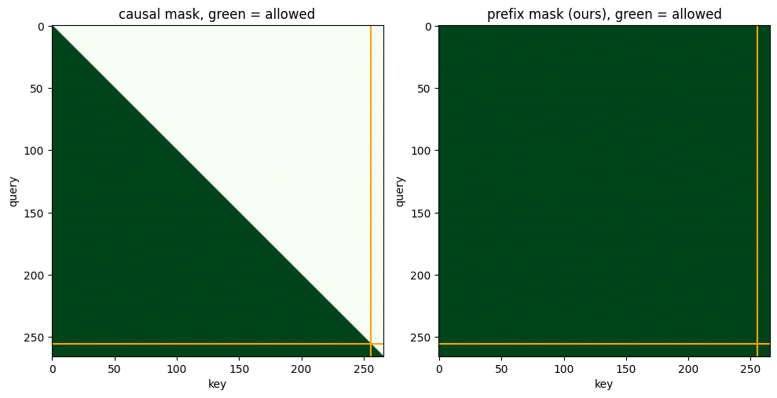


### Position IDs

The attention mask tells the model which tokens can attend to each other, but not where each token sits in the sequence.

As we saw earlier, attention by itself does not encode token order. Without positional information, the model would struggle to distinguish sequences such as "dog bites man" and "man bites dog".

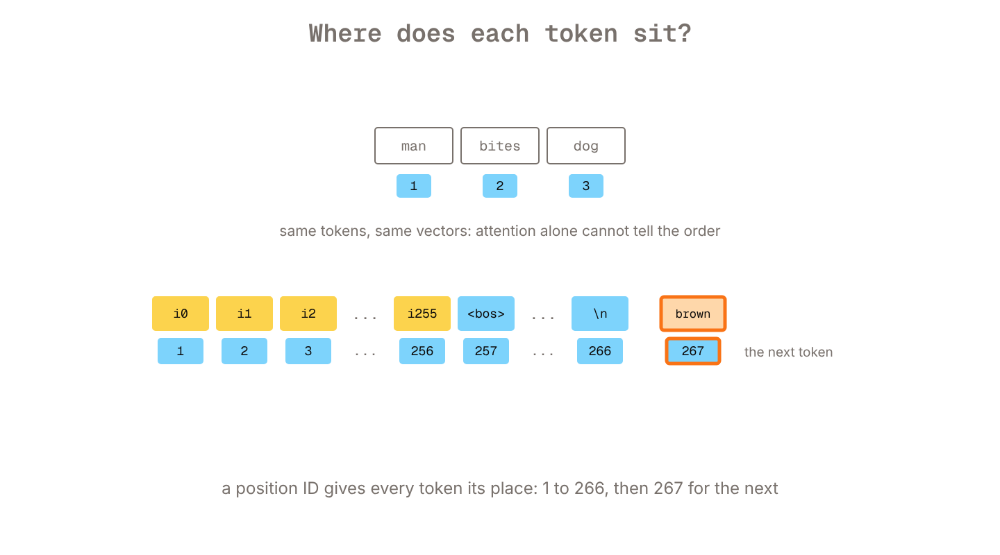

The language model therefore needs a position ID for every token, which is an integer that identifies a token's position in the sequence. Instead of adding position vectors to the token embeddings, as the encoder did, Gemma uses position IDs with **rotary positional embeddings**, or **RoPE**. We will implement RoPE when we build the attention layers.

We calculate the position IDs from the processor's `attention_mask` using a **cumulative sum**, which replaces each entry with the sum of that entry and all entries before it.

For a sequence without padding, the mask `[1, 1, 1, 1]` becomes `[1, 2, 3, 4]`. The position IDs start at 1, matching the convention used in PaliGemma's code.

Now take a sequence with two padding tokens on the left. Its mask `[0, 0, 1, 1, 1]` has the cumulative sum `[0, 0, 1, 2, 3]`, so the real tokens still receive positions 1, 2 and 3.

We then use `masked_fill_(mask == 0, 1)` to replace the zeros at padded positions with 1.
The final position IDs become `[1, 1, 1, 2, 3]`. The trailing underscore in `masked_fill_` means the operation modifies the tensor in place.

The first real token always receives position 1, regardless of how much padding comes before it.

During decoding, we append a 1 to the `attention_mask` for each new token, compute the cumulative sum and take its last value with `cumsum(-1)[:, -1]`, which gives the position ID of the newest token.

For the dog prompt, the first new token receives position **267** because, the 266 prompt tokens occupy positions 1 through 266.

Let's take the padded batch from chapter 7 as an example. The shorter row, `"caption en"`, contains six padding tokens and 260 real tokens, and its next token receives position 261. Because the batch uses left padding, both rows place their next token in the final column, immediately after their respective prompt endings.

With right padding, the shorter sequence would end with padding tokens, so its next token would appear after them instead of right after the prompt. Left padding avoids that problem during batched generation.

The variable `mask_next` represents the attention mask after adding one new token.

```python
mask = inputs["attention_mask"]                                      # [1, 266], all ones
pos = mask.cumsum(-1).masked_fill_(mask == 0, 1)                     # [1, 266]
print("prefill positions, first 3 and last 3:", pos[0, :3].tolist(), pos[0, -3:].tolist())

mask_next = torch.cat([mask, torch.ones(1, 1, dtype=mask.dtype)], dim=-1)   # [1, 267], one more token
print("first decode step position:", mask_next.cumsum(-1)[:, -1].tolist())

b_mask = batch["attention_mask"]                                     # the padded batch from chapter 7
b_pos = b_mask.cumsum(-1).masked_fill_(b_mask == 0, 1)
print("padding side:", tokenizer.padding_side)
for row in range(2):
    print(f"row {row}: mask first 3 {b_mask[row, :3].tolist()}, last 3 {b_mask[row, -3:].tolist()} | "
          f"positions first 3 {b_pos[row, :3].tolist()}, last 3 {b_pos[row, -3:].tolist()}")
```

**Output:**

```
prefill positions, first 3 and last 3: [1, 2, 3] [264, 265, 266]
first decode step position: [267]
padding side: left
row 0: mask first 3 [1, 1, 1], last 3 [1, 1, 1] | positions first 3 [1, 2, 3], last 3 [264, 265, 266]
row 1: mask first 3 [0, 0, 0], last 3 [1, 1, 1] | positions first 3 [1, 1, 1], last 3 [258, 259, 260]
```


### The full merge

In chapter 7 we built `merge_input_ids_with_image_features`, which combines the image features and text embeddings into one sequence. We now extend it so it also prepares the attention mask and the position IDs.

As we did with `VisionAttention`, we replace the earlier definition with a new one. The function takes two extra inputs and returns three outputs instead of one, while the embedding logic stays the same.

During prefill, there is no cache yet or it is empty. Every prefix token can attend to every other one, so the function creates an all zero mask of shape `[B, q, q]`.

During decoding, the cache already contains the prompt and previously generated tokens. The function checks with `assert q_len == 1` that the current input contains exactly one new token.

It then calculates `kv_len = kv_cache.num_items() + q_len`, the number of cached tokens plus the new one. The new token’s key and value will be added to the cache later, but the mask must already have a column for them.

The decoding mask therefore has shape `[B, 1, kv]`. Calling `unsqueeze(1)` adds the head dimension, giving the final shape `[B, 1, q, kv]`.

TThe position IDs also depend on the phase. During prefill, the function calculates them for the entire sequence, producing shape `[B, T]`. During decoding, it takes only the last cumulative sum value of each batch row, producing shape `[B]`. The extra `unsqueeze(0)` turns this into `[1, B]`, which is `[1, 1]` for our single prompt.

To test the decoding branch, we need a cache that already contains the 266 prompt tokens. We create `fake_cache` and fill its first layer with zero tensors of shape `[1, 1, 266, 256]`, which is enough for `num_items` to report 266 cached tokens.

Our next token is `▁brown`, the example answer token we used earlier. Its `input_ids` tensor has shape `[1, 1]` because it contains only the new token. The `attention_mask`, however, is `mask_next`, with shape `[1, 267]`, because it represents the complete sequence, including the new token.

```python
def merge_input_ids_with_image_features(image_features, inputs_embeds, input_ids, attention_mask, config, kv_cache=None):
    _, _, embed_dim = image_features.shape
    batch_size, sequence_length = input_ids.shape
    dtype, device = inputs_embeds.dtype, inputs_embeds.device
    pad_token_id = config.pad_token_id if config.pad_token_id is not None else -1

    scaled_image_features = image_features / (config.hidden_size ** 0.5)
    final_embedding = torch.zeros(batch_size, sequence_length, embed_dim, dtype=dtype, device=device)

    text_mask = (input_ids != config.image_token_index) & (input_ids != pad_token_id)   # [B, T]
    image_mask = input_ids == config.image_token_index                                   # [B, T]
    pad_mask = input_ids == pad_token_id                                                 # [B, T]

    text_mask_expanded = text_mask.unsqueeze(-1).expand(-1, -1, embed_dim)              # [B, T, D]
    image_mask_expanded = image_mask.unsqueeze(-1).expand(-1, -1, embed_dim)            # [B, T, D]
    pad_mask_expanded = pad_mask.unsqueeze(-1).expand(-1, -1, embed_dim)                # [B, T, D]

    final_embedding = torch.where(text_mask_expanded, inputs_embeds, final_embedding)
    final_embedding = final_embedding.masked_scatter(image_mask_expanded, scaled_image_features)
    final_embedding = torch.where(pad_mask_expanded, torch.zeros_like(final_embedding), final_embedding)

    q_len = inputs_embeds.shape[1]
    if kv_cache is None or kv_cache.num_items() == 0:
        # prefill, every token sees every token
        causal_mask = torch.full((batch_size, q_len, q_len), fill_value=0, dtype=dtype, device=device)
    else:
        # decoding, one new query that sees everything cached plus itself
        assert q_len == 1
        kv_len = kv_cache.num_items() + q_len
        causal_mask = torch.full((batch_size, q_len, kv_len), fill_value=0, dtype=dtype, device=device)
    causal_mask = causal_mask.unsqueeze(1)                           # [B, 1, q_len, kv_len], one mask for all heads

    if kv_cache is not None and kv_cache.num_items() > 0:
        position_ids = attention_mask.cumsum(-1)[:, -1]              # [B], the new token's position
        if position_ids.dim() == 1:
            position_ids = position_ids.unsqueeze(0)
    else:
        position_ids = attention_mask.cumsum(-1).masked_fill_((attention_mask == 0), 1).to(device)   # [B, T]

    return final_embedding, causal_mask, position_ids

with torch.no_grad():
    emb, m, p = merge_input_ids_with_image_features(
        projected, inputs_embeds, inputs["input_ids"], inputs["attention_mask"], cfg)
print("prefill: embeddings", tuple(emb.shape), "| mask", tuple(m.shape), "all zero:", bool((m == 0).all()),
      "| positions", p[0, 0].item(), "to", p[0, -1].item())

fake_cache = KVCache()                                               # pretend the 266 prompt tokens are cached
t_cfg = cfg.text_config
fake_cache.update(torch.zeros(1, t_cfg.num_key_value_heads, T, t_cfg.head_dim),
                  torch.zeros(1, t_cfg.num_key_value_heads, T, t_cfg.head_dim), layer_idx=0)
new_id = torch.tensor([[tokenizer.convert_tokens_to_ids("▁brown")]])                    # [1, 1], one new token
with torch.no_grad():
    emb, m, p = merge_input_ids_with_image_features(
        projected, embed_tokens(new_id), new_id, mask_next, cfg, kv_cache=fake_cache)
print("decode:  embeddings", tuple(emb.shape), "| mask", tuple(m.shape), "| position", p.tolist())
```

**Output:**

```
prefill: embeddings (1, 266, 2048) | mask (1, 1, 266, 266) all zero: True | positions 1 to 266
decode:  embeddings (1, 1, 2048) | mask (1, 1, 1, 267) | position [[267]]
```

We now have the three things the language model needs: the input vectors, the attention mask and the position IDs.

### How big the cache gets

The KV cache saves computation, but it costs memory. Each layer stores a key and a value for every token, and each of those holds $H_{kv} \cdot d_h$ numbers.

The total cache memory is $$\text{bytes} = L \cdot 2 \cdot H_{kv} \cdot d_h \cdot T \cdot \text{bytes per number}$$
$L$ is the number of layers, the factor of 2 accounts for keys and values, $H_{kv}$ is the number of key-value heads, $d_h$ is the head dimension, and $T$ is the number of cached tokens.

Gemma, our real language model, has 18 layers, one key value head and a head dimension of 256
$$18 \cdot 2 \cdot 1 \cdot 256 = 9{,}216$$

For 1,000 tokens stored in `float16`, at 2 bytes per number, the cache needs:
$$9{,}216 \cdot 1000 \cdot 2 = 18{,}432{,}000~\text{bytes}$$ or 18.4 MB.

For the 266-token dog prompt stored in `float32`, at 4 bytes per number, the cache needs: $$9{,}216 \cdot 266 \cdot 4 = 9{,}805{,}824~\text{bytes}$$ or 9.8 MB.

The following code calculates these values from the model configuration, then fills a cache for the dog prompt and measures its actual memory.

```python
t_cfg = cfg.text_config
per_token = t_cfg.num_hidden_layers * 2 * t_cfg.num_key_value_heads * t_cfg.head_dim   # numbers stored per token
print(f"numbers per token: {per_token:,}")
for T_, bytes_per, name in [(1000, 2, "float16"), (T, 4, "float32")]:
    print(f"{T_:5d} tokens in {name}: {per_token * T_ * bytes_per:,} bytes")

c = KVCache()                                                        # the same count, from real tensors
for layer in range(t_cfg.num_hidden_layers):
    c.update(torch.zeros(1, t_cfg.num_key_value_heads, T, t_cfg.head_dim, dtype=torch.float32),
             torch.zeros(1, t_cfg.num_key_value_heads, T, t_cfg.head_dim, dtype=torch.float32), layer)
measured = sum(t.numel() * t.element_size() for t in c.key_cache + c.value_cache)
print(f"measured from a filled cache for the dog prompt: {measured:,} bytes")
```

**Output:**

```
numbers per token: 9,216
	1000 tokens in float16: 18,432,000 bytes
	266 tokens in float32: 9,805,824 bytes
measured from a filled cache for the dog prompt: 9,805,824 bytes
```

Compared with the model's **11.7 GB** of weights, the cache for the dog prompt is small, using less than 0.1% of that amount.

However, cache memory grows with every token. At the maximum sequence length of 8192 positions allowed by our `TextConfig`, the cache uses

$$9{,}216 \cdot 8192 \cdot 4 = 301{,}989{,}888~\text{bytes}$$

or about 302 MB per sequence in `float32`.

One reason Gemma's cache is relatively small is that it uses just one key value head, shared by its eight query heads. With eight key value heads, the cache would be eight times larger. We will see how this sharing works when we implement the language model's attention layer.

### Where the new pieces sit

```
  photo, "answer en what color is the dog?"

  processor              pixel_values [1, 3, 224, 224], input_ids [1, 266], attention_mask [1, 266]
  vision_tower, projector, embed_tokens, as in chapter 7
  merge, prefill
    final_embedding      [1, 266, 2048]
    causal_mask          [1, 1, 266, 266], all zeros, the prefix mask
    position_ids         [1, 266], 1 to 266
  merge, each decode step
    final_embedding      [1, 1, 2048], the new token only
    causal_mask          [1, 1, 1, 267], then 268, 269, ...
    position_ids         [[267]], then 268, 269, ...
  KVCache                per layer, keys and values [1, 1, T, 256]; T = 266 after prefill, then + 1 per step
  language model         not built yet, it will fill the cache and read the mask and the positions
```


**The updated merge function returns the input vectors, attention mask, and position IDs. During prefill, it prepares the whole prompt. During decoding, it prepares only the newest token.**

Think back to our room example once more, Everyone who arrived with the prompt can now read everyone else's name tag. Each new arrival gets a position number, and the already prepared keys and values stay on the table for later arrivals to use.

But one piece is still missing, nothing yet processes the 266 vectors, writes their keys and values into the cache, or turns the output at the newline into a prediction.

That is what we will build in the next chapter. We will implement the decoder layer, including its normalization and MLP, and then stack 18 of them into the language model.

---
